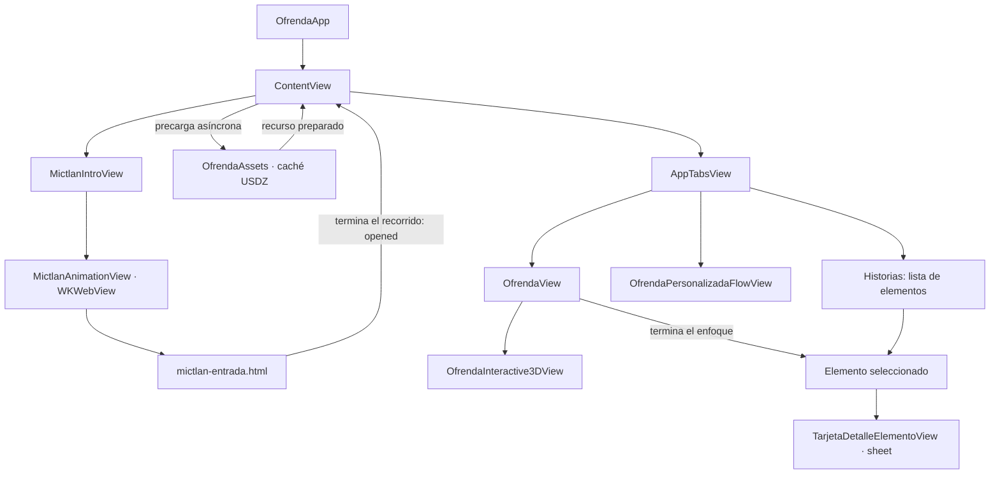
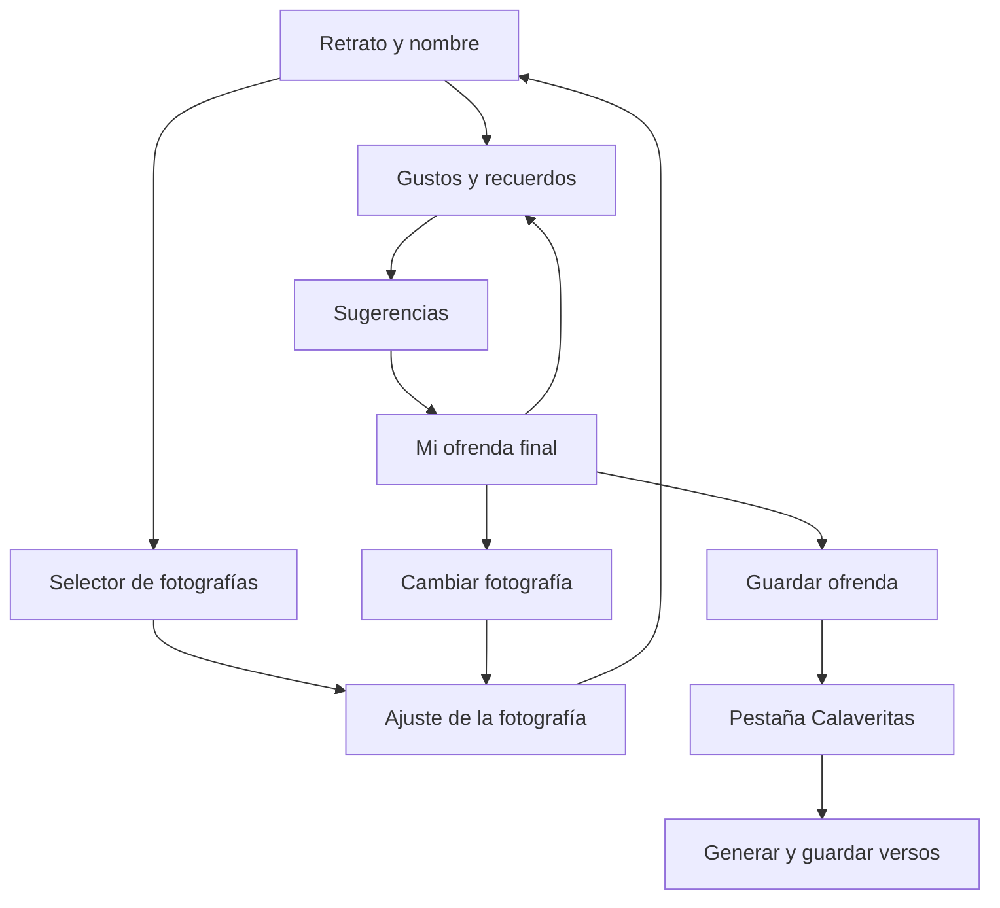
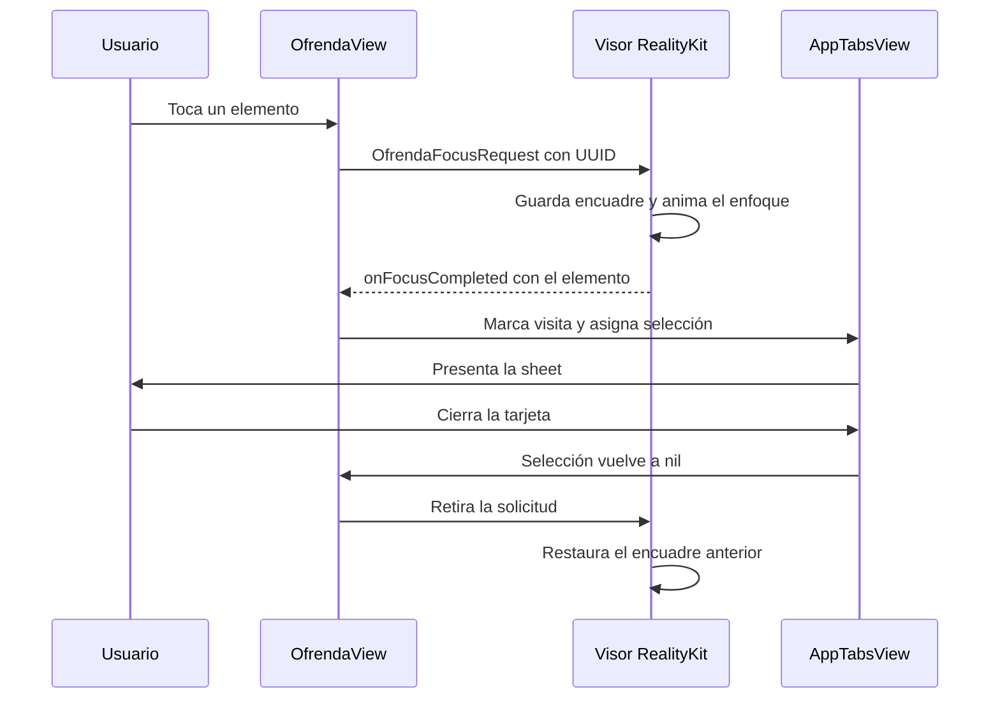

# Ofrenda Día de Muertos · Guía completa del proyecto

> Documentación actualizada el **25 de octubre de 2026**. Actualmente tenemos **105 archivos Swift** dentro de la carpeta de la aplicación; las integraciones posteriores al inventario inicial se explican en las secciones finales.

Te explico cómo quedó organizado el proyecto, esto porque ya se movieron varios archivos y también se separaron responsabilidades que antes estaban juntas. La idea de este README es que cualquiera del equipo pueda abrirlo, entender cómo funciona la aplicación y saber dónde hacer un cambio sin tener que revisar todo desde cero.

En nuestro caso estamos trabajando una aplicación didáctica sobre las ofrendas del Día de Muertos. Queremos que el usuario pueda ver el altar en 3D, acercarse a sus elementos y conocer su historia, su significado y cómo se han integrado a la tradición. Además de esto, dejamos una sección opcional para recordar a alguien mediante una fotografía, sus gustos y una calaverita literaria.

Este documento describe lo que tenemos implementado actualmente. Cuando una parte todavía tiene limitaciones o depende de un recurso externo al repositorio, lo explico en su sección para que tengamos claro con qué contamos.

<a id="contenido"></a>
## Contenido

1. [Qué hace actualmente la aplicación](#estado-actual).
2. [Cómo abrirla y qué configuración estamos usando](#abrir-proyecto).
3. [Cómo está acomodado el repositorio](#estructura).
4. [Cómo se conectan las pantallas y los datos](#arquitectura).
5. [Archivos de arranque: App](#archivos-app).
6. [Archivos compartidos: Core](#archivos-core).
7. [Entrada al Mictlán: Inicio](#archivos-inicio).
8. [Pestaña Historias](#archivos-historias).
9. [Datos y estados de la ofrenda](#archivos-datos-ofrenda).
10. [Visores, cámara y carga de modelos 3D](#archivos-3d).
11. [Pantalla del altar y botones flotantes](#archivos-interfaz-ofrenda).
12. [Tarjetas, cronología y fuentes](#archivos-detalle).
13. [Contenido de cada elemento del altar](#archivos-elementos).
14. [Personalización: Mi ofrenda](#archivos-personalizacion).
15. [HTML, modelos y otros recursos](#recursos).
16. [Zoom, enfoque, iluminación y optimización](#comportamiento-3d).
17. [Qué archivo modificar según el cambio](#mantenimiento).
18. [Trabajo en equipo, proyecto local y Git](#equipo-git).
19. [Pruebas y revisión antes de compartir cambios](#pruebas).
20. [Problemas que podemos encontrar](#problemas).
21. [Límites actuales y pendientes](#limites).
22. [Convenciones y glosario](#convenciones).
23. [Fotografías en los marcos de la ofrenda principal](#fotos-marcos).
24. [Retratos predeterminados y fotos compartidas](#retratos-compartidos).
25. [Referencias que descubrimos al acercar la ofrenda](#detalles-nuevos).
26. [Objetos aislados y uno o dos marcos](#objetos-aislados).
36. [Guía de primer inicio y Créditos](#guia-inicial).
37. [Guías de las hojas y administración de ofrendas](#guias-hojas).
38. [Una identidad por marco y ajustes de navegación](#identidad-marcos).
39. [Creación por retrato y avance entre marcos](#creacion-por-retrato).
40. [Ayuda inferior en Calaveritas](#ayuda-calaveritas).

<a id="estado-actual"></a>
## 1. Qué hace actualmente la aplicación

Al abrir la app vemos una entrada animada al Mictlán, hecha con HTML, CSS, SVG y JavaScript. Primero se cruza el umbral y después se entra a la ofrenda. Al terminar ese recorrido aparecen cinco pestañas. En el primer inicio, la guía espera a que el altar esté listo y explica sus controles con la pantalla atenuada:

| Pestaña | Qué encontramos ahí |
| --- | --- |
| **Ofrenda** | El altar 3D, sus controles de movimiento y los botones flotantes que abren las historias. |
| **Historias** | Elementos y celebraciones: 14 temas —los 13 grupos del altar y las calaveritas literarias—, tres celebraciones monumentales y progreso persistente del recorrido físico. |
| **Mi ofrenda** | Crear y editar las ofrendas, sus fotos, gustos y elementos 3D. |
| **Calaveritas** | Generar versos para una ofrenda guardada, conservarlos y abrir la colección de calaveritas. |
| **Créditos** | Los cuatro integrantes, la leyenda del laboratorio y la opción para volver a ver la guía. |

Tenemos **13 grupos físicos del altar**: Flores, Retrato, Velas, Papel, Agua y sal, Calaveritas de azúcar, Pan, Comida, Caña de azúcar, Frutas, Incienso, Cigarro y Tequila. Los ocho primeros pertenecen a la vista general. Los cinco últimos aparecen al acercar la cámara a un factor de 0.9 o menor, si su objeto está en el encuadre y cabe su etiqueta.

<<<<<<< HEAD
Cada uno tiene su tarjeta. En doce casos usamos las secciones **Historia, Significado e Indagar**. Calaveritas de azúcar tiene **Significado, Elaboración, Historia e Indagar**. La lectura literaria aparece por separado en Historias, con Ejemplo, Origen y Estructura; no agrega un objeto al altar ni aumenta los 13 grupos del recorrido.
=======
Cada grupo tiene su tarjeta. Doce utilizan **Historia, Significado, Conocer más y Mapa**. Calaveritas de azúcar tiene **Significado, Historia, Mapa y Conocer más**; Significado incluye también la elaboración. Las calaveritas literarias tienen una ficha independiente en Historias con **Ejemplo, Origen, Estructura y Conocer más**, sin otro objeto 3D.
>>>>>>> main

La personalización es opcional para recorrer la aplicación. Si decidimos entrar a ese flujo, la interfaz permite conservar la foto de ejemplo y pide nombre para continuar desde el retrato, y una comida favorita para pasar de gustos a sugerencias. Las aficiones y el recuerdo compartido complementan esa información.

Los gustos se utilizan para mostrar sugerencias escritas y completar una plantilla de calaverita literaria. Actualmente esas sugerencias no agregan por sí mismas nuevas mallas al altar. Las fotografías sí se actualizan dentro de los marcos del altar. Ahora también podemos elegir cuáles de los 13 tipos de elementos existentes se ven en 3D. La selección se comparte entre el editor, la propuesta y la pantalla principal, y se conserva en el teléfono. Los gustos escritos no crean modelos nuevos automáticamente.

En la ofrenda principal también tenemos el botón de fotografías y selección directa de los marcos visibles. Podemos mostrar uno o dos; al conservar uno, se centra y se oculta el otro, sin borrar su fotografía. Cada uno admite una foto con encuadre propio; sus copias se guardan localmente y se recuperan al abrir de nuevo la app.

Las ofrendas se guardan en `mis_ofrendas.json`. Las calaveritas que guardamos desde su nueva pestaña se conservan en `mis_calaveritas.json`, con su persona y fecha. El poema recién generado sigue siendo un borrador hasta tocar Guardar calaverita. El recorrido de historias abiertas se conserva localmente con identificadores estables; desbloquea celebraciones al llegar a 3, 6 y 13 elementos. No necesitamos una cuenta ni un servicio remoto.

<a id="abrir-proyecto"></a>
## 2. Cómo abrirla y qué configuración estamos usando

### Proyecto principal

El archivo para abrir el proyecto compartido es:

[OfrendaDiaDeMuertosProyecto.xcodeproj](OfrendaDiaDeMuertosProyecto.xcodeproj)

Desde Xcode seleccionamos el esquema **OfrendaDiaDeMuertosProyecto**, elegimos un simulador con una versión de iOS admitida y ejecutamos con **Run**.

Para un teléfono físico también debemos revisar **Signing & Capabilities** con el equipo de desarrollo disponible en esa Mac. Compilar sin firma y poder instalar en un iPhone son pasos distintos.

### Configuración que tiene el archivo del proyecto

| Ajuste | Valor actual | Qué significa para nosotros |
| --- | --- | --- |
| Deployment target | `26.2` | Es la versión mínima de iOS que declara el proyecto. |
| Formato del proyecto | `objectVersion = 77` | Es parte de la configuración que utiliza Xcode para abrir el proyecto. |
| Swift Language Version | `5.0` | Es el modo de lenguaje configurado; no quiere decir que el compilador instalado sea Swift 5.0. |
| Aislamiento predeterminado | `MainActor` | Debemos cuidar qué trabajo hacemos en el hilo de la interfaz. |
| Approachable Concurrency | Activado | Se conserva el ajuste actual del proyecto. |
| Member Import Visibility | Activado | Conviene importar de forma explícita los módulos que definen los tipos usados. |
| Previews | Activadas | Podemos abrir el Canvas desde `ContentView.swift`. |
| Dispositivos | iPhone y iPad | La familia configurada es `1,2`. |
| Info.plist | Generado | Varias claves se definen en Build Settings; no tenemos un Info.plist fuente independiente en la carpeta de la app. |
| Categoría | Educación | Corresponde al propósito didáctico del proyecto. |
| Identificador del producto | `Tenshi.OfrendaDiaDeMuertosProyecto` | Identifica la aplicación para su compilación e instalación. |

Las orientaciones configuradas para iPhone incluyen vertical y ambos horizontales. En iPad también se declara vertical invertida. El diseño usa el espacio disponible; no está construido como una imagen fija con las dimensiones de un solo teléfono.

La validación local realizada hasta esta revisión utiliza **Xcode 27**, compilación para simulador ARM64, un **iPhone 17 Pro Max simulado con iOS 26.5** y compilación para iPhone genérico sin firma. Eso no sustituye una prueba ejecutada directamente con Xcode 26.2 o 26.4 en otra Mac.

Conforme trabajemos con el equipo, hay que distinguir la versión de Xcode, el SDK instalado, el modo de Swift y el iOS mínimo. Bajar el mínimo de iOS no convierte automáticamente una API nueva en una API disponible para un compilador anterior.

### Proyecto local de cada compañero

También existe una alternativa para conservar la configuración de Xcode de cada Mac:

```sh
python3 Scripts/crear-proyecto-local.py --ios-minimo 26.2
```

La explicación completa está en [Trabajo en equipo, proyecto local y Git](#equipo-git). Esa copia referencia el mismo código y los mismos recursos; no genera otra aplicación con sus propios Swift duplicados.

### Dependencias

Actualmente el target no declara productos externos de Swift Package Manager. El código usa frameworks de Apple: SwiftUI, UIKit, RealityKit, WebKit, PhotosUI, ImageIO, Foundation, CoreGraphics, QuartzCore, Combine, Observation, OSLog y simd. `Item.swift` importa SwiftData, aunque ese modelo no está conectado al flujo actual.

No hace falta agregar una dependencia para dibujar el altar o para reproducir la entrada HTML. El HTML se carga desde los recursos locales del bundle.

<a id="estructura"></a>
## 3. Cómo está acomodado el repositorio

La carpeta exterior es el repositorio. Dentro hay otra carpeta con el mismo nombre que contiene los archivos de la aplicación.

```text
OfrendaDiaDeMuertosProyecto/
├── README.md
├── PRODUCT.md
├── ESTRUCTURA-Y-MODELO.md
├── PRUEBA-SWIFT-COMPARTIDOS.md
├── RETRATOS-PREDETERMINADOS.md
├── .gitignore
├── Scripts/
│   ├── crear-proyecto-local.py
│   ├── probar-guia.sh
│   └── commit-swift.py
├── Tests/
│   └── GuiaRegression.swift
├── OfrendaDiaDeMuertosProyecto.xcodeproj/
│   ├── project.pbxproj
│   └── project.xcworkspace/
│       └── contents.xcworkspacedata
├── OfrendaDiaDeMuertosProyecto/
│   ├── App/
│   │   ├── OfrendaApp.swift
│   │   ├── ContentView.swift
│   │   └── AppTabsView.swift
│   ├── Core/
│   │   ├── DesignSystem/
│   │   │   ├── AppTheme.swift
│   │   │   ├── GlassControls.swift
│   │   │   ├── ElementSheetControls.swift
│   │   │   ├── IlustracionOfrenda.swift
│   │   │   └── IlustracionOfrendaView.swift
│   │   ├── Images/
│   │   │   ├── PhotoCropGeometry.swift
│   │   │   └── PhotoProcessor.swift
│   │   └── Models/
│   │       └── Item.swift
│   ├── Features/
│   │   ├── Guia/
│   │   │   ├── Models/
│   │   │   │   ├── PasoGuiaOfrenda.swift
│   │   │   │   ├── GuiaContextualAmbito.swift
│   │   │   │   └── GuiaDestacadoLayout.swift
│   │   │   ├── Services/
│   │   │   │   ├── GuiaOfrendaStore.swift
│   │   │   │   └── GuiaContextualStore.swift
│   │   │   └── Views/
│   │   │       ├── ObjetivoGuia.swift
│   │   │       ├── GuiaContextual.swift
│   │   │       └── GuiaInicialOverlay.swift
│   │   ├── Creditos/
│   │   │   └── Views/
│   │   │       └── CreditosView.swift
│   │   ├── Inicio/
│   │   │   ├── MictlanIntroView.swift
│   │   │   └── MictlanAnimationView.swift
│   │   ├── Historias/
│   │   │   └── Views/
│   │   │       └── HistoriasView.swift
│   │   ├── Ofrenda/
│   │   │   ├── Models/
│   │   │   │   ├── ElementoOfrenda.swift
│   │   │   │   ├── HistoriaElemento.swift
│   │   │   │   ├── MarcoOfrenda.swift
│   │   │   │   ├── Objeto3DInspectionState.swift
│   │   │   │   ├── ModelLoadState.swift
│   │   │   │   └── OfrendaViewportState.swift
│   │   │   ├── Data/
│   │   │   │   ├── OfrendaCatalog.swift
│   │   │   │   └── CalaveritasHistoria.swift
│   │   │   ├── Services/
│   │   │   │   └── FotosMarcosStore.swift
│   │   │   ├── ThreeD/
│   │   │   │   ├── OfrendaAssets.swift
│   │   │   │   ├── OfrendaRenderSession.swift
│   │   │   │   ├── OfrendaRenderConfiguration.swift
│   │   │   │   ├── OfrendaCameraPolicy.swift
│   │   │   │   ├── OfrendaInteractive3DView.swift
│   │   │   │   ├── OfrendaMaterials.swift
│   │   │   │   ├── OfrendaElementSelection.swift
│   │   │   │   ├── OfrendaElementVisibility.swift
│   │   │   │   ├── Elemento3DView.swift
│   │   │   │   ├── OfrendaModelView.swift
│   │   │   │   └── OfrendaPhotoFrames.swift
│   │   │   └── Views/
│   │   │       ├── OfrendaView.swift
│   │   │       ├── RecorridoOfrendaView.swift
│   │   │       ├── Components/
│   │   │       │   ├── MarcoPhotoControls.swift
│   │   │       │   └── OfrendaPinLayout.swift
│   │   │       ├── Detalle/
│   │   │       │   ├── TarjetaDetalleElementoView.swift
│   │   │       │   ├── PlantillaTarjetaElementoView.swift
│   │   │       │   ├── TarjetaHitoTimeline.swift
│   │   │       │   └── VistaFuentesElemento.swift
│   │   │       ├── Marcos/
│   │   │       │   ├── ConfiguracionMarcosView.swift
│   │   │       │   └── MarcosFotosView.swift
│   │   │       └── Elementos/
│   │   │           ├── FloresView.swift
│   │   │           ├── RetratoView.swift
│   │   │           ├── VelasView.swift
│   │   │           ├── PapelView.swift
│   │   │           ├── AguaYSalView.swift
│   │   │           ├── CalaveritasView.swift
│   │   │           ├── CalaveritaLiterariaView.swift
│   │   │           ├── PanDeMuertoView.swift
│   │   │           ├── ComidaView.swift
│   │   │           ├── CanaDeAzucarView.swift
│   │   │           ├── FrutasView.swift
│   │   │           ├── InciensoView.swift
│   │   │           ├── CigarroView.swift
│   │   │           └── TequilaView.swift
│   │   ├── CalaveritasLiterarias/
│   │   │   ├── Models/
│   │   │   │   └── CalaveritaGuardada.swift
│   │   │   ├── Services/
│   │   │   │   ├── CalaveritaGenerator.swift
│   │   │   │   └── CalaveritasStore.swift
│   │   │   └── Views/
│   │   │       ├── CalaveritasLiterariasView.swift
│   │   │       ├── CalaveritasGuardadasView.swift
│   │   │       └── CalaveritaTextoView.swift
│   │   └── MiOfrenda/
│   │       ├── Models/
│   │       │   ├── ConfiguracionElementosOfrenda.swift
│   │       │   └── PersonalizacionOfrenda.swift
│   │       ├── Services/
│   │       │   ├── ElementosOfrendaStore.swift
│   │       │   └── OfrendasManager.swift
│   │       └── Views/
│   │           ├── ListaMisOfrendasView.swift
│   │           ├── OfrendaPersonalizadaFlowView.swift
│   │           ├── PersonalizarRetratoView.swift
│   │           ├── PersonalizarElementosView.swift
│   │           ├── AjusteFotoView.swift
│   │           ├── GustosRecuerdosView.swift
│   │           ├── SugerenciasOfrendaView.swift
│   │           └── MiOfrendaFinalView.swift
│   ├── Resources/
│   │   ├── Models/
│   │   │   ├── Ofrenda.usdz
│   │   │   └── foto.usdz
│   │   ├── Portraits/
│   │   │   ├── RetratoIzquierdo.png
│   │   │   └── RetratoDerecho.png
│   │   └── Web/
│   │       ├── mictlan-entrada.html
│   │       └── ofrenda-ilustraciones.html
│   └── Assets.xcassets/
│       ├── Contents.json
│       ├── AccentColor.colorset/
│       │   └── Contents.json
│       └── AppIcon.appiconset/
│           └── Contents.json
└── output/
    └── pdf/
        └── Guia_Blender_a_Xcode.pdf
```

`ProyectoLocal/` puede existir en cada Mac cuando se utiliza el generador. Es una carpeta ignorada por Git, por lo que su presencia y sus ajustes dependen de cada compañero.

### Para qué sirve cada carpeta principal

**App** contiene el arranque y la navegación general. Ahí se decide si vemos la entrada o las pestañas, y se conserva el estado que necesitan compartir esas pestañas.

**Core** reúne lo que reutilizamos en varias partes: colores, estilos, controles comunes y procesamiento de imágenes. Una vista de Flores no debería tener que definir otra paleta ni otro botón de cerrar si ya existen aquí.

**Features** separa la aplicación por sus secciones. Dentro de Ofrenda tenemos más carpetas porque ahí conviven información cultural, interfaz, cámara, materiales y carga del modelo.

**Models** describe datos y estados. **Data** contiene valores concretos del catálogo. **Views** dibuja la interfaz. **ThreeD** integra RealityKit y los gestos. **Services** contiene la lógica de cada sección: MiOfrenda guarda los perfiles y CalaveritasLiterarias genera y conserva los poemas.

**Resources** contiene archivos que la app debe encontrar en ejecución. Cambiar un Swift no sustituye la necesidad de incluir el USDZ o el HTML.

La carpeta de código está configurada como `PBXFileSystemSynchronizedRootGroup`. Por eso Xcode detecta su estructura en disco. No debemos duplicar archivos arrastrándolos a otra ubicación solo para que aparezcan otra vez en el navegador.

<a id="arquitectura"></a>
## 4. Cómo se conectan las pantallas y los datos

### Arranque y navegación



La entrada HTML se muestra una sola vez mientras vive ese `ContentView`. Al iniciar de nuevo un estado raíz nuevo, `mostrandoEntrada` vuelve a ser `true`.

La vista previa del Canvas abre `AppTabsView` directamente. Esto nos permite trabajar sobre la ofrenda sin tener que cruzar el umbral en cada actualización del Canvas. El modelo que usa esa vista previa es el USDZ real mediante RealityKit.

### Dónde vive el estado

| Dato | Archivo que lo conserva | Quién lo utiliza |
| --- | --- | --- |
| Mostrar la entrada | `ContentView.swift` | La entrada HTML y el cambio hacia las pestañas. |
| Pestaña actual | `AppTabsView.swift` | Navegación y activación del visor correspondiente. |
| Elemento seleccionado | `AppTabsView.swift` | Ofrenda, Historias y presentación de la hoja. |
| Elementos visitados | `AppTabsView.swift` | Progreso y marcas de las categorías recorridas en el altar. |
| Fotos de los marcos principales | `FotosMarcosStore`, conservado por `AppTabsView.swift` | Editor, visor interactivo y archivos locales. |
| Perfil personalizado | `AppTabsView.swift` | Todo el flujo de Mi ofrenda. |
| Paso de personalización | `OfrendaPersonalizadaFlowView.swift` | Retrato, ajuste, gustos, sugerencias, elementos y resultado. |
| Coordenadas de las etiquetas | `OfrendaView.swift` mediante `OfrendaViewportState` | Distribución de botones en 2D. |
| Giro, zoom y cámara | Coordinadores de los visores 3D | RealityKit y reconocimiento de gestos. |
| Sección de una tarjeta | La plantilla o `CalaveritasView.swift` | Selector de Historia, Significado, Conocer más, etc. |
| Calaverita generada visible | `CalaveritasLiterariasView.swift` | Borrador creado con el último perfil guardado. |
| Colección de calaveritas | `CalaveritasStore.swift` | Poemas conservados en `mis_calaveritas.json`. |

Para entender el código, `@State` indica que esa vista conserva un valor. `@Binding` permite trabajar sobre un valor que pertenece a otra vista. Por ejemplo, Mi ofrenda recibe el perfil como binding y lo modifica sin crear otro perfil independiente.

Los callbacks como `onContinuar`, `onVolver`, `onSalir` y `onFocusCompleted` indican qué debe ocurrir después. De esta manera una pantalla de formulario puede pedir avanzar sin tener que decidir cómo está organizada toda la aplicación.

`@Environment` obtiene condiciones del sistema, como la fase de la escena, el tamaño de texto o Reducir movimiento. Esas condiciones cambian cómo mostramos o activamos algunas partes.

### Qué papel tiene el Coordinator

SwiftUI dibuja la mayor parte de la interfaz, pero RealityKit usa una `ARView` y la entrada usa una `WKWebView`. Las integramos mediante `UIViewRepresentable`.

En esos archivos encontramos cuatro partes:

1. `makeCoordinator()` prepara el objeto que recibe eventos y conserva la lógica del puente.
2. `makeUIView(context:)` crea la vista UIKit.
3. `updateUIView(_:context:)` recibe cambios de SwiftUI sin volver a cargar todo innecesariamente.
4. `dismantleUIView(_:coordinator:)` limpia tareas, callbacks y recursos al retirar la vista.

En nuestro caso el coordinador del altar también conserva cámara, pivote y gestos. La vista SwiftUI conserva los botones y la presentación de las tarjetas.

<a id="archivos-app"></a>
## 5. Archivos de arranque: App

### 1. OfrendaApp.swift

**Archivo:** [App/OfrendaApp.swift](OfrendaDiaDeMuertosProyecto/App/OfrendaApp.swift)

Es el punto de entrada de la aplicación, identificado mediante `@main`. Define `OfrendaApp: App` y abre un `WindowGroup` que contiene `ContentView`.

Aquí también se aplica el esquema oscuro y el acento de `AppTheme`. Son decisiones generales de presentación para el arranque de la app.

Este archivo debe mantenerse pequeño. Si queremos cambiar la navegación entre pestañas, el formulario de gustos o la cámara, esos cambios tienen su propio archivo. Aquí corresponde revisar qué vista raíz se inicia y qué configuración general queremos aplicar a esa raíz.

No hay un segundo `@main` para una pantalla de prueba y tampoco se registra aquí un contenedor de SwiftData. Que exista `Item.swift` no significa que este arranque ya esté guardando perfiles.

### 2. ContentView.swift

**Archivo:** [App/ContentView.swift](OfrendaDiaDeMuertosProyecto/App/ContentView.swift)

Controla el paso entre la entrada y la aplicación principal. `mostrandoEntrada` comienza en `true`. Desde que aparece la puerta inicia `OfrendaAssets.preload(named: "Ofrenda")`. Cuando el HTML avisa que terminó el recorrido, `recorridoTerminado` cambia a `true`; `entrarSiEstaLista()` abre `AppTabsView` cuando la precarga también haya terminado y la aplicación esté activa. No hay una segunda pantalla con otro botón de entrada.

La condición crea una sola rama de interfaz a la vez. Durante la puerta se prepara el recurso mediante la carga asíncrona de RealityKit, compartiendo la misma tarea y caché que usa el altar. No se monta otra `ARView` ni se dibuja el altar detrás de WebKit. Al entrar se crea la escena desde el prototipo precargado; las fotos y el renderizado final se completan en el visor habitual.

Si la animación termina antes de que el recurso esté preparado, `MictlanIntroView` superpone «Cargando modelo 3D…» al final del recorrido. Si la precarga falla, se permite pasar al visor para su reintento y su mensaje de error habitual; no dejamos la entrada esperando para siempre. `revisionPrecarga` cancela la espera anterior y reinicia la preparación cuando corresponde volver desde segundo plano o recuperar una caché vaciada por un aviso de memoria.

El contenedor se expande al ancho y alto disponibles. El fondo morado se extiende a las áreas seguras. Esto participa en la corrección del HTML que antes no ocupaba correctamente toda la pantalla.

También escucha el aviso de memoria de UIKit y el cambio a segundo plano. En ambos casos puede vaciar la caché de `OfrendaAssets`. Vaciar esa caché no equivale a borrar el modelo del repositorio ni a eliminar el perfil del usuario.

Al final está:

```swift
#Preview("Ofrenda · Modelo 3D") {
    AppTabsView()
}
```

Ese es el Canvas que debemos abrir para revisar la interfaz con el modelo real. No utiliza una fotografía estática del altar.

### 3. AppTabsView.swift

**Archivo:** [App/AppTabsView.swift](OfrendaDiaDeMuertosProyecto/App/AppTabsView.swift)

Es el punto donde se unen Ofrenda, Historias, Mi ofrenda, Calaveritas y Créditos. El enum privado `AppTab` identifica las cinco pestañas sin depender del texto que ve el usuario. Conserva también `GuiaOfrendaStore`, que se comparte por el entorno. La guía se dibuja por encima del TabView usando las anclas reales publicadas por los controles de OfrendaView.

La vista conserva la pestaña, el elemento seleccionado, la sesión 3D y las instancias de `OfrendasManager`, `CalaveritasStore` y `ProgresoRecorridoStore`. Los tres almacenes se entregan como objetos del entorno. El último conserva los elementos visitados entre arranques. `OfrendaPrincipalTabView` conserva los almacenes de fotos y elementos correspondientes al altar elegido. `AppTabsView` obtiene el catálogo completo de `OfrendaCatalog.elementos`; `OfrendaPrincipalTabView` utiliza `elementosDelAltar`, que conserva los 13 grupos físicos.

`OfrendaPrincipalTabView` carga la selección persistida del altar elegido. Cada flujo de edición recibe almacenes propios para el ID de su perfil. Si se oculta un elemento que estuviera seleccionado, se cierra su detalle. Los errores de lectura o escritura tienen un aviso con opción de guardar de nuevo. El encabezado principal recibe el nombre del perfil confirmado en `ofrendasGuardadas`.

El conjunto de visitados alimenta el progreso del altar; solo se cuentan las categorías que siguen visibles. Historias recibe el catálogo completo de 14 temas y el binding del elemento seleccionado. Al tocar una tarjeta abre la hoja compartida; la ficha literaria no monta un objeto 3D ni incrementa el recorrido físico. El botón inferior dice Volver a historias y conserva esa pestaña al cerrar.

El `TabView` es nativo. La hoja de detalle también se presenta aquí mediante `.sheet(item:)`. Las tarjetas del altar usan alturas de 82 % y pantalla completa para dejar espacio al ejemplar 3D sobre el contenido. Conservan el texto Volver a la ofrenda.

El parámetro `isActive` permite montar el visor solo cuando corresponde: pestaña visible y escena activa. Este archivo conecta ese criterio con las vistas; la limpieza de cada motor queda en su propio representable.

<a id="archivos-core"></a>
## 6. Archivos compartidos: Core

### 4. AppTheme.swift

**Archivo:** [Core/DesignSystem/AppTheme.swift](OfrendaDiaDeMuertosProyecto/Core/DesignSystem/AppTheme.swift)

Define la paleta que reutilizamos en las pantallas nativas:

| Propiedad | Componentes RGB | Uso |
| --- | --- | --- |
| `background` | `0.11, 0.05, 0.18` | Fondo morado oscuro. |
| `surface` | `0.21, 0.13, 0.30` | Superficies de lectura y tarjetas. |
| `accent` | `0.96, 0.65, 0.25` | Acentos y acciones principales. |
| `secondaryText` | `0.78, 0.75, 0.84` | Textos de apoyo. |

Si cambiamos la paleta nativa, empezamos aquí. Copiar colores a cada vista provocaría diferencias difíciles de mantener.

El HTML tiene variables CSS propias y los modelos tienen sus materiales. Cambiar `AppTheme` no recolorea automáticamente los tres sistemas.

### 5. GlassControls.swift

**Archivo:** [Core/DesignSystem/GlassControls.swift](OfrendaDiaDeMuertosProyecto/Core/DesignSystem/GlassControls.swift)

Reúne estilos y controles de uso común. Con esto mantenemos una misma forma de presentar las acciones en toda la aplicación.

- `ofrendaPrimaryAction()` configura una acción principal con `.glassProminent`, forma de cápsula, tamaño grande y acento naranja.
- `ofrendaSecondaryAction()` aplica `.glass` a acciones secundarias.
- `ofrendaSurface(cornerRadius:)` conserva una superficie morada para el contenido de lectura y añade un borde tenue.
- `ofrendaSheet(detents:)` define las alturas permitidas, el indicador de arrastre, esquinas de 32 puntos y la apariencia oscura de una hoja.
- `GlassIconButton` dibuja un botón circular con área de 44 × 44 puntos, etiqueta accesible y material interactivo.
- `FlowNavigationBar` ofrece Volver y, cuando se proporciona `onSalir`, una salida hacia la ofrenda.

El valor predeterminado de `ofrendaSheet` sigue siendo 68 % y completa. `AppTabsView` pasa otros detents cuando la tarjeta se abre desde el altar.

Si queremos modificar el estilo de todos los botones principales o el indicador común de las hojas, este es el archivo. Los textos educativos siguen en sus vistas correspondientes.

### 6. ElementSheetControls.swift

**Archivo:** [Core/DesignSystem/ElementSheetControls.swift](OfrendaDiaDeMuertosProyecto/Core/DesignSystem/ElementSheetControls.swift)

Contiene tres componentes que comparten las tarjetas.

`ElementSheetHeader` conserva icono, título y ayuda. El parámetro de subtítulo permanece por compatibilidad, pero no se dibuja, y la cabecera no añade una X de cierre. Si recibe `onGuardar`, presenta Guardar con el estilo principal y admite `guardarDeshabilitado`; en tamaños de accesibilidad coloca esa acción debajo de la cabecera. El título está marcado como encabezado para accesibilidad y el icono decorativo no se lee como otro dato.

`SheetSectionPicker` recibe un arreglo de secciones y un binding al índice seleccionado. Calcula el ancho necesario con la fuente adaptada a Dynamic Type. Si cabe, utiliza `UISegmentedControl`, conservando la selección, el arrastre y el material nativos. Cuando desborda, presenta botones Liquid Glass en un `ScrollView` horizontal: `.glassProminent` para la opción seleccionada y `.glass` para las demás, con estado seleccionado accesible y zonas táctiles de al menos 44 puntos. Durante la guía selecciona la sección explicada, la centra cuando hay desplazamiento y al terminar recupera la selección anterior.

`SheetReadingContent` desplaza el texto en los tamaños habituales. Con texto de accesibilidad deja el contenido a su altura natural para que `TarjetaDetalleElementoView` utilice un único desplazamiento vertical exterior.

Los componentes reciben información; no eligen qué texto histórico debe tener Flores o Calaveritas. Esa separación permite reutilizarlos con las cuatro secciones de la plantilla, la ficha de azúcar y la literaria.

### 7. PhotoProcessor.swift

**Archivo:** [Core/Images/PhotoProcessor.swift](OfrendaDiaDeMuertosProyecto/Core/Images/PhotoProcessor.swift)

Prepara la foto antes de abrir el editor de encuadre. Su método `thumbnail(from:maxPixelSize:)` recibe `Data` y devuelve un `CGImage?`.

ImageIO crea una miniatura con un lado máximo predeterminado de 2048 píxeles y aplica la transformación de orientación de la imagen. Además evita pedir de entrada una imagen completa almacenada en caché.

El método es `nonisolated`. El flujo de personalización lo llama dentro de una tarea separada y después convierte el resultado en `UIImage` para la interfaz.

Si no puede interpretar los datos, devuelve `nil`. Este archivo no abre el selector de fotos, no dibuja el recorte y no crea una textura de RealityKit. Atiende el primer paso de esa cadena para limitar el costo de decodificación.

### 8. Item.swift

**Archivo:** [Core/Models/Item.swift](OfrendaDiaDeMuertosProyecto/Core/Models/Item.swift)

Es el modelo que quedó de la plantilla inicial con SwiftData. Declara `@Model final class Item` y conserva un `timestamp: Date`, recibido en el inicializador.

Actualmente no es el modelo de una ofrenda ni de una persona. No se utiliza para guardar `PersonalizacionOfrenda` y el punto de entrada no registra un `ModelContainer` para este flujo.

Lo conservamos como archivo existente. Si más adelante se implementa persistencia, tendremos que diseñar los datos que realmente se necesitan y conectarlos con su contenedor y sus operaciones de guardado. La presencia de esta clase por sí sola no realiza ese trabajo.

<a id="archivos-inicio"></a>
## 7. Entrada al Mictlán: Inicio

### 9. MictlanIntroView.swift

**Archivo:** [Features/Inicio/MictlanIntroView.swift](OfrendaDiaDeMuertosProyecto/Features/Inicio/MictlanIntroView.swift)

Es la vista SwiftUI que envuelve la animación de entrada. Recibe `onEntrar` y se lo entrega a `MictlanAnimationView`. También recibe `esperandoModelo`: muestra el indicador nativo «Cargando modelo 3D…» sobre el HTML únicamente si el recorrido acabó y falta preparar el recurso.

Su responsabilidad principal es el espacio: expande el representable, aplica el fondo de la app e ignora las áreas seguras para que el ambiente llegue a toda la pantalla. Los controles internos del HTML sí consideran los márgenes seguros.

Si necesitamos cambiar el contenedor nativo o cómo se integra la entrada en SwiftUI, revisamos este archivo. Para cambiar puertas, pétalos o tiempos de la animación debemos revisar el HTML.

### 10. MictlanAnimationView.swift

**Archivo:** [Features/Inicio/MictlanAnimationView.swift](OfrendaDiaDeMuertosProyecto/Features/Inicio/MictlanAnimationView.swift)

Es el puente entre SwiftUI y `WKWebView`. En `makeUIView` registra el handler `bookAction`, prepara la vista transparente, desactiva el desplazamiento y carga `mictlan-entrada.html` desde el bundle.

Su `Coordinator` implementa `WKScriptMessageHandler`. Antes de llamar `onEntrar` revisa que el mensaje venga del frame principal, que use `bookAction`, que su contenido sea `opened` y que no se haya procesado ya una entrada. El booleano `haEntrado` evita repetir la transición por mensajes duplicados.

`updateUIView` actualiza el callback. `dismantleUIView` detiene la carga y retira el handler.

El contrato con JavaScript es:

```javascript
window.webkit.messageHandlers.bookAction.postMessage("opened");
```

Si cambiamos el nombre del handler o el mensaje, tenemos que hacerlo en Swift y en el HTML. El único botón, «Cruzar el umbral», inicia la apertura. El HTML manda `opened` automáticamente al terminar el acercamiento por la puerta y su camino. La vista final con «Entrar a mi ofrenda» y «Volver a ver la entrada» fue retirada.

Si el HTML no aparece en el bundle, el archivo no dibuja una pantalla de error propia. Una entrada vacía requiere revisar primero ese recurso y su inclusión.

<a id="archivos-historias"></a>
## 8. Pestaña Historias

### 11. HistoriasView.swift

**Archivo:** [Features/Historias/Views/HistoriasView.swift](OfrendaDiaDeMuertosProyecto/Features/Historias/Views/HistoriasView.swift)

`HistoriasView` recibe `elementos` y el binding `elementoSeleccionado`. Dibuja el encabezado Historias de la ofrenda y una tarjeta por tema, con icono, nombre, subtítulo temático y flecha. `subtituloPara` agrupa los objetos por guiar el camino, recibir con cariño, compartir la mesa y mantener la memoria.

<<<<<<< HEAD
Al tocar una tarjeta actualiza la selección compartida de `AppTabsView`; la hoja muestra las mismas secciones culturales y el objeto 3D que usamos desde el altar. La lista conserva los 13 elementos aunque algunos estén ocultos en la personalización, más la lectura de Calaveritas literarias sin visor 3D. `OfrendaAssets.cloneElement` activa únicamente la copia de inspección; no cambia la visibilidad del objeto original ni guarda otra selección.
=======
Al tocar una tarjeta actualiza la selección compartida de `AppTabsView`. La lista conserva los 13 grupos físicos aunque algunos estén ocultos en la personalización y añade Calaveritas literarias como lectura independiente. Las fichas físicas muestran el mismo objeto 3D del altar; la literaria presenta únicamente su contenido cultural. `OfrendaAssets.cloneElement` activa solo la copia de inspección y no cambia la visibilidad del original ni guarda otra selección.
>>>>>>> main

Las historias, los significados y las cronologías de los objetos siguen disponibles al tocar sus referencias sobre el altar. Por eso no vaciamos las vistas compartidas de detalle ni los datos de Ofrenda: también los necesita la pantalla principal.

<a id="archivos-datos-ofrenda"></a>
## 9. Datos y estados de la ofrenda

### 12. ElementoOfrenda.swift

**Archivo:** [Features/Ofrenda/Models/ElementoOfrenda.swift](OfrendaDiaDeMuertosProyecto/Features/Ofrenda/Models/ElementoOfrenda.swift)

Define la información básica de un elemento: `nombre`, `icono`, `tituloHistoria`, `descripcionHistoria`, `significado` y `anclaNormalizada`. También declara `entidadesAncla` y `zoomMaximoEtiqueta`, con valores predeterminados para los elementos existentes.

Su `id` se calcula a partir de `nombre`. Ese identificador conecta la lista, las visitas, el anclaje 3D y la selección de la tarjeta. `nombreVisible` permite mostrar Calaveritas de azúcar conservando el ID histórico Calaveritas. `esElementoDelAltar` distingue los grupos físicos de los temas adicionales y vale `true` de forma predeterminada.

`anclaNormalizada` es un `SIMD3<Float>` que ubica el punto de interés dentro de las dimensiones del altar. No es una coordenada en píxeles de la pantalla.

Si cambiamos el nombre de un elemento, hay que revisar sus usos como identificador, el enrutamiento de detalles y los datos del catálogo. Cambiar solo el texto visible en un lugar puede romper esa relación.

### 13. HistoriaElemento.swift

**Archivo:** [Features/Ofrenda/Models/HistoriaElemento.swift](OfrendaDiaDeMuertosProyecto/Features/Ofrenda/Models/HistoriaElemento.swift)

Aquí viven `HitoHistorico` y `FuenteDocumental`.

Un hito tiene época, título, descripción, color del punto y un arreglo de fuentes. Cada fuente tiene periodo, título, detalle y referencia. Ambos tipos generan un `UUID` al crear la instancia.

Este archivo describe la forma de los datos. Los hitos concretos se encuentran en las vistas de los elementos o en `CalaveritasHistoria.swift`.

`referencia` conserva el nombre escrito de la fuente. El campo opcional `url` permite que las nuevas tarjetas abran el documento en el navegador; las fuentes antiguas sin URL siguen mostrándose como texto. No se descarga contenido para construir las tarjetas.

### 14. ModelLoadState.swift

**Archivo:** [Features/Ofrenda/Models/ModelLoadState.swift](OfrendaDiaDeMuertosProyecto/Features/Ofrenda/Models/ModelLoadState.swift)

Es un enum `Equatable` con tres estados: `loading`, `ready` y `failed(String)`.

Los visores informan su progreso a través de `onLoad`. `OfrendaView` utiliza ese valor para mostrar el indicador de carga o un mensaje de fallo y para impedir selecciones mientras el modelo no esté listo.

La propuesta y la cabecera del detalle también conservan este estado y presentan «Cargando modelo 3D…» o un error. Los fallos de textura de las fotografías se comunican por un callback aparte.

### 15. OfrendaViewportState.swift

**Archivo:** [Features/Ofrenda/Models/OfrendaViewportState.swift](OfrendaDiaDeMuertosProyecto/Features/Ofrenda/Models/OfrendaViewportState.swift)

Contiene `OfrendaViewportState`, `MarcoProjection` y `OfrendaFocusRequest`.

El viewport publica las posiciones de los elementos, el factor de zoom y `frameProjections`, un diccionario con los cuatro vértices proyectados de cada marco. `MarcoProjection.bounds` calcula el rectángulo ocupado por la foto. Esa información permite colocar las opciones junto a cada marco y reservar su espacio al distribuir historias.

Los estados son comparables para evitar publicaciones repetidas. `OfrendaFocusRequest` conserva el UUID de la solicitud y el ID del elemento que debemos enfocar.

### 16. OfrendaCatalog.swift

**Archivo:** [Features/Ofrenda/Data/OfrendaCatalog.swift](OfrendaDiaDeMuertosProyecto/Features/Ofrenda/Data/OfrendaCatalog.swift)

Define el arreglo estático `elementos` con 14 temas: los 13 grupos físicos y Calaveritas literarias. `elementosDelAltar` filtra `esElementoDelAltar` para entregar únicamente los grupos con representación 3D. La ficha literaria no añade ancla visible ni aumenta el recorrido físico.

| Nombre usado como ID | Ancla normalizada X, Y, Z |
| --- | --- |
| Flores | `-0.28, 0.52, 0.05` |
| Retrato | `0.06, 0.56, 0.00` |
| Velas | `-0.22, 0.38, 0.12` |
| Papel | `0.25, 0.78, 0.00` |
| Agua y sal | `-0.32, 0.24, 0.22` |
| Calaveritas | `0.24, 0.38, 0.15` |
| Pan | `0.00, 0.22, 0.28` |
| Comida | `-0.18, 0.20, 0.28` |

El coordinador convierte esos valores con las dimensiones normalizadas del altar:

```swift
x = ancla.x * extents.x
y = (ancla.y - 0.5) * extents.y
z = ancla.z * extents.z
```

Los ocho elementos originales usan las coordenadas de la tabla. Los cinco nuevos declaran las entidades concretas del USDZ y usan su centro real dentro del pivote; el anclaje normalizado queda como respaldo. Si hay varias instancias se elige la más próxima al centro del visor. Si cambiamos los nombres de las mallas en Blender, debemos actualizar esa correspondencia.

| Detalle | Entidades del modelo | Aparece al acercar |
| --- | --- | --- |
| Caña de azúcar | `comida__012`, `comida__013` | Factor ≤ 0.9 |
| Frutas | `comida__003`, `comida__004`, `comida__010`, `comida__011` | Factor ≤ 0.9 |
| Incienso | `copal__002`, `copal__004` | Factor ≤ 0.9 |
| Cigarro | `recuerdos__001`, `recuerdos__002` | Factor ≤ 0.9 |
| Tequila | `bebidas__006` | Factor ≤ 0.9 |

Los textos resumidos del catálogo y los párrafos largos de cada tarjeta están definidos por separado. Si corregimos el contenido de una historia, debemos revisar ambos lugares para mantenerlos consistentes.

### 17. CalaveritasHistoria.swift

**Archivo:** [Features/Ofrenda/Data/CalaveritasHistoria.swift](OfrendaDiaDeMuertosProyecto/Features/Ofrenda/Data/CalaveritasHistoria.swift)

Extiende `OfrendaCatalog` con dos arreglos estáticos: `historiaCalaveritas` e `historiaCalaveritasLiterarias`.

La cronología de azúcar contiene Figuras de azúcar y Artesanía que se comparte. La literaria contiene La sátira en verso y La calavera en los impresos. Cada recorrido conserva sus propias fuentes institucionales con URL.

`CalaveritasView` y `CalaveritaLiterariaView` utilizan sus respectivos hitos en Conocer más y los entregan a `VistaFuentesElemento`. Aquí corresponde editar ambas cronologías y sus referencias.

Las referencias son las que tenemos cargadas en el código. Para una entrega académica debemos completar su revisión bibliográfica; que se muestren en una tarjeta no equivale a que la aplicación consulte o verifique esas fuentes.


<a id="archivos-3d"></a>
## 10. Visores, cámara y carga de modelos 3D

Antes de entrar a cada archivo, conviene ubicar que tenemos dos visores:

| Visor | Dónde se usa | Responsabilidad particular |
| --- | --- | --- |
| `OfrendaInteractive3DView` | Pestaña Ofrenda | Proyectar anclajes y marcos, coordinar etiquetas y enfocar el elemento que se toca. |
| `OfrendaModelView` | Resultado de Mi ofrenda | Presentar el visor compartido y las mismas fotos, sin etiquetas culturales. |

Los dos recorridos reutilizan el coordinador de `OfrendaInteractive3DView`, la caché, las luces, los materiales y los límites de cámara. `OfrendaModelView` es el contenedor SwiftUI del resultado.

### 18. OfrendaAssets.swift

**Archivo:** [Features/Ofrenda/ThreeD/OfrendaAssets.swift](OfrendaDiaDeMuertosProyecto/Features/Ofrenda/ThreeD/OfrendaAssets.swift)

Centraliza la carga de los recursos 3D. Es una clase `@MainActor` con una instancia compartida, `OfrendaAssets.shared`.

Tiene tres piezas:

- `models`, una `NSCache<NSString, Entity>` con límite de cantidad configurado en dos.
- `loading`, un diccionario de tareas que evita iniciar otra carga del mismo nombre mientras ya hay una pendiente.
- `logger`, que registra las cargas con la categoría `Modelo3D`.

`preload(named:)` espera a `source(named:)` para preparar el recurso sin crear un clon completo ni una vista gráfica. ContentView lo usa durante la animación.

`source(named:)` busca el prototipo en caché, comparte cargas pendientes y, cuando hace falta, carga el USDZ del bundle mediante `Entity(contentsOf:)`. `clone(named:)` devuelve una copia recursiva para el altar. `cloneElement(nombres:from:)` clona solamente las entidades de un ejemplar, conservando su transformación respecto a la raíz de origen; recibe el altar ya cargado o utiliza el prototipo como alternativa. No crea otro altar completo para la tarjeta.

Después conserva el resultado reutilizable y entrega un clon. De esta manera cada visor puede cambiar posición, escala y jerarquía sin mover la instancia que utiliza el otro. Las copias pueden compartir los recursos de mallas y texturas.

El archivo también define `AssetError.notFound` con una descripción para el caso de un recurso ausente. Si falla una carga, retira su entrada pendiente y propaga el error.

`clearCachedModels()` retira los modelos guardados en la caché. No borra archivos ni garantiza que se libere toda la memoria gráfica inmediatamente: un visor activo puede seguir conservando su clon, y las tareas pendientes tienen su propia referencia.

Si cambiamos el nombre de Ofrenda.usdz, hay que revisar las llamadas a este cargador. foto.usdz se conserva como recurso histórico sin uso en el recorrido actual. La búsqueda actual usa el nombre y la extensión; no recibe una ruta arbitraria desde el usuario.

### 19. OfrendaRenderConfiguration.swift

**Archivo:** [Features/Ofrenda/ThreeD/OfrendaRenderConfiguration.swift](OfrendaDiaDeMuertosProyecto/Features/Ofrenda/ThreeD/OfrendaRenderConfiguration.swift)

Guarda los ajustes de renderizado comunes a los dos visores.

`apply(to:)` pone el fondo morado y desactiva motion blur, profundidad de campo y grano de cámara. En compilaciones para simulador también desactiva HDR y grounding shadows.

Esta diferencia entre simulador y dispositivo está escrita con `#if targetEnvironment(simulator)`. No depende de que el usuario elija un modo dentro de la app.

`release(_:)` retira los anchors de la escena y sus reconocedores de gestos. Los coordinadores completan la limpieza de sus propias tareas y referencias antes de llamar este método.

Las luces se crean en el coordinador de `OfrendaInteractive3DView`, que reutiliza la propuesta. Si queremos cambiar intensidad o posición, revisamos ese archivo. Si queremos cambiar una opción de render que comparten, este es el lugar.

### 20. OfrendaCameraPolicy.swift

**Archivo:** [Features/Ofrenda/ThreeD/OfrendaCameraPolicy.swift](OfrendaDiaDeMuertosProyecto/Features/Ofrenda/ThreeD/OfrendaCameraPolicy.swift)

Es la política compartida de giro y zoom. Se separó para que el altar principal y el personalizado respeten los mismos límites.

| Regla | Valor |
| --- | --- |
| Giro horizontal, `yawLimit` | ±65°. |
| Inclinación vertical, `pitchRange` | De −8° a +22°. |
| Factor de distancia, `zoomRange` | De 0.45 a 2.5. |
| Acercamiento al seleccionar, `focusZoom(from:)` | Multiplica el factor por 0.85 y vuelve a limitarlo. |

Los métodos `yaw(_:)`, `pitch(_:)` y `zoom(_:)` recortan cualquier valor al rango permitido.

En este proyecto un `zoomFactor` menor acerca la cámara porque multiplica su distancia. Un factor mayor la aleja. Por eso `0.45` representa el extremo cercano y `2.5` el lejano; no son porcentajes directos de escala visual del modelo.

El mini zoom reduce la distancia calculada un 15 % cuando todavía hay margen para acercarse. En el límite cercano se conserva ese límite y el enfoque puede consistir principalmente en reencuadrar.

Si se quieren modificar los laterales o la inclinación, se cambian aquí y después se revisan ambos visores. La intención actual es mantener una vista frontal del altar.

### 21. OfrendaInteractive3DView.swift

**Archivo:** [Features/Ofrenda/ThreeD/OfrendaInteractive3DView.swift](OfrendaDiaDeMuertosProyecto/Features/Ofrenda/ThreeD/OfrendaInteractive3DView.swift)

Es el archivo que controla la escena del altar que exploramos. Usa RealityKit mediante una `ARView` configurada en `.nonAR` y sin configuración automática de sesión.

Estamos mostrando una escena 3D dentro de la pantalla. El flujo actual no coloca el altar en una superficie detectada con la cámara del teléfono.

#### Qué recibe desde SwiftUI

| Parámetro | Función |
| --- | --- |
| `elementos` | Catálogo que se utilizará para crear los anclajes. |
| `resetToken` | Orden de restablecer cuando cambia su número. |
| `viewport` | Binding para publicar posiciones en pantalla y factor de zoom. |
| `focusRequest` | Solicitud de enfoque que incluye elemento e identidad de la orden. |
| `reduceMotion` | Indica si debemos omitir la transición animada. |
| `onFocusCompleted` | Avisa cuándo puede abrirse la tarjeta del elemento. |
| `onLoad` | Entrega carga, éxito o fallo. |
| `fotosMarcos` | Imágenes vigentes de los dos marcos. |
| `onSeleccionarMarco` | Abre la edición desde un toque en su superficie. |
| `onErrorFoto` | Comunica fallos al preparar una textura de foto. |
| `configuracionMarcos` | Cantidad de marcos y fotografía principal que quedan visibles. |
| `seleccionElementos` | Configuración compartida que activa o desactiva las piezas, sus luces y sus referencias. |
| `isObscured` | Retira el altar de escena cuando otra hoja cubre su visor. |
| `renderSession` | Conserva el mismo visor y altar entre Ofrenda, el editor de elementos y el resultado; también presta el visor al detalle. |
| `ocultarParedDeFondo` | Decide si se desactiva la geometría con prefijo `fondo__`; comienza en `true`. |

La propiedad que oculta la pared se conserva dentro del renderer al crearlo. Si queremos cambiar esa decisión durante una ejecución, hay que considerar también la actualización o recreación de la sesión.

#### Cómo construye la escena

`setup(view:)` crea un `AnchorEntity`, un pivote para el altar y una cámara de perspectiva con campo de visión de 47°. Añade las luces y registra los gestos.

Después carga un clon de `Ofrenda`. Calcula sus límites, omite la pared para el encuadre y lleva el lado mayor a una medida de referencia de **2.65 unidades**. Reubica el modelo alrededor del centro de esos límites.

Si el tamaño calculado no es válido o no hay geometría aprovechable, informa un fallo en lugar de aplicar una escala inválida.

Tras montar el modelo prepara materiales y calcula las luces de velas con la geometría completa. Indexa los grupos de `OfrendaElementVisibility`, aplica la selección y desactiva las luces cuando Velas está oculto. Configura los marcos respetando tanto su cantidad como la visibilidad de Retrato, crea los anclajes de las categorías visibles y restablece el encuadre. Entonces prepara el aviso `.ready`. Lo entrega fuera de la actualización de SwiftUI cuando el visor tiene ventana, dimensiones válidas y el altar está en escena.

#### Cómo se reparten Coordinator y Renderer

`Coordinator` es el puente de cada montaje SwiftUI. Conserva la identidad de su montaje y la sesión, y solo permite actualizar el renderer si todavía es el propietario activo. `Renderer` conserva la escena durante toda la sesión.

Entre sus propiedades están el pivote, la cámara, los nodos de anclaje, `yaw`, `pitch`, `zoomFactor`, `offset` y el tamaño del altar.

Además conserva la tarea de carga, la tarea corta de animación, el último viewport publicado y la publicación pendiente. `previousFraming` guarda el zoom y el objetivo de cámara que había antes de abrir un detalle.

El renderer mantiene referencias débiles a la `ARView` y a la sesión. Su raíz UIKit es `OfrendaRenderHost`, para que el visor pueda trasladarse entre las pantallas y la cabecera de la tarjeta sin mover la raíz que controla SwiftUI. `OfrendaRenderSession` conserva tanto el visor como el renderer.

Al desmontar la pantalla activa se retira el ancla del altar, se cancelan el enfoque y las publicaciones pendientes, y se limpian sus callbacks. Se conserva el modelo preparado para el siguiente montaje. Al volver, `bind(to:newOwner:)` recibe los callbacks y el binding nuevos, aplica la selección y las fotos vigentes, recalcula las referencias y restablece el encuadre para el tamaño del nuevo contenedor. Un desmontaje antiguo no puede vaciar una pantalla que ya tomó el visor. Un visor independiente sin sesión compartida sí libera la escena al desmontarse.

#### Métodos que debemos ubicar

| Método | Qué hace |
| --- | --- |
| `crearAnclasParaBotones()` | Crea un nodo `Pin_nombre` por elemento a partir de su ancla normalizada. |
| `proyectarBotonesEnPantalla()` | Proyecta posiciones 3D a puntos 2D y publica el viewport cuando cambia. |
| `OfrendaMaterials.prepare` | Revisa los prefijos de la jerarquía para papel, flores, llamas y pared, tanto en el altar como en el objeto aislado. |
| `addCandleLights(in:)` | Crea luces cálidas sobre llamas determinadas en dispositivo. |
| `contentBounds(of:)` | Calcula los límites del contenido sin usar la pared para ajustar la cámara. |
| `resize()` | Recalcula el encuadre cuando cambió el tamaño y entrega el estado de carga cuando el visor ya está montado. |
| `bind(to:newOwner:)` | Conecta la pantalla vigente al renderer existente; al cambiar de propietario reconstruye referencias y encuadre, sin cargar otro modelo. |
| `suspend()` | Retira el altar y limpia callbacks del propietario que sale, conservando los recursos para volver. |
| `notifyLoadState()` | Publica carga o fallo y espera a que exista ventana, tamaño y altar visible antes de comunicar que está listo. |
| `reset()` | Cancela el enfoque y recupera giro, zoom, desplazamiento y objetivo iniciales. |
| `focus(on:)` | Calcula el pequeño acercamiento y el punto que debe quedar visible sobre la hoja. |
| `restoreFraming()` | Regresa al zoom y objetivo previos al cerrar la tarjeta. |
| `animateCamera(...)` | Interpola el zoom y objetivo durante la transición. |
| `cancelFocus()` | Cancela la animación pendiente. |
| `cameraDistance(zoom:)` | Ajusta la distancia al tamaño del altar y la proporción de la vista. |
| `updateCamera()` | Aplica orientación, desplazamiento y posición de cámara; actualiza las proyecciones. |
| `rotate`, `move` y `zoom` | Procesan los gestos y aplican sus límites. |
| `setObscured(_:)` y `applyVisibility()` | Retiran solo el ancla del altar, cancelan enfoques y publicaciones pendientes, y restauran la misma ancla al volver. La inspección conserva su ancla independiente en el mismo visor. |
| `setSeleccion(_:)` | Aplica únicamente cambios de visibilidad sobre las entidades cargadas, actualiza marcos, luces y anclajes, y conserva la cámara. No recarga el USDZ. |
| `setFotos(_:)` y `selectFrame(_:)` | Actualizan las fotos y atienden los toques sobre los marcos. |

La distancia utiliza la tangente del medio campo de visión, las dimensiones normalizadas del modelo y el aspect ratio de la vista. Se conserva un margen de encuadre de 1.18 y se considera la profundidad del altar.

El estado de restablecimiento usa `yaw = -0.12` y `pitch = 0.12`, en radianes, `zoomFactor = 1`, desplazamiento cero y objetivo de cámara en el origen.

#### Cómo actualiza los botones

Antes de proyectar, comprueba que el punto quede delante de la cámara. Los puntos 2D deben ser finitos.

Redondea las posiciones a medio punto y el factor de zoom a tres decimales. Después compara con `lastViewport`. Si no hay cambio, no vuelve a escribir el binding.

La escritura se publica mediante un `DispatchWorkItem` en la cola principal, fuera de `layoutSubviews`. Con esto evitamos iniciar una invalidación de SwiftUI dentro de su propio ajuste de layout.

Mientras el altar está retirado tampoco se calculan proyecciones ni se aplican cambios a su cámara. Las referencias y controles de fotos dejan de distribuirse detrás de la hoja.

No existe una suscripción permanente a `SceneEvents.Update` para recalcular todas las etiquetas en reposo. Se actualizan al cargar, mover la cámara, cambiar el tamaño o recorrer una transición de enfoque.

#### Cómo hace el enfoque

Busca el nodo del elemento solicitado y conserva el encuadre anterior. Calcula el nuevo zoom con `OfrendaCameraPolicy` y un objetivo que coloca el punto seleccionado hacia la parte superior del visor.

`animateCamera` interpola desde la posición actual. La curva suave se calcula con `p * p * (3 - 2 * p)`. Entre actualizaciones usa una suspensión corta de la tarea; no bloquea el hilo con una espera activa.

Al terminar el enfoque llama `onFocusCompleted` con el ID de la solicitud. La vista que recibe ese callback comprueba que siga siendo la solicitud vigente antes de abrir el detalle.

Si no encuentra el nodo, permite que se complete la selección sin hacer un movimiento hacia un punto inexistente.

Mientras hay una tarea de enfoque o regreso en curso, los handlers de giro, desplazamiento y zoom evitan competir con esa transición. Un nuevo restablecimiento cancela la tarea anterior.

#### OfferingInteractiveARView

Al final del archivo está la subclase privada `OfferingInteractiveARView`.

`layoutSubviews` avisa del cambio de tamaño mediante `onResize`. El coordinador verifica si las dimensiones cambiaron antes de recalcular.

`didMoveToWindow` configura `contentScaleFactor` dentro del rango de 1 a 2. Esa asignación se realiza al montar la vista en una ventana, en lugar de renegociarla en cada layout.

Para cambiar la cámara y el enfoque trabajamos aquí junto con `OfrendaCameraPolicy`. Para cambiar el estilo de las etiquetas trabajamos en `OfrendaView`; para resolver su distribución trabajamos en `OfrendaPinLayout`.

### 22. OfrendaModelView.swift

**Archivo:** [Features/Ofrenda/ThreeD/OfrendaModelView.swift](OfrendaDiaDeMuertosProyecto/Features/Ofrenda/ThreeD/OfrendaModelView.swift)

Es el contenedor de la vista previa 3D de Mi ofrenda. Ahora reutiliza `OfrendaInteractive3DView`; ambos recorridos construyen la misma escena y reciben las mismas fotos.

Recibe `resetToken`, el diccionario `fotosMarcos` y callbacks de carga, selección de marco y error de foto. Su viewport local permite dibujar `MarcoPhotoControls` sobre los dos retratos.

Pasa un catálogo de elementos vacío porque la propuesta no necesita los botones culturales. Los marcos sí se proyectan aunque ese catálogo esté vacío. Conserva el modelo real, sus gestos, los límites de cámara, la iluminación y la preparación de materiales del visor compartido.

Esta vista ya no carga `foto.usdz` ni monta un retrato separado delante del altar. La fotografía se coloca dentro de los dos marcos existentes mediante `OfrendaPhotoFrames`.

Al recibir otro UUID de fotografía, la escena actualiza su textura. No hace falta sustituir el USDZ ni reconstruir toda la ofrenda. La foto elegida desde esta vista también se refleja en la pantalla principal.

<a id="archivos-interfaz-ofrenda"></a>
## 11. Pantalla del altar y botones flotantes

### 23. OfrendaView.swift

**Archivo:** [Features/Ofrenda/Views/OfrendaView.swift](OfrendaDiaDeMuertosProyecto/Features/Ofrenda/Views/OfrendaView.swift)

Es la pantalla SwiftUI de la pestaña Ofrenda. Aquí se unen el encabezado, el progreso, el visor 3D, los botones flotantes, las fotos de los marcos y el acceso opcional a personalizar.

Recibe el catálogo, `isActive`, los bindings del progreso y la selección, y `onPersonalizar`.

La vista principal ya no muestra el texto de acercar la ofrenda ni el botón de restablecer, para dejar más altura disponible al modelo. El doble toque conserva la opción de recuperar el encuadre inicial. La misma fila del nombre reúne los botones de fotografías, ojo y cámara; no se reserva una esquina del visor para esos controles. Sus símbolos limitan el crecimiento a XXXL para caber dentro de las áreas de toque de 44 puntos, sin limitar el tamaño del texto del resto de la pantalla.

Sus estados principales son:

- `loadState`, para la carga y sus errores.
- `viewport`, con posiciones y zoom recibidos del coordinador.
- `focusRequest`, para identificar el elemento que se está enfocando.
- `mostrarReferencias`, para mostrar u ocultar las etiquetas y accesos de los marcos sin cambiar la selección de piezas.
- `solicitudCaptura`, `capturaCompartida` y `errorCaptura`, para preparar una imagen, compartirla y comunicar un fallo recuperable.

También lee Reducir movimiento, el tamaño vertical y el tamaño de texto. En horizontal o con texto de accesibilidad utiliza un contenedor desplazable.

Dentro de `GeometryReader` transforma las posiciones del viewport en entradas para `OfrendaPinLayout`. El ancho de cada botón depende del nombre, con límites, y el área de toque tiene 44 puntos de alto.

Los botones se dibujan solo cuando hay una posición válida devuelta por el layout. Si una etiqueta se aparta de su anclaje, aparece una línea discontinua que conserva la relación visual con el objeto.

El `GlassEffectContainer` utiliza spacing de 4, mientras el layout reserva una separación mayor entre etiquetas. Así el material no obliga a mantener los textos amontonados.

Al tocar un botón se crea una solicitud de enfoque. Todavía no se abre inmediatamente la tarjeta. Cuando el coordinador termina y devuelve el ID correcto, la vista marca el elemento como visitado y actualiza `elementoSeleccionado`.

Cuando se cierra la hoja, se limpia la solicitud. Esa actualización llega al representable y se recupera el encuadre anterior.

Si la pestaña deja de estar activa, se limpian el viewport y la solicitud y se prepara otra vez el estado de carga. Los botones permanecen deshabilitados durante la carga o mientras se está completando una selección.

El encabezado usa el nombre capturado en Mi ofrenda cuando existe y conserva La ofrenda de Elena como ejemplo cuando está vacío. La fila de progreso ahora es un botón con flecha hacia abajo: abre `RecorridoOfrendaView` con las categorías visibles y sus visitas. Mientras esa hoja está abierta se retira el ancla del altar, sin destruir su modelo. Al elegir una fila, primero se cierra la lista y después se solicita el enfoque 3D de ese elemento.

### 24. OfrendaPinLayout.swift

**Archivo:** [Features/Ofrenda/Views/Components/OfrendaPinLayout.swift](OfrendaDiaDeMuertosProyecto/Features/Ofrenda/Views/Components/OfrendaPinLayout.swift)

Resuelve el acomodo de las etiquetas sin depender de RealityKit. Recibe puntos ya proyectados, sus nombres y anchos, el tamaño de la vista, el zoom y el elemento seleccionado.

Define `Pin` como entrada y `Placement` como resultado. Cada placement expone su centro, ancho y rectángulo de 44 puntos de alto.

#### Reglas de cantidad

| Factor de zoom | Máximo de etiquetas |
| --- | --- |
| Mayor de 0.9 | 8 |
| Mayor de 0.7 y hasta 0.9 | 5 |
| Mayor de 0.5 y hasta 0.7 | 3 |
| Hasta 0.5 | 2 |

Es un máximo. Si faltan anclajes visibles o no cabe una posición válida, pueden aparecer menos.

`place` descarta puntos no finitos o fuera de un área interior del viewport. Al acercar prioriza el elemento elegido y la distancia al centro. En la vista general reserva primero espacio a la parte inferior, donde se juntan más objetos.

Antes de colocarlos, filtra cada `Pin` por su `zoomMaximo`. Los detalles pequeños no ocupan espacio en la vista general. Al acercar sigue priorizando las referencias próximas al centro y el elemento seleccionado. Si una etiqueta no cabe, intenta la siguiente candidata hasta completar el límite.

Para cada pin propone posiciones cercanas, respeta los bordes y rechaza las que invaden otro rectángulo o las áreas reservadas a los controles de las fotos. La separación de referencia es **16 puntos**, con margen exterior de **12 puntos**.

En acercamientos limita el desplazamiento de una etiqueta respecto a su ancla para que no termine apuntando a una zona demasiado lejana. Si no encuentra lugar, la omite.

`gridPlacement` es una alternativa de distribución para la vista general. Solo se utiliza si consigue mostrar más etiquetas que la distribución previa. No sirve para traer de regreso los puntos que ya fueron filtrados por estar fuera de pantalla.

Las reservas corresponden a los controles de las fotos; `distance` compara distancias al cuadrado.

Si queremos modificar cuántas etiquetas aparecen al acercar, los umbrales están aquí. Si queremos mover el punto real de un objeto en el altar, corresponde cambiar su ancla en el catálogo.

<a id="archivos-detalle"></a>
## 12. Tarjetas, cronología y fuentes

### 25. TarjetaDetalleElementoView.swift

**Archivo:** [Features/Ofrenda/Views/Detalle/TarjetaDetalleElementoView.swift](OfrendaDiaDeMuertosProyecto/Features/Ofrenda/Views/Detalle/TarjetaDetalleElementoView.swift)

Elige qué tarjeta presentar a partir de `elemento.nombre`. Recibe el elemento, `fotosMarcos` y el texto del botón de regreso. Cuando `esElementoDelAltar` es verdadero, sitúa encima `Elemento3DView`, con una altura de entre 140 y 220 puntos según la hoja. Calaveritas literarias abre su ficha propia sin montar ese visor.

El switch contempla los nombres del catálogo y algunos equivalentes: Flores o Cempasúchil, Papel o Papel picado, y Pan o Pan de muerto. Los demás casos llevan a sus vistas específicas.

Si recibe un nombre desconocido, actualmente el caso `default` muestra Flores. No tenemos todavía una tarjeta genérica para un elemento nuevo.

Por lo tanto, para agregar otra categoría no basta con incorporarla al catálogo: hay que crear su contenido y añadir el caso correspondiente aquí.

Esta vista no presenta por sí misma otra hoja. Es el contenido que `AppTabsView` coloca en la hoja ya abierta.

### 26. PlantillaTarjetaElementoView.swift

**Archivo:** [Features/Ofrenda/Views/Detalle/PlantillaTarjetaElementoView.swift](OfrendaDiaDeMuertosProyecto/Features/Ofrenda/Views/Detalle/PlantillaTarjetaElementoView.swift)

Es la estructura compartida de las fichas físicas generales. Recibe icono, subtítulo de cabecera, nombre, textos de Historia, textos de Significado, pregunta o reflexión, nota e hitos.

Conserva `seccionActiva` y `mostrarFuentes`. El selector tiene cuatro opciones:

1. **Historia:** título, dos párrafos y reflexión.
2. **Significado:** explicación principal, segundo subtítulo, segundo párrafo y nota.
3. **Conocer más:** título del recorrido histórico, tarjetas de hitos y acceso a fuentes.
4. **Mapa:** referencia geográfica, vista previa y acciones de exploración y rutas mediante `MapaElementoView`.

El texto extenso utiliza `SheetReadingContent`. En tamaños habituales desplaza su contenido dentro de la ficha; con texto de accesibilidad, toda la ficha comparte el desplazamiento exterior de `TarjetaDetalleElementoView`. El encabezado y el botón inferior de regreso permanecen en esa estructura.

Los botones de fuente activan una segunda hoja con `VistaFuentesElemento`. Actualmente se le entrega el arreglo completo de hitos del elemento. Tocar un hito abre las fuentes del elemento completo, no una lista filtrada exclusivamente a ese hito.

El botón inferior utiliza `dismiss` y el texto recibido desde la ruta. Desde Historias puede decir Volver a historias y desde el altar Volver a la ofrenda.

Si cambiamos esta plantilla, cambian las fichas que la usan. Las dos fichas de calaveritas tienen estructuras propias y deben revisarse por separado.

### 27. TarjetaHitoTimeline.swift

**Archivo:** [Features/Ofrenda/Views/Detalle/TarjetaHitoTimeline.swift](OfrendaDiaDeMuertosProyecto/Features/Ofrenda/Views/Detalle/TarjetaHitoTimeline.swift)

Dibuja un hito histórico. Recibe `hito` y el callback `onVerFuentes`.

Muestra el punto con `colorPunto`, época en mayúsculas, título, descripción y un botón que indica cuántas fuentes tiene ese hito. La superficie utiliza `ofrendaSurface` y la acción usa el estilo secundario.

El archivo no conoce la presentación de la hoja. Al tocar el botón llama el callback y la vista contenedora decide abrir las fuentes.

La cronología actual se presenta como una sucesión de estas tarjetas con un punto de color. No tenemos aquí una línea de tiempo gráfica con fechas calculadas, búsqueda o desplazamiento automático a un año.

### 28. VistaFuentesElemento.swift

**Archivo:** [Features/Ofrenda/Views/Detalle/VistaFuentesElemento.swift](OfrendaDiaDeMuertosProyecto/Features/Ofrenda/Views/Detalle/VistaFuentesElemento.swift)

Recibe el nombre y los hitos del elemento. Aplana sus arreglos de fuentes mediante `flatMap` y presenta todas las referencias recibidas.

Cada bloque muestra periodo y título, detalle y el campo Referencia. Encima se conserva el encabezado común; debajo aparece **Volver al elemento**.

Ese botón y la cruz cierran la hoja de fuentes. No cambian la pestaña general ni deben sacar al usuario del detalle que estaba leyendo.

Si la fuente tiene `url`, se muestra un `Link` con su nombre y el icono de enlace externo. Al tocarlo se abre el documento en el navegador. Las referencias anteriores que solo tienen texto conservan su presentación. La tarjeta sigue leyendo contenido local.

<a id="archivos-elementos"></a>
## 13. Contenido de cada elemento del altar

En estos archivos tenemos la parte educativa. Doce fichas físicas utilizan la plantilla compartida. Calaveritas de azúcar y Calaveritas literarias conservan estructuras particulares; la segunda es un tema de lectura sin representación 3D.

Los textos largos están definidos en Swift. La revisión del contenido se hace editando estos datos; actualmente no se cargan desde JSON ni desde una API.

### 29. FloresView.swift

**Archivo:** [Features/Ofrenda/Views/Elementos/FloresView.swift](OfrendaDiaDeMuertosProyecto/Features/Ofrenda/Views/Elementos/FloresView.swift)

Presenta la tarjeta con el nombre **Cempasúchil**, aunque el identificador del catálogo es Flores. Recibe únicamente `textoBotonCerrar` y completa la plantilla.

En Historia aparece Un camino de pétalos. Significado reúne la función de guía, el aroma, el color y la explicación del nombre de la flor. Conocer más contiene los momentos Cultivo y usos rituales, Senderos de bienvenida y Una tradición viva.

Cada hito incluye una fuente escrita. Este archivo define ese contenido, pero no carga los ramos 3D ni les aplica texturas. Si una flor del modelo se ve mal, debemos revisar el recurso y los materiales del visor.

Si cambiamos el título o el resumen de la historia, también conviene revisar el registro de Flores en `OfrendaCatalog`.

### 30. RetratoView.swift

**Archivo:** [Features/Ofrenda/Views/Elementos/RetratoView.swift](OfrendaDiaDeMuertosProyecto/Features/Ofrenda/Views/Elementos/RetratoView.swift)

Explica el retrato como identidad y presencia de la persona recordada. La historia se titula Una sonrisa conocida.

Utiliza la plantilla con sus cuatro secciones. La cronología recorre Objetos y prendas de identidad, La fotografía en México y El corazón de la ofrenda personal.

La tarjeta explica el significado cultural de colocar una imagen. Las fotos del altar se editan desde Fotos mediante `MarcosFotosView`; la foto del perfil opcional sigue su propio flujo de Mi ofrenda.

Esta separación permite leer sobre el retrato sin que sea obligatorio personalizar uno.

### 31. VelasView.swift

**Archivo:** [Features/Ofrenda/Views/Elementos/VelasView.swift](OfrendaDiaDeMuertosProyecto/Features/Ofrenda/Views/Elementos/VelasView.swift)

Presenta Una luz para volver. Los textos desarrollan la guía, la fe y la esperanza asociadas a la flama, junto con prácticas regionales.

Sus hitos son El fuego ceremonial, Cirios y cerería tradicional y Luz para recordar. Las referencias de esos hitos acompañan la lectura de Conocer más.

Este archivo no controla las luces de RealityKit. Cambiar un párrafo de Velas no modifica la intensidad de las llamas, y cambiar una luz no corrige el texto cultural.

Tampoco es la antigua pantalla de inicio de una vela apagada y encendida. El inicio actual corresponde a la animación del Mictlán.

### 32. PapelView.swift

**Archivo:** [Features/Ofrenda/Views/Elementos/PapelView.swift](OfrendaDiaDeMuertosProyecto/Features/Ofrenda/Views/Elementos/PapelView.swift)

Su tarjeta se llama **Papel picado** y utiliza El aire entre los colores como título de historia.

Incluye los textos sobre movimiento, color y trabajo artesanal. La cronología actual tiene El papel amate ritual, Papel de China y cincelado, y Color y movimiento en el altar.

La transparencia del papel en 3D no se configura aquí. Esa parte depende del alfa exportado en las texturas y de `OfrendaMaterials.prepare`.

Si se cambia el nombre usado para la selección, también debemos mantener la relación entre Papel en el catálogo y Papel picado en el detalle.

### 33. AguaYSalView.swift

**Archivo:** [Features/Ofrenda/Views/Elementos/AguaYSalView.swift](OfrendaDiaDeMuertosProyecto/Features/Ofrenda/Views/Elementos/AguaYSalView.swift)

Reúne agua y sal en una misma tarjeta, con la historia Después del viaje.

Los párrafos explican hospitalidad, cuidado y purificación. Los hitos se presentan como Agua para el viaje, Recibir y purificar y Hospitalidad esencial.

En el catálogo también son una sola categoría y tienen un anclaje compartido. Actualmente no hay un botón independiente para el vaso y otro para la sal.

Si más adelante se deciden separar, el cambio abarca catálogo, anclajes, selección de detalles y contenido; no solo el título de esta pantalla.

### 34. CalaveritasView.swift

**Archivo:** [Features/Ofrenda/Views/Elementos/CalaveritasView.swift](OfrendaDiaDeMuertosProyecto/Features/Ofrenda/Views/Elementos/CalaveritasView.swift)

<<<<<<< HEAD
Es la tarjeta específica de las calaveritas de dulce. Conserva `seccionActiva` y `mostrarFuentes`, y reutiliza el encabezado, el selector y la tarjeta de hitos.

| Sección | Qué muestra |
| --- | --- |
| Significado | Simbolismo de las calaveritas de dulce y los nombres en su frente. |
| Elaboración | Técnica de alfeñique y variedades. |
| Historia | Contexto histórico del dulce. |
| Indagar | Los hitos de `OfrendaCatalog.historiaCalaveritas`, sus fuentes y la ficha geográfica de Toluca. |

La lectura del ejemplo fijo La Calaca jardinera pasó a `CalaveritaLiterariaView.swift`, aportado por Victor. Esa ficha usa la ilustración de papel y pluma, presenta Ejemplo, Origen y Estructura y no monta un visor 3D. El ejemplo sigue siendo estático: el poema personalizado se genera y guarda desde la pestaña Calaveritas mediante `CalaveritaGenerator` y `CalaveritasStore`.

Si queremos editar los hitos y sus referencias, revisamos `CalaveritasHistoria.swift`. La separación de los 14 temas de Historias y los 13 grupos físicos del altar se documenta en la sección 31.
=======
Es la ficha de Calaveritas de azúcar. Conserva el ID Calaveritas para el objeto y el recorrido del altar.

Su selector presenta:

| Sección | Qué muestra |
| --- | --- |
| Significado | El simbolismo, los nombres y el afecto asociados a las figuras de dulce; incluye la técnica del alfeñique y las variedades de azúcar, chocolate y amaranto. |
| Historia | Su incorporación a la celebración y a las ferias del alfeñique. |
| Mapa | La referencia de Toluca mediante `MapaElementoView`. |
| Conocer más | Los hitos de `OfrendaCatalog.historiaCalaveritas` y sus fuentes. |

Conserva `seccionActiva` y `mostrarFuentes`. Reutiliza el encabezado, el selector y las tarjetas de hitos sin pasar por `PlantillaTarjetaElementoView`. Sus cuatro opciones utilizan `SheetSectionPicker`: control segmentado nativo cuando caben y botones Liquid Glass desplazables cuando desbordan. Escuchar lee juntos los textos de significado y elaboración en la primera sección; Historia, Mapa y Conocer más conservan sus lecturas correspondientes.

`CalaveritaLiterariaView.swift` contiene la ficha literaria independiente, con Ejemplo, Origen, Estructura y Conocer más. Su ejemplo La Calaca jardinera es estático y utiliza `CalaveritaTextoView`; el poema personalizado se genera en la pestaña Calaveritas mediante `CalaveritaGenerator`. La ficha literaria usa `historiaCalaveritasLiterarias` y no monta un visor 3D.

**Ficha literaria:** [CalaveritaLiterariaView.swift](OfrendaDiaDeMuertosProyecto/Features/Ofrenda/Views/Elementos/CalaveritaLiterariaView.swift)
>>>>>>> main

### 35. PanDeMuertoView.swift

**Archivo:** [Features/Ofrenda/Views/Elementos/PanDeMuertoView.swift](OfrendaDiaDeMuertosProyecto/Features/Ofrenda/Views/Elementos/PanDeMuertoView.swift)

Presenta la tarjeta **Pan de muerto**, a partir del elemento Pan.

La historia se titula El aroma de la cocina y relaciona la preparación, la mesa y el recuerdo. El significado desarrolla la forma del pan y la convivencia familiar.

Los hitos son Ofrendas de amaranto, Trigo, azúcar y azahar, y Cientos de formas y sabores. Cada uno conserva su referencia escrita.

El archivo no genera los panes 3D ni modifica sus vértices. Si se necesita reducir geometría, ese cambio se hace en la preparación del modelo. Esta vista corresponde a la explicación que abre el botón flotante.

### 36. ComidaView.swift

**Archivo:** [Features/Ofrenda/Views/Elementos/ComidaView.swift](OfrendaDiaDeMuertosProyecto/Features/Ofrenda/Views/Elementos/ComidaView.swift)

Presenta Su platillo favorito y los textos sobre cocina, aromas y memoria familiar.

La cronología contiene El maíz y los frutos de la tierra, El banquete del altar y Los gustos que cuentan su historia. La tarjeta usa la misma plantilla y navegación de los demás elementos generales.

El contenido es del recorrido didáctico común. No interpola la comida que alguien escribió en Mi ofrenda. Ese dato se utiliza en sugerencias, resumen y poema de la personalización.

Si más adelante se quiere mostrar una historia adaptada al perfil, habrá que pasar esa información de forma explícita. Actualmente ambos recorridos comparten el tema, pero no mezclan automáticamente sus textos.


<a id="archivos-personalizacion"></a>
## 14. Personalización: Mi ofrenda

Esta parte es opcional dentro de la aplicación. Podemos recorrer el altar y abrir sus historias sin crear un perfil. Cuando entramos a Mi ofrenda, pedimos nombre y comida favorita para guardar los parámetros. Las fotos pueden conservar las imágenes de ejemplo; subir una foto propia sigue siendo opcional.

El recorrido está organizado así:



Cuando cambiamos la fotografía desde el resultado, el ajuste regresa al resultado. El diagrama muestra el recorrido principal; ese regreso depende del paso que guardó el controlador del flujo.

### 37. PersonalizacionOfrenda.swift

**Archivo:** [Features/MiOfrenda/Models/PersonalizacionOfrenda.swift](OfrendaDiaDeMuertosProyecto/Features/MiOfrenda/Models/PersonalizacionOfrenda.swift)

Define `PersonalizacionOfrenda` con fotografía, nombre, comida favorita, música o canción favorita opcional, conjunto de aficiones y recuerdo compartido. Ahora también contiene `marcoRetrato: MarcoOfrenda`, cuyo valor inicial es el marco izquierdo.

`marcoRetrato` indica qué foto corresponde a la persona de este perfil. La imagen de `foto` se sincroniza con ese marco en el almacén compartido. Seleccionar el marco derecho no reemplaza la imagen del izquierdo.

`estaCompleta` comprueba nombre y comida favorita después de quitar espacios y saltos de línea. Las vistas también tienen sus validaciones; el flujo puede conservar una foto de ejemplo y pide un nombre para continuar, además de comida en el paso de gustos. Esta validación se aplica a los parámetros guardados antes de habilitar Calaveritas.

El archivo también contiene `Aficion`, con las cinco opciones Jardinería, Cocina, Lectura, Costura y Café. Música tiene su propio campo para escribir una canción o género y ya no se duplica como afición. También define `PasoPersonalizacion` con retrato, ajusteFoto, gustos, sugerencias, elementos y resultado.

El perfil completo todavía vive en memoria. La persistencia de fotos de los marcos es una responsabilidad de `FotosMarcosStore`.

### 38. CalaveritaGenerator.swift

**Archivo:** [Features/CalaveritasLiterarias/Services/CalaveritaGenerator.swift](OfrendaDiaDeMuertosProyecto/Features/CalaveritasLiterarias/Services/CalaveritaGenerator.swift)

Contiene `CalaveritaGenerator.generar(para:)`. Recibe una `PersonalizacionOfrenda` y devuelve un `String` con tres estrofas.

La generación combina una estrofa inicial, una intermedia y una final elegidas al azar. Hay 6 comienzos, 8 partes intermedias y 6 cierres: 288 combinaciones posibles antes de sustituir los datos del perfil. Funciona sin conexión y no consulta una inteligencia artificial ni un servicio externo. Cada resultado conserva tres estrofas de cuatro versos; el cierre incluye el recuerdo compartido.

Cuando un dato está vacío, utiliza los siguientes valores:

| Dato | Valor de respaldo |
| --- | --- |
| Nombre | el alma querida |
| Comida | pan de muerto |
| Música | un dulce cantar |
| Afición | sus pasatiempos |
| Recuerdo | las tardes en paz |

La comida, la música, la afición y el recuerdo se convierten a minúsculas al incorporarse a los versos. El nombre conserva el texto escrito. Si seleccionamos varias aficiones, toma la primera después de ordenarlas alfabéticamente; no necesariamente la primera que tocamos.

El botón Generar otra vuelve a sortear las estrofas. El argumento opcional `evitando` recibe el poema visible: si el sorteo coincide con él, cambia la estrofa inicial. No se repite inmediatamente esa versión, aunque una combinación más antigua sí puede volver a aparecer. Los datos se marcan con `**` para resaltarlos en el resultado. `escaparMarkdown` conserva como texto literal los caracteres especiales escritos por el usuario, de modo que un gusto no se convierta en un enlace o formato introducido accidentalmente.

Este servicio no modifica la foto ni el modelo 3D. Su responsabilidad termina al devolver el texto.

### 39. OfrendaPersonalizadaFlowView.swift

**Archivo:** [Features/MiOfrenda/Views/OfrendaPersonalizadaFlowView.swift](OfrendaDiaDeMuertosProyecto/Features/MiOfrenda/Views/OfrendaPersonalizadaFlowView.swift)

Controla los pasos del perfil y recibe los mismos `FotosMarcosStore` y `ElementosOfrendaStore` que utiliza la pantalla principal. Conserva el paso actual, el regreso del editor, la selección de PhotosUI y una imagen temporal para ajustar.

`abrirPicker()` recuerda el paso y el `marcoRetrato` elegido. Así, al confirmar una foto sabe exactamente qué marco debe actualizar.

La selección se decodifica mediante `PhotoProcessor` antes del ajuste. `AjusteFotoView` recibe la proporción 15:17 del marco. Al confirmar se guarda la foto en ese marco; si la escritura tiene éxito, se actualiza el perfil y se regresa al paso anterior. Durante el guardado se deshabilita el editor y los fallos de escritura tienen un aviso.

`sincronizarRetrato()` mantiene la foto del perfil conectada al marco seleccionado. Se ejecuta al cargar, cambiar de marco o recibir otro UUID de foto en ese marco, incluyendo cambios hechos desde la pantalla principal.

Las dos fotos se conservan por separado y la vista previa recibe el mismo almacén. Los gustos siguen sirviendo para sugerencias y versos; no agregan por sí mismos nuevas mallas. `editarElementos(regreso:siguiente:)` recuerda el origen del editor y a dónde continuar: puede abrirse desde Retrato sin llenar el perfil, desde Sugerencias antes del resultado o desde el resultado para ajustar la propuesta. Solo el paso visible monta su visor; el editor no se abre encima de otro visor en una hoja.

La carga inicial del selector en este flujo conserva su salida silenciosa si falla la lectura de datos. El editor específico de los marcos tiene sus propios avisos de selección.

### 40. PersonalizarRetratoView.swift

**Archivo:** [Features/MiOfrenda/Views/PersonalizarRetratoView.swift](OfrendaDiaDeMuertosProyecto/Features/MiOfrenda/Views/PersonalizarRetratoView.swift)

Es el primer paso de Mi ofrenda. Recibe el perfil, el almacén de fotos y callbacks para elegir imagen, editar los elementos del modelo, continuar o volver. «Elegir elementos del modelo 3D» abre el editor sin exigir nombre ni comida; al terminar vuelve a este paso.

Un selector permite decidir si el retrato de la persona corresponde al marco izquierdo o al derecho. La imagen mostrada viene de ese marco y conserva la proporción de su hueco interior.

El botón Elegir foto para este marco abre la selección mediante el controlador del flujo. Podemos conservar el retrato de ejemplo o sustituirlo por una imagen propia.

El nombre se valida quitando espacios y saltos de línea. Con una foto disponible y un nombre válido se habilita Añadir gustos y recuerdos. El uso de fotos predeterminadas permite continuar sin seleccionar una foto nueva.

Esta vista muestra la información; el flujo realiza el ajuste y el almacén confirma el guardado que comparten las escenas.

### 41. AjusteFotoView.swift

**Archivo:** [Features/MiOfrenda/Views/AjusteFotoView.swift](OfrendaDiaDeMuertosProyecto/Features/MiOfrenda/Views/AjusteFotoView.swift)

Permite encuadrar la fotografía antes de usarla en el retrato. Recibe la imagen original y dos callbacks: uno entrega la imagen confirmada y el otro cancela.

El marco mantiene por defecto una proporción de **4:5**. El editor también recibe una proporción configurable: los marcos de la ofrenda principal utilizan **15:17**. PhotoCropGeometry calcula el tamaño que llena el marco y limita el desplazamiento manteniendo la proporción.

| Estado | Función |
| --- | --- |
| `escala` | Acercamiento entre 1 y 3, controlado por un slider. |
| `offset` | Desplazamiento que ya quedó confirmado al terminar un arrastre. |
| `dragOffset` | Desplazamiento temporal mientras el dedo sigue arrastrando. |
| `previewSize` | Tamaño real del marco mostrado, utilizado para convertir puntos a píxeles. |

El gesto de arrastre mueve el encuadre. El slider y los botones de menos y más modifican el acercamiento; este control de fotografía es independiente de los gestos de cámara del altar.

Al confirmar, `recortar(ladoMaximo: 1024)` genera una imagen con lado máximo de **1024 píxeles** y la proporción del marco mediante `UIGraphicsImageRenderer`. Calcula el tamaño necesario para llenar el rectángulo, aplica la escala y convierte los desplazamientos de la vista al tamaño de salida. El renderer usa escala 1 para que el resultado no cambie según la densidad de pantalla.

`onGeometryChange` actualiza el tamaño real de la vista previa. Eso ayuda a que el recorte corresponda al encuadre que vimos, incluso si el espacio disponible cambia.

El resultado regresa mediante `onConfirmar`. El editor no guarda archivos por sí mismo; el flujo que lo presenta decide qué hacer con la imagen. `PhotoCropGeometry` limita el arrastre para que siempre quede cubierto el marco y comparte el cálculo con la exportación.

### 42. GustosRecuerdosView.swift

**Archivo:** [Features/MiOfrenda/Views/GustosRecuerdosView.swift](OfrendaDiaDeMuertosProyecto/Features/MiOfrenda/Views/GustosRecuerdosView.swift)

Recoge la comida favorita, la música o canción favorita opcional, las aficiones y el recuerdo compartido. Trabaja directamente sobre el perfil mediante `@Binding`.

El campo de comida alimenta `comidaFavorita`. El siguiente campo alimenta `musicaFavorita` y puede quedarse vacío. Después se recorren las opciones de `Aficion.todas`. Al tocar una, se inserta o elimina su nombre del `Set` de aficiones. Por eso podemos seleccionar varias y no se repite una misma opción.

Cada selección cambia el tinte del control y sustituye el símbolo de agregar por una marca. También se comunica el estado seleccionado mediante accesibilidad.

El campo de recuerdo permite escribir el texto que después se muestra en la propuesta y se incorpora a la calaverita.

`puedeContinuar` comprueba únicamente que la comida favorita no esté vacía después de quitar espacios. La música, las aficiones y el recuerdo pueden quedarse vacíos. El botón de continuar llama al flujo para abrir sugerencias; los controles de navegación permiten regresar al retrato o salir hacia la ofrenda.

Esta vista no crea alimentos ni objetos tridimensionales. Recoge datos que las siguientes pantallas interpretan.

### 43. SugerenciasOfrendaView.swift

**Archivo:** [Features/MiOfrenda/Views/SugerenciasOfrendaView.swift](OfrendaDiaDeMuertosProyecto/Features/MiOfrenda/Views/SugerenciasOfrendaView.swift)

Convierte el perfil en una propuesta escrita. Recibe `personalizacion` como valor, porque en esta pantalla leemos los datos y mostramos recomendaciones.

Primero presenta una base con flores, una vela y agua. Después agrega una tarjeta para la comida favorita, otra para la música si fue escrita, tarjetas por cada afición seleccionada y, si existe, una tarjeta para el recuerdo compartido.

Las aficiones se ordenan alfabéticamente antes de mostrarse. Para construir cada sugerencia tenemos tres funciones privadas:

- `iconoPara` busca el icono de la afición y utiliza un símbolo de respaldo si no la encuentra.
- `tituloPara` devuelve el objeto o detalle propuesto según el gusto.
- `razonPara` explica por qué ese detalle puede representar a la persona.

Los casos particulares de esas funciones cubren las aficiones del catálogo y conservan el caso de Música como respaldo. Si agregamos una nueva, debemos revisar también sus sugerencias para que no dependa únicamente de los valores de respaldo.

En este mismo archivo está `TarjetaSugerencia`, una vista privada que acomoda icono, título y explicación sobre una superficie morada. La reutilizamos para mantener el mismo diseño entre recomendaciones.

El botón «Elegir elementos del modelo» abre el paso de selección 3D antes de mostrar el resultado. Las sugerencias escritas siguen siendo orientación; la presencia real de las piezas se controla en el editor con sus selectores. No se genera una malla nueva a partir de una comida o afición escrita.

### 44. MiOfrendaFinalView.swift

**Archivo:** [Features/MiOfrenda/Views/MiOfrendaFinalView.swift](OfrendaDiaDeMuertosProyecto/Features/MiOfrenda/Views/MiOfrendaFinalView.swift)

Reúne el resultado personalizado. Recibe el perfil, `FotosMarcosStore`, `ElementosOfrendaStore`, la actividad de la pestaña y los callbacks para editar gustos, elementos, fotos o regresar. El mismo `seleccionElementos` pasa a `OfrendaModelView`, junto con la disposición de marcos. El resumen indica cuántos tipos están visibles y avisa cuando los retratos están ocultos; «Editar elementos de la ofrenda» permite volver al editor.

La tarjeta principal contiene el altar real a todo el ancho, con 300 puntos de alto. `OfrendaModelView` recibe las dos fotos del almacén. Los botones junto a los marcos permiten editar el retrato correspondiente desde la propuesta.

La presentación utiliza `EditorMarcos` mediante `.sheet(item:)`, para que la hoja reciba desde el primer intento el marco elegido. El botón Cambiar foto del resumen utiliza el marco asociado al perfil.

Solo monta el visor si la pestaña y la escena están activas. Al salir conserva su espacio y suspende el altar; la sesión mantiene el mismo visor y modelo preparados para el siguiente montaje.

Las cuatro `MiniTarjeta` se acomodan en una cuadrícula de dos columnas y muestran comida, música, primera afición ordenada y recuerdo. Esta pantalla ya no genera versos. Guardar ofrenda confirma los datos mediante `OfrendasManager`, informa un fallo de escritura y termina el flujo solamente cuando se guardó correctamente. La generación ahora está en Calaveritas.

La lectura con formato y la animación de pétalos se trasladaron a `CalaveritaTextoView`, compartido por el generador y la colección.

El resultado y el altar principal muestran las mismas fotos. Ya no existe un montaje independiente del retrato con `foto.usdz`. Los fallos de textura se comunican a la interfaz; el resumen conserva `ModelLoadState` y muestra «Cargando modelo 3D…» mientras prepara el altar. También retira su ancla al abrir el editor de marcos.

<a id="recursos"></a>
## 15. HTML, modelos y otros recursos

### Resources/Models/Ofrenda.usdz

**Recurso:** [Ofrenda.usdz](OfrendaDiaDeMuertosProyecto/Resources/Models/Ofrenda.usdz)

Es el altar que cargan los dos visores. Incluye geometría y materiales del conjunto exportado. El archivo ocupa aproximadamente **58 MiB**; su tamaño en disco no representa por sí solo el consumo de memoria al abrirlo.

La inspección del recurso utilizada en la revisión registró 131 mallas, 516,576 triángulos, 32 materiales principales y 41 imágenes. Estos datos corresponden a esta versión del archivo. Si reemplazamos el USDZ, hay que volver a medirlos.

Las imágenes descomprimidas, las mipmaps, los buffers de geometría y la escena activa también consumen memoria. Por eso, reducir el peso del archivo comprimido no siempre reduce en la misma proporción el costo de mostrarlo.

Los Swift aplican ajustes de presentación, materiales y luces al cargar el recurso. No ejecutan una reducción de polígonos ni reconstruyen automáticamente el modelo de Blender.

### Resources/Models/foto.usdz

**Recurso:** [foto.usdz](OfrendaDiaDeMuertosProyecto/Resources/Models/foto.usdz)

Se conserva como recurso histórico de la primera integración de un retrato separado. Los recorridos actuales ya no lo cargan: las fotos se montan sobre los dos marcos que contiene `Ofrenda.usdz`.

Su presencia no implica que siga activo. Para modificar las fotos actuales se revisan `OfrendaPhotoFrames` y el almacén compartido.

### Nombres que utiliza el código dentro del modelo

| Nombre o convención | Uso actual |
| --- | --- |
| Prefijo `fondo__` | Excluir la pared del cálculo de límites; el visor interactivo también puede ocultarla. |
| Ruta que contiene `papel__` | Preparar el papel picado para verse por ambos lados y aplicar el umbral de opacidad. |
| Ruta que contiene `flores__` | Permitir la visualización por ambos lados de las superficies de flores. |
| Ruta que contiene `llama__` o `Llama___Compartida` | Preparar la emisión de las llamas. |
| `llama__01`, `llama__04` y `llama__09` | Buscar posiciones concretas para luces puntuales en dispositivo. |
| `retrato__001` y `retrato__002` | Identificar los dos marcos originales; se selecciona su panel frontal de material lambert2. |

Los marcos se buscan por su nombre exacto y se utiliza el panel frontal de su malla. Los demás ajustes conservan sus comprobaciones por prefijo o ruta dentro del coordinador compartido.

### Resources/Web/mictlan-entrada.html

**Recurso:** [mictlan-entrada.html](OfrendaDiaDeMuertosProyecto/Resources/Web/mictlan-entrada.html)

Contiene toda la entrada animada: estructura HTML, estilos CSS, gráficos SVG y comportamiento JavaScript. Sus elementos visuales están incluidos en el archivo y no requieren descargar una página externa.

| Parte | Responsabilidad |
| --- | --- |
| HTML | Organización de títulos, escena, mensajes y botones. |
| CSS | Colores, tamaños, capas, transiciones, puertas y adaptación de pantalla. |
| SVG | Formas gráficas de la entrada y sus elementos. |
| JavaScript | Inicio del recorrido, temporizadores, fin de transición y aviso automático a Swift. |
| `window.webkit.messageHandlers.bookAction` | Puente que comunica que terminó el recorrido de entrada. |

El documento usa viewport móvil con `viewport-fit=cover`, tamaño completo y `100dvh` en su contenedor principal. La escena SVG conserva su proporción dentro del espacio disponible. En horizontal tiene reglas que reparten el título y la escena.

El botón Cruzar el umbral abre la puerta. A los 1.9 segundos empieza el acercamiento por el camino existente, que dura 3.4 segundos. Al terminar su transición se envía `opened` automáticamente, con un respaldo a los 5.5 segundos. Reducir movimiento usa tiempos breves. No aparece otra pantalla de confirmación ni un segundo botón.

La página pausa animaciones cuando pierde visibilidad y limpia temporizadores al salir. El receptor nativo también se retira cuando se desmonta la vista WebKit.

Los colores del HTML se modifican en este recurso. Cambiar `AppTheme.swift` no cambia automáticamente su CSS. De igual forma, el desenfoque de un botón HTML pertenece a CSS; los controles de cristal nativos del resto de la app pertenecen a SwiftUI.

### Assets.xcassets

**Carpeta:** [Assets.xcassets](OfrendaDiaDeMuertosProyecto/Assets.xcassets)

Contiene la estructura de recursos de Xcode: el catálogo principal, `AccentColor.colorset` y `AppIcon.appiconset`.

En la revisión actual los conjuntos conservan su configuración JSON y no tienen imágenes de icono asignadas mediante nombres de archivo. No debemos confundir la existencia del conjunto AppIcon con tener ya una entrega final del icono de la aplicación.

El tinte utilizado explícitamente por `OfrendaApp` viene de `AppTheme.accent`. Si cambiamos solamente el catálogo de AccentColor, debemos revisar qué controles siguen recibiendo ese tinte explícito.

### Archivos del proyecto de Xcode

`project.pbxproj` define el target, la configuración de compilación, la firma, las versiones mínimas y el grupo de archivos sincronizado. `contents.xcworkspacedata` describe el workspace del proyecto.

La carpeta de código utiliza un grupo sincronizado con el sistema de archivos. Por eso los nuevos Swift dentro de la estructura compartida pueden aparecer sin registrar manualmente una entrada por cada archivo. Aun así debemos comprobar su pertenencia y comportamiento en Xcode al reorganizar recursos.

Los datos de usuario de Xcode son locales y están ignorados por Git. No forman parte de la lógica de la aplicación.

### Documentación que acompaña al README

| Archivo | Para qué lo conservamos |
| --- | --- |
| [ESTRUCTURA-Y-MODELO.md](ESTRUCTURA-Y-MODELO.md) | Notas específicas de la reorganización, el modelo y las revisiones técnicas. |
| [PRUEBA-SWIFT-COMPARTIDOS.md](PRUEBA-SWIFT-COMPARTIDOS.md) | Explicación de la prueba para separar la configuración local de los Swift compartidos. |
| [Guia_Blender_a_Xcode.pdf](output/pdf/Guia_Blender_a_Xcode.pdf) | Guía existente para preparar y exportar recursos de Blender hacia Xcode. |

El documento de la prueba conserva referencias a las ramas y versiones de ese momento. Para conocer la configuración presente debemos revisar el proyecto de la rama que realmente abrimos.

Los originales editables de Blender no forman parte de las carpetas de código descritas aquí. El USDZ es el recurso de ejecución; si necesitamos modificar la geometría o rehacer una textura debemos trabajar sobre el original correspondiente y exportar de nuevo.

<a id="comportamiento-3d"></a>
## 16. Zoom, enfoque, iluminación y optimización

### Dos visores con responsabilidades distintas

| Comportamiento | OfrendaInteractive3DView | OfrendaModelView |
| --- | --- | --- |
| Uso principal | Altar didáctico con botones flotantes. | Resumen de la ofrenda personalizada. |
| Publicación de anclajes a SwiftUI | Sí. | No. |
| Enfoque por elemento y apertura posterior | Sí. | No recibe solicitudes de elementos. |
| Aplicación de foto personalizada | Sí, las dos fotos del almacén compartido. | Sí, las mismas fotos y marcos mediante el mismo visor. |
| Pared de fondo | Se oculta por defecto con la opción disponible. | Usa la misma configuración del visor compartido. |
| Límites de cámara compartidos | Sí. | Sí. |
| Movimiento con gestos | Sí. | Sí. |
| Escena | RealityKit en modo no AR. | RealityKit en modo no AR. |

Los dos cargan el altar, pero no representan exactamente el mismo flujo. Los cambios de materiales y luces en el visor compartido se reflejan en ambos recorridos.

### Movimiento que tenemos disponible

| Acción | Resultado |
| --- | --- |
| Arrastrar con un dedo | Girar dentro de los límites laterales y verticales. |
| Pellizcar | Acercar o alejar la cámara dentro del rango permitido. |
| Arrastrar con dos dedos | Desplazar el encuadre horizontal y verticalmente. |
| Doble toque | Recuperar el encuadre inicial. |
| Tocar un botón flotante | Enfocar ese elemento y después abrir su tarjeta. |

El giro horizontal se limita a ±65°. La inclinación vertical se limita entre −8° y 22°. Con esto mantenemos el altar dentro de una vista frontal y lateral controlada, para evitar una vuelta completa hacia atrás.

El factor de distancia se limita entre 0.45 y 2.5. Un valor menor acerca la cámara porque multiplica su distancia. No es una escala que agrande la geometría del modelo.

### Cómo se abre una tarjeta sin perder el enfoque



La animación de enfoque dura aproximadamente 0.36 segundos y la restauración 0.28. Con movimiento reducido se evita esa duración animada. El acercamiento solicita el 85 % de la distancia actual, respetando el límite mínimo.

También se ajusta el punto al que mira la cámara para colocar el elemento hacia la zona superior del visor, donde puede seguir viéndose con la tarjeta mediana abierta.

Las solicitudes tienen identidad propia y se revisan antes de completar una selección. Una tarea anterior no debe terminar abriendo la tarjeta de un toque que ya perdió vigencia.

### Por qué desaparecen algunos botones al acercarnos

Los elementos no se quitan del catálogo ni de Historias. Solo cambia cuántos botones dibujamos sobre el visor.

| Factor de distancia | Máximo de botones flotantes |
| --- | --- |
| Mayor que 0.9 | 8 |
| Mayor que 0.7 y hasta 0.9 | 5 |
| Mayor que 0.5 y hasta 0.7 | 3 |
| 0.5 o menor | 2 |

Además del máximo, el algoritmo exige que el anclaje esté dentro del área visible y que el botón encuentre una posición sin invadir a los demás. Por eso podemos ver menos que el máximo de la tabla.

En la vista general se intenta conservar el conjunto completo. Al acercarnos se da prioridad al elemento seleccionado y a los puntos próximos al centro. Se respetan las áreas de los controles de las fotos y se busca una separación de 16 puntos entre etiquetas.

Los puntos fuera de pantalla no se fuerzan al borde. Para leer un elemento que no tiene botón visible podemos alejar la cámara o entrar desde Historias.

### Iluminación y materiales

La escena usa una luz direccional principal y una luz puntual de relleno. En dispositivo se agrega una luz de borde morada y se intentan crear tres luces de vela si se encuentran las entidades correspondientes.

| Luz | Configuración principal |
| --- | --- |
| Direccional | Intensidad 1100, tono cálido; sombras configuradas en dispositivo. |
| Relleno | Intensidad 2800 en simulador y 2200 en dispositivo. |
| Borde | Intensidad 1600 y tono morado; solo dispositivo. |
| Velas | Hasta tres luces de intensidad 24, radio de atenuación 0.65; solo dispositivo. |

La emisión del material de una llama y una luz puntual son cosas distintas. La emisión hace visible su brillo; la luz ilumina superficies cercanas. Las llamas conservan su preparación de material aunque el simulador use menos luces.

El papel picado utiliza visualización por ambos lados y un umbral de opacidad de 0.5. Para que se recorten los huecos, la imagen exportada debe conservar su canal alfa y el material debe trasladarlo correctamente. Un plano opaco con los huecos pintados no se vuelve transparente solo por activar esa configuración.

Algunas combinaciones de nodos de Blender no tienen una representación equivalente al exportarse. Cuando una textura no aparece, hay que revisar el recurso exportado, sus UV y sus materiales, además del código de RealityKit.

### Qué hacemos actualmente para reducir trabajo

- La entrada y las pestañas se montan por etapas. El USDZ se precarga de forma asíncrona durante la puerta; la escena gráfica del altar se monta al terminar el recorrido, usando el mismo recurso compartido.
- Los visores dependen de la actividad de la pestaña y de la escena de la aplicación.
- `OfrendaAssets` comparte cargas pendientes y mantiene una caché limitada de recursos.
- La pantalla principal, el editor de elementos, el resultado y el detalle comparten una sola `ARView`. El altar preparado se conserva entre pantallas; cambiar de pestaña no vuelve a clonar ni preparar el USDZ. Al entrar al detalle se traslada el visor al contenedor de la tarjeta, se retira el ancla del altar y se monta únicamente el ejemplar.
- La pieza se clona desde el altar que ya tenemos cargado; comparte sus recursos de malla y textura, aunque la caché del prototipo haya sido desalojada. No se conserva un segundo clon completo del altar para el detalle.
- Las hojas de edición de fotos también retiran el altar mientras lo cubren.
- El reloj del detalle se limita a 30 actualizaciones por segundo y se detiene al pausar el giro, con Reducir movimiento, al salir de la ventana o en segundo plano.
- Mostramos «Cargando modelo 3D…» durante la preparación del altar y de la pieza. Las cargas de RealityKit son asíncronas; el disco de fotos ya se atiende desde un actor. Las entidades y vistas siguen coordinadas en MainActor, sin trasladarlas a hilos arbitrarios.
- Al desmontar el altar activo se retira su ancla y se cancelan el enfoque y las publicaciones, conservando sus recursos en la sesión. Al desmontar la inspección se cancelan sus tareas, se retiran su ancla y sus gestos, y se devuelve el visor al altar.
- La proyección de etiquetas se actualiza cuando cambia la cámara, el tamaño o una animación breve; no tiene una suscripción permanente a cada fotograma.
- Los cambios de posiciones se redondean y se publican solo cuando corresponde actualizar el estado.
- Se desactivan motion blur, profundidad de campo y grano de cámara.
- En simulador también se desactivan HDR y sombras de contacto y se reduce el conjunto de luces.
- La escala de contenido del visor se limita entre 1 y 2; la interfaz nativa mantiene su presentación independiente.
- Las fotos se decodifican primero como miniaturas y la textura del retrato se limita antes de crearse.

La caché tiene un límite de dos entradas, pero `NSCache` decide cuándo desalojar recursos. Limpiar esa caché no destruye las entidades que siguen montadas en una escena ni cancela por sí mismo una carga pendiente.

Estas medidas reducen trabajo innecesario. El altar todavía tiene un costo de geometría y texturas que depende del dispositivo. No tenemos una cifra de FPS garantizada ni una medición de rendimiento en todos los iPhone del equipo.

<a id="mantenimiento"></a>
## 17. Qué archivo modificar según el cambio

Esta tabla sirve para ubicar primero la responsabilidad y después revisar las conexiones que puede afectar.

| Cambio que queremos hacer | Dónde empezar | Qué más revisar |
| --- | --- | --- |
| Colores y superficies nativas | `Core/DesignSystem/AppTheme.swift` | Controles compartidos y contraste sobre el altar. |
| Botones de cristal | `GlassControls.swift` | Tamaños táctiles, accesibilidad y estados seleccionados. |
| Encabezados o selector de una sheet | `ElementSheetControls.swift` | Dynamic Type y presentación de fuentes. |
| Animación de entrada | `Resources/Web/mictlan-entrada.html` | `MictlanAnimationView` y el mensaje `bookAction/opened`. |
| Decidir cuándo mostrar entrada o pestañas | `ContentView.swift` | Ciclo de vida y liberación de caché. |
| Pestañas o sheet principal | `AppTabsView.swift` | Selección compartida, visitas y actividad de escenas. |
| Resumen, nombre o anclaje de un elemento | `OfrendaCatalog.swift` | Router de tarjetas y posiciones sobre el USDZ actual. |
| Historia o significado de un elemento | Su archivo en `Views/Elementos` | Coherencia con el resumen del catálogo. |
| Plantilla de siete tarjetas | `PlantillaTarjetaElementoView.swift` | Las fichas de azúcar y literaria tienen composición propia. |
| Línea de tiempo general | `TarjetaHitoTimeline.swift` | Datos de hitos y callback a las fuentes. |
| Fuentes documentales | `HistoriaElemento.swift` y datos de cada vista | `VistaFuentesElemento`; las fuentes con URL muestran un enlace y las demás conservan su texto. |
| Separación y cantidad de etiquetas | `OfrendaPinLayout.swift` | Anchos calculados por `OfrendaView` y distintos tamaños del visor. |
| Límites de giro y zoom | `OfrendaCameraPolicy.swift` | Ambos visores y restauración de enfoque. |
| Animación al tocar un elemento | `OfrendaInteractive3DView.swift` | Solicitudes, callbacks y presentación de la sheet. |
| Escala o material del altar | Ambos archivos de visor 3D | Exportación USDZ y nombres de entidades. |
| Fotografía dentro del modelo | `OfrendaPhotoFrames.swift` y `FotosMarcosStore.swift` | Paneles originales, UV, textura y estado compartido. |
| Recorte de la fotografía | `AjusteFotoView.swift` | Conversión entre tamaño de vista previa y salida. |
| Opciones de gustos | `PersonalizacionOfrenda.swift` | Funciones de sugerencias y selección en gustos. |
| Textos de las sugerencias | `SugerenciasOfrendaView.swift` | Casos de aficiones y valores de respaldo. |
| Versos de la calaverita | `CalaveritaGenerator.swift` | Datos vacíos y resultado mostrado. |
| Guardado de perfiles | Estado actual en `AppTabsView.swift` | Requiere diseñar persistencia; `Item` no la conecta. |
| Ajustes compartidos de Xcode | `project.pbxproj` | Compatibilidad real y proyectos locales existentes. |

### Si agregamos un nuevo elemento del altar

1. Agregamos su información a `OfrendaCatalog.elementos` con un nombre estable.
2. Definimos un anclaje en el mismo espacio normalizado que usa el modelo.
3. Creamos su vista de contenido, preferentemente con la plantilla común.
4. Agregamos el caso correspondiente en `TarjetaDetalleElementoView`.
5. Escribimos los hitos y sus referencias.
6. Revisamos el progreso del altar y abrimos el mismo elemento desde Historias, incluyendo uno que esté oculto en la ofrenda personal.
7. Revisamos el máximo de etiquetas en `OfrendaPinLayout`: la vista general actualmente permite ocho, por lo que agregar un noveno elemento no implica mostrar nueve botones.
8. Probamos el enfoque, el cierre de la tarjeta y la recuperación del encuadre.

Renombrar un elemento también afecta su identidad, porque actualmente `id` depende del nombre. Debemos revisar los casos del router y las visitas; no conviene tratar ese cambio como un ajuste de texto aislado.

### Si reemplazamos el altar

Primero conservamos una copia del recurso que funciona y exportamos el nuevo USDZ. Después verificamos materiales, transparencias, orientación, escala, nombres de entidades y encuadre en ambos visores.

Los anclajes de los ocho elementos originales usan coordenadas del catálogo. Los cinco detalles nuevos usan entidades del USDZ por nombre. Si cambia la distribución del altar o su normalización, debemos comprobar los trece enfoques y actualizar las coordenadas de respaldo o los nombres de las mallas.

También debemos revisar los paneles y UV de los retratos. Los dos visores comparten las fotos de los marcos originales; sustituir el altar puede cambiar esa geometría.


<a id="equipo-git"></a>
## 18. Trabajo en equipo, proyecto local y Git

### Qué compartimos y qué conserva cada Mac

El código Swift y los recursos de ejecución pertenecen al proyecto compartido. La configuración personal de una Mac puede mantenerse en `ProyectoLocal/` mediante el generador que ya tenemos.

El proyecto principal `OfrendaDiaDeMuertosProyecto.xcodeproj` sigue estando dentro del repositorio como plantilla y configuración compartida. No está ignorado globalmente. La carpeta que sí ignora nuestro `.gitignore` es `/ProyectoLocal/`.

Esto permite que un compañero abra un proyecto local con sus ajustes y siga editando los Swift de la carpeta común. No tiene que arrastrar y duplicar todos los archivos después de cada cambio.

### Scripts/crear-proyecto-local.py

**Archivo:** [crear-proyecto-local.py](Scripts/crear-proyecto-local.py)

Es un script de Python 3 que utiliza la biblioteca estándar y Git. Desde la raíz del repositorio podemos ejecutar:

```sh
python3 Scripts/crear-proyecto-local.py --ios-minimo 26.2
open ProyectoLocal/OfrendaDiaDeMuertosProyecto.xcodeproj
```

Su comportamiento es el siguiente:

1. Valida el formato de la versión mínima solicitada.
2. Comprueba si ya existe el proyecto local.
3. Si existe y contiene su `project.pbxproj`, lo conserva sin sobrescribir sus ajustes.
4. Si todavía no existe, verifica que la carpeta local esté ignorada por Git.
5. Lee el proyecto principal como plantilla.
6. Cambia la referencia del grupo de código a `../OfrendaDiaDeMuertosProyecto`, porque la copia de configuración está un nivel más abajo.
7. Establece el formato de proyecto 77 y sustituye los deployment targets por la versión solicitada.
8. Crea el archivo del proyecto y su workspace local.

El argumento tiene `26.2` como valor predeterminado. Volver a ejecutar el script con otro mínimo **no cambia un proyecto local que ya existe**. En ese caso debemos revisar sus Build Settings si necesitamos modificarlo.

El script tampoco actualiza automáticamente otras opciones de un proyecto local existente cuando cambia la plantilla compartida. Si se agregan capacidades o ajustes necesarios, cada compañero debe revisar cómo incorporarlos.

Esta herramienta separa la configuración local del código común. No adapta por sí sola una API ni transforma el código para que lo acepte cualquier versión anterior de Xcode.

### Scripts/commit-swift.py

**Archivo:** [commit-swift.py](Scripts/commit-swift.py)

Prepara y crea un commit que incluye únicamente los `.swift` dentro de la carpeta compartida de la aplicación.

Antes de usarlo revisamos nuestra rama y los cambios:

```sh
git branch --show-current
git status --short
git diff --stat
git diff --cached --stat
```

Cuando sí queremos crear ese commit, el uso es:

```sh
python3 Scripts/commit-swift.py "Actualiza las vistas compartidas"
```

Este último comando **crea un commit**; no es una vista previa. El script:

- Rechaza un mensaje vacío.
- Rechaza ejecutarse en `main`, `master` o sin una rama activa.
- Se detiene si encuentra conflictos sin resolver.
- Se detiene si ya hay archivos preparados que no sean Swift de la carpeta compartida.
- Prepara altas, modificaciones y eliminaciones de esos Swift.
- Comprueba que la selección resultante siga conteniendo únicamente esos archivos.
- Ejecuta `git diff --cached --check` y después `git commit`.
- No hace push.

No instala hooks ni cambia una configuración global de Git. Un commit manual puede incluir otros archivos; la regla de solo Swift pertenece a esta herramienta.

### Cuándo no alcanza con compartir solo los Swift

Si un cambio necesita HTML, USDZ, imágenes, documentación, scripts o ajustes de proyecto, esos archivos requieren una revisión y un commit que los incluya expresamente.

Por ejemplo, si un Swift comienza a buscar el HTML en una estructura reorganizada y compartimos solo ese Swift, otro compañero puede quedarse sin el recurso correspondiente. Lo mismo ocurre si el código espera entidades nuevas dentro de un USDZ que no se compartió.

Después de una reorganización debemos comprobar las rutas nuevas y las eliminaciones de las rutas anteriores. Restaurar los archivos antiguos además de los nuevos puede provocar declaraciones duplicadas o dos puntos de entrada.

En esta revisión la rama de trabajo consultada es `angel`. Eso describe el estado revisado, no una instrucción para que todos cambien a esa rama. Antes de integrar o publicar cambios debemos verificar la rama de destino acordada por el equipo.

<a id="pruebas"></a>
## 19. Pruebas y revisión antes de compartir cambios

### Compilación desde Xcode

Abrimos el proyecto que corresponda, seleccionamos el esquema y ejecutamos **Product → Build**. Después iniciamos la app en el simulador.

Para comprobar el modelo en Canvas abrimos `App/ContentView.swift` y activamos la preview Ofrenda · Modelo 3D. Esa preview usa RealityKit y puede consumir más recursos que una pantalla de formulario.

### Compilación desde Terminal

Estos ejemplos se ejecutan desde la raíz del repositorio. La ruta de Xcode debe corresponder a la instalación de esa Mac. `DEVELOPER_DIR` afecta al comando que ejecutamos; no cambia la selección global del sistema.

```sh
DEVELOPER_DIR="/Applications/Xcode.app/Contents/Developer" \
xcodebuild \
  -project OfrendaDiaDeMuertosProyecto.xcodeproj \
  -scheme OfrendaDiaDeMuertosProyecto \
  -destination 'generic/platform=iOS Simulator' \
  -derivedDataPath /tmp/OfrendaDerivedData \
  CODE_SIGNING_ALLOWED=NO \
  build
```

Para comprobar una compilación genérica de iPhone sin firma:

```sh
DEVELOPER_DIR="/Applications/Xcode.app/Contents/Developer" \
xcodebuild \
  -project OfrendaDiaDeMuertosProyecto.xcodeproj \
  -scheme OfrendaDiaDeMuertosProyecto \
  -destination 'generic/platform=iOS' \
  -derivedDataPath /tmp/OfrendaDeviceDerivedData \
  CODE_SIGNING_ALLOWED=NO \
  build
```

Si usamos el proyecto local, cambiamos el argumento de `-project` por `ProyectoLocal/OfrendaDiaDeMuertosProyecto.xcodeproj`. Compilar sin firma sirve para revisar el código, pero no realiza la firma necesaria para instalar en un teléfono.

### Recorrido manual que debemos comprobar

| Parte | Qué revisamos |
| --- | --- |
| Entrada | Un toque cruza la puerta y el camino, y muestra el altar automáticamente; respeta Reducir movimiento y precarga el USDZ durante el recorrido. |
| Carga del altar | Muestra el estado de carga y termina presentando el modelo. |
| Trece elementos | Ocho referencias generales y cinco de detalle; cada una abre su tarjeta correspondiente. |
| Enfoque | Hay un acercamiento breve antes de presentar la tarjeta. |
| Cierre | Vuelve al encuadre anterior y recupera las etiquetas que correspondan. |
| Acercamiento | La cantidad de botones disminuye y respeta los controles de las fotos. |
| Giro | No permite dar la vuelta completa para ver la parte trasera. |
| Gestos | Funcionan rotación, desplazamiento, pellizco y doble toque en un dispositivo táctil. |
| Historias | Los 14 temas abren su ficha; los 13 físicos incluyen modelo y el literario no monta 3D. Un objeto oculto se puede inspeccionar sin reactivarlo en la ofrenda. |
| Tarjetas | Se pueden leer todas sus secciones con texto normal y texto de accesibilidad. |
| Conocer más | La línea de tiempo abre las fuentes y permite regresar al elemento. |
| Calaveritas | Se distinguen el recorrido literario y el de azúcar. |
| Personalización | Valida nombre, foto y comida en el paso correspondiente. |
| Fotografía | Elegir, ajustar, confirmar y cancelar conservan el comportamiento esperado. |
| Resultado | La foto aparece en su superficie 3D y los datos se muestran en el resumen. |
| Poema | Los versos utilizan los datos actuales cuando pulsamos generar. |
| Cambio de pestaña | El mismo visor se traslada entre contenedores y se restaura el altar preparado con la selección vigente. |
| Segundo plano | El regreso no deja tareas anteriores modificando una escena retirada. |

También conviene probar un viewport pequeño en horizontal, no únicamente el teléfono vertical grande. La distribución de etiquetas depende del área real disponible.

### Qué se validó hasta esta documentación

Se registraron compilaciones correctas para simulador y para iPhone genérico sin firma utilizando Xcode 27. La revisión visual se realizó en un iPhone 17 Pro Max simulado con iOS 26.5.

Durante la revisión de la interacción se ejecutó una comprobación auxiliar de 832 escenarios de distribución, con tamaños fijos y aleatorios y cuatro niveles de zoom. Se comprobaron límites de cantidad, márgenes, separación, reserva del botón de restablecer y exclusión de puntos fuera de pantalla. También se revisaron los límites matemáticos de cámara y el factor de enfoque.

En el simulador se abrieron las ocho tarjetas desde sus botones y se comprobó la recuperación de las ocho etiquetas del encuadre general después de cerrar cada una.

Esas comprobaciones auxiliares se ejecutaron fuera del repositorio. **No tenemos actualmente un target de tests ni una suite de XCTest incluida aquí.** No debemos presentar `xcodebuild test` como si ya ejecutara esas pruebas.

Todavía hace falta validar directamente los gestos físicos y el rendimiento en los iPhone que usará el equipo, además de compilar con las instalaciones concretas de Xcode 26.2 y 26.4. Que el archivo del proyecto abra es una comprobación distinta a compilar y ejecutar toda la app.

La creación de este README es un cambio de documentación. No agrega funciones ni sustituye una validación posterior cuando se modifique el código.

<a id="problemas"></a>
## 20. Problemas que podemos encontrar

| Síntoma | Qué revisar primero |
| --- | --- |
| La entrada queda vacía | Que `mictlan-entrada.html` exista en los recursos del bundle y que su nombre coincida con el que busca `MictlanAnimationView`. |
| La entrada no pasa a las pestañas | El mensaje automático `bookAction/opened`, la finalización de la precarga y que la aplicación esté activa. Ya no existe un botón final. |
| El altar no carga | El estado de error de `OfrendaView`, la presencia de `Ofrenda.usdz` y su apertura correcta como recurso 3D. |
| El visor del resultado falla sin explicar el motivo | El estado `loadState` que recibe MiOfrendaFinalView y el recurso disponible en el bundle. |
| El modelo aparece de espaldas o mal orientado | La orientación de exportación y el pivote; la política de cámara no corrige una exportación invertida. |
| Falta la pared en el altar principal | El valor de `ocultarParedDeFondo` y las entidades con prefijo `fondo__`. |
| El papel se ve como una lámina opaca | Canal alfa de la textura, material exportado, nombre de entidad y preparación en el visor. |
| Un plano desaparece al verlo de lado | Caras, normales y aplicación de `faceCulling = .none` donde corresponde. |
| Una vela está oscura | Textura, material, nombre de llama y luces disponibles en ese entorno. No todas las superficies oscuras se corrigen aumentando una luz. |
| La foto cubre también el marco | Las entidades retrato__001 y retrato__002, el panel frontal y sus UV en OfrendaPhotoFrames. |
| La foto está mal encuadrada | Proporción 15:17 del marco, orientación, desplazamiento del editor y UV del panel frontal. |
| Faltan botones al hacer zoom | Puede ser el filtrado esperado; revisar distancia, puntos visibles y espacio para distribuirlos. |
| Un botón apunta al lugar equivocado | El anclaje del catálogo y la normalización del USDZ actual. |
| Una tarjeta nueva abre Flores | Falta su caso en `TarjetaDetalleElementoView` y se está usando el caso predeterminado. |
| Dos nombres o tipos producen error de duplicado | Que no convivan archivos antiguos y reorganizados declarando los mismos tipos. |
| La calaverita se repite | El generador es una plantilla determinista; los mismos datos producen el mismo resultado. |
| Se perdió el perfil al reiniciar | Actualmente vive en memoria y no tiene persistencia conectada. |
| El script no cambia el mínimo del proyecto local | Conserva la configuración local existente; revisar sus Build Settings. |
| Un compañero recibe código pero no ve la animación o el modelo nuevo | Comprobar si se compartieron también los recursos requeridos, además de los Swift. |
| Compila en una Mac y en otra no | Revisar Xcode, SDK, ajustes del proyecto, imports y APIs utilizadas; no solo el deployment target. |
| El Canvas tarda o se reinicia | Revisar diagnósticos de preview, carga real del USDZ y memoria; comparar también con una ejecución normal. |
| El simulador va lento | Medir recursos, luces, texturas y geometría antes de atribuir el problema a una vista SwiftUI particular. |

Para investigar un cierre debemos conservar el mensaje de error o el reporte correspondiente. Cambiar varios límites, luces y recursos al mismo tiempo dificulta saber qué corrigió realmente el problema.

<a id="limites"></a>
## 21. Límites actuales y pendientes

Esta sección nos ayuda a diferenciar lo que funciona de lo que todavía tendríamos que implementar.

- El progreso didáctico se guarda entre arranques en `ProgresoRecorridoStore`; el perfil personalizado se administra por separado en `OfrendasManager`.
- `Item.swift` no representa una persistencia terminada de Mi ofrenda.
- Las sugerencias son texto local basado en reglas y no reorganizan automáticamente los objetos 3D.
- La calaverita personalizada combina estrofas locales al azar; puede repetirse una combinación y no utiliza generación remota.
- La página HTML es local; no existe una descarga de contenido cultural ni un backend conectado.
- Las referencias nuevas incluyen URL; parte del contenido anterior solo conserva referencias escritas. Conviene revisar la bibliografía completa antes de una entrega académica.
- El nombre personalizado aparece también en el encabezado del altar durante la sesión; el perfil sigue sin guardarse entre arranques.
- Los anclajes dependen de coordenadas o nombres de entidades declarados en el catálogo y de la distribución del recurso actual.
- El visor es 3D en pantalla, sin seguimiento de superficies físicas mediante realidad aumentada.
- El recurso 3D sigue siendo considerable en geometría y texturas. Las optimizaciones del visor no equivalen a una nueva optimización de la malla.
- La selección de fotografía de Mi ofrenda todavía no muestra un mensaje específico cuando falla su carga. El editor de los marcos principales sí presenta errores.
- El resultado personalizado muestra carga y error del modelo, y comunica también errores de textura.
- Las pruebas de catálogo, progreso y desbloqueos están en `Tests/TradicionesRegression.swift`; se ejecutan con `Scripts/probar-tradiciones.sh`. No sustituyen las pruebas visuales y de rendimiento en dispositivos físicos.
- Falta completar la validación en los dispositivos físicos y en cada versión de Xcode del equipo.

No todos estos puntos son errores del recorrido actual. Algunos describen el alcance que tenemos por ahora y las decisiones que necesitaríamos tomar si se amplía el proyecto.

<a id="convenciones"></a>
## 22. Convenciones y glosario

### Encabezados y nombres de archivos

Para los archivos nuevos usamos un encabezado como este, con el nombre real del archivo y los datos de creación que correspondan:

```swift
//
//  NombreArchivo.swift
//  OfrendaDiaDeMuertosProyecto
//
//  Created by Angel Lara on 16/10/26.
//
```

Los archivos existentes pueden conservar autores y nombres históricos en su comentario inicial. La ruta real en disco y la declaración del tipo son las referencias que utilizamos para ubicar el código; no debemos atribuir a otra persona un archivo solo para uniformar los comentarios.

Las vistas terminan normalmente en `View`. Los modelos describen los datos, los servicios encapsulan una tarea y los coordinadores conectan eventos UIKit con el estado de SwiftUI.

### Criterios para seguir organizando el proyecto

1. Colocamos un cambio en la sección a la que pertenece.
2. Si un control ya se comparte, revisamos Core antes de copiarlo.
3. Conservamos los textos largos fuera de los coordinadores 3D.
4. Pasamos datos y callbacks explícitos entre pantallas.
5. Evitamos recargar modelos dentro de cada actualización de SwiftUI.
6. Cancelamos las tareas que ya no corresponden a una vista activa.
7. Revisamos recursos y nombres de entidades cuando cambiamos una exportación.
8. Actualizamos esta documentación cuando cambia el recorrido o se mueve una responsabilidad.

### Glosario para leer el código

| Término | Qué significa en nuestro proyecto |
| --- | --- |
| Bundle | Conjunto de recursos que se empaqueta con la aplicación. |
| `@State` | Valor que conserva una vista y cuyo cambio actualiza su interfaz. |
| `@Binding` | Acceso editable a un valor que pertenece a otra vista. |
| Callback | Función que una vista llama para avisar una acción o resultado. |
| `MainActor` | Aislamiento usado para coordinar trabajo asociado a la interfaz y sus estados. |
| `Task` | Operación que puede ejecutar trabajo asíncrono y comprobar su cancelación. |
| `UIViewRepresentable` | Puente que permite integrar una vista UIKit en SwiftUI. |
| Coordinator | Objeto que recibe eventos y conserva la lógica de ese puente. |
| Entity | Objeto de la escena de RealityKit; puede contener otros objetos. |
| ModelEntity | Entidad que contiene geometría y materiales para representar un modelo. |
| Malla | Geometría formada por vértices y caras. |
| Material | Propiedades que definen cómo responde visualmente una superficie. |
| Textura | Imagen utilizada por un material. |
| UV | Coordenadas que indican cómo se coloca una textura sobre la malla. |
| Alfa | Canal que puede representar transparencia en una imagen. |
| USDZ | Paquete del recurso 3D que utiliza la aplicación. |
| Pivote | Entidad o referencia alrededor de la que aplicamos transformaciones. |
| Anclaje didáctico | Coordenada que usamos para ubicar el botón de un elemento; no implica seguimiento AR. |
| Proyección | Conversión de un punto 3D a una posición 2D sobre el visor. |
| Yaw | Giro horizontal de la vista. |
| Pitch | Inclinación vertical. |
| Viewport | Área disponible donde mostramos la escena. |
| Sheet | Hoja nativa que se presenta sobre el contenido. |
| Detent | Altura permitida de una sheet. |
| Dynamic Type | Tamaños de texto que el usuario configura en el sistema. |
| Caché | Recurso conservado temporalmente para evitar repetir una carga. |
| Deployment target | Versión mínima de iOS que declara el proyecto. |
| SDK | Herramientas e interfaces de plataforma incluidas en la instalación de desarrollo. |
| Modo de lenguaje Swift | Reglas de lenguaje seleccionadas para compilar; es distinto de la versión instalada del compilador. |

Para ubicar una modificación podemos regresar a [Qué archivo modificar según el cambio](#mantenimiento), y para entender una pantalla completa conviene seguir sus datos desde AppTabsView hasta la vista y el coordinador que realmente realizan el trabajo.


<a id="fotos-marcos"></a>
## 23. Fotografías en los marcos de la ofrenda principal

Ahora podemos colocar una fotografía distinta en cada uno de los dos marcos del altar. Esta parte funciona desde Ofrenda y comparte sus fotos con el perfil y la propuesta de Mi ofrenda.

### Recorrido del usuario

1. Abre **Fotos** en el encabezado o toca directamente un marco.
2. Completa el nombre y la música de cada marco visible. Para reemplazar una foto personal guardada, cambia también el nombre de esa persona.
3. Toca Elegir fotografía y selecciona una imagen con el selector nativo.
4. Mueve la foto y ajusta el acercamiento con el slider o los botones de menos y más.
5. Confirma el recorte con Usar esta foto y después toca Guardar en la hoja de fotografías para publicar el conjunto y volver al altar.

Podemos ajustar de nuevo el encuadre cuando se cumple la misma regla de cambio de nombre. Cancelar el ajuste conserva el borrador anterior; cerrar la hoja sin Guardar descarta sus cambios. Las dos superficies tienen proporción **15:17**, medida en el hueco interior. La imagen conserva su proporción y no cubre el borde.

### 45. MarcoOfrenda.swift

**Archivo:** [Features/Ofrenda/Models/MarcoOfrenda.swift](OfrendaDiaDeMuertosProyecto/Features/Ofrenda/Models/MarcoOfrenda.swift)

Define `MarcoOfrenda` con `izquierdo = retrato__001` y `derecho = retrato__002`, los nombres reales del USDZ. Cada caso tiene ID, título y relación de aspecto.

También define `FotoMarco`: una `UIImage` y un `UUID` que cambia al cargar o sustituir la fotografía. El visor usa esa identidad para evitar crear otra textura cuando solo se actualizan cámara o etiquetas.

### 46. FotosMarcosStore.swift

**Archivo:** [Features/Ofrenda/Services/FotosMarcosStore.swift](OfrendaDiaDeMuertosProyecto/Features/Ofrenda/Services/FotosMarcosStore.swift)

Es el estado observable compartido de las fotografías. `AppTabsView` conserva `FotosMarcosStore.shared` y entrega esa misma instancia al altar y al flujo de personalización.

Al inicializarse carga dos retratos de ejemplo del bundle y los encuadra al tamaño de los marcos. Se decodifican y generan con lado máximo de 1024 píxeles.

`cargar()` combina las fotos predeterminadas con los JPEG personalizados que existan en Application Support. Cada marco se resuelve por separado.

`guardarCambios(_:imagenes:nombresAnteriores:)` exige que la carga haya terminado y valida las identidades y la condición de cambio de nombre antes de sustituir una foto personal. Escribe las imágenes nuevas con nombres versionados y publica sus referencias junto con la disposición, los nombres y las músicas mediante un cambio atómico de configuración. Después actualiza las fotos y sus UUID para los visores. Si falla la publicación, elimina los archivos nuevos de ese intento y conserva la versión anterior.

Confirmar el encuadre solo modifica el borrador de la hoja; Guardar publica el conjunto. No se modifica el original de la fototeca.

El actor privado `ArchivoFotosMarcos` realiza las operaciones de disco fuera del actor de la interfaz. Las rutas locales son `Application Support/FotosMarcos/retrato__001.jpg` y `retrato__002.jpg`.

### 47. OfrendaPhotoFrames.swift

**Archivo:** [Features/Ofrenda/ThreeD/OfrendaPhotoFrames.swift](OfrendaDiaDeMuertosProyecto/Features/Ofrenda/ThreeD/OfrendaPhotoFrames.swift)

Monta las fotografías dentro de los dos marcos originales. `attach(to:)` lee el panel frontal de cada malla: material `lambert2`, índice 2, cuatro vértices y dos triángulos en el USDZ actual.

Crea una superficie con UV propias y separación de 0.0005 unidades. Al ser hija de la malla hereda inclinación, tamaño y posición; los bordes originales conservan sus materiales.

`update(_:)` aplica cada foto mediante una textura de color y `UnlitMaterial`. Una tarea y un UUID por marco evitan cargas repetidas y que una selección anterior sobrescriba otra nueva.

`projections(in:camera:)` publica los vértices 2D de las caras visibles. Esa proyección sirve para los botones y para reservar el área de los retratos. `frame(at:in:camera:)` utiliza esos cuadriláteros para reconocer el toque sin generar colisiones de toda la ofrenda.

`dispose()` cancela tareas y retira las superficies. No modifica el USDZ ni el modelo reutilizable de la caché.

La misma integración se utiliza en la pantalla principal y en la propuesta. Si cambiamos la exportación debemos revisar nombres de entidades, panel de material y relación de aspecto.

### 48. MarcosFotosView.swift

**Archivo:** [Features/Ofrenda/Views/Marcos/MarcosFotosView.swift](OfrendaDiaDeMuertosProyecto/Features/Ofrenda/Views/Marcos/MarcosFotosView.swift)

Es la hoja con las opciones de fotografía. Su selector muestra un retrato centrado o dos retratos lado a lado. Si entramos desde un marco 3D, empieza seleccionando ese retrato, pero permite cambiar al otro sin cerrar la hoja. Si el marco inicial está oculto, selecciona el principal que sigue visible.

El retrato seleccionado lleva borde naranja y un check. Debajo del selector aparece Editando: Marco 1 o Marco 2, con su posición izquierda o derecha. `DatosRetratosView` permite completar el nombre y la música del marco seleccionado. La tarjeta inferior contiene las acciones de ese marco: elegir fotografía y ajustar encuadre, sujetas a la regla de cambio de nombre para fotos personales. No duplicamos las fotos en otra lista de tarjetas. La selección capturada al abrir PhotosPicker o AjusteFotoView conserva el destino aunque termine de cargar más tarde.

Utiliza `PhotosPicker`, decodificación asíncrona con `PhotoProcessor` y una sheet de `AjusteFotoView` con proporción 15:17. Usar esta foto conserva el recorte en `fotosPendientes`; cancelar el encuadre conserva el borrador anterior. Ninguna de esas acciones publica todavía la imagen en el almacén compartido.

El encabezado presenta Guardar con el acento amarillo de las acciones principales. La acción espera a que terminen la carga, la selección y el encuadre; valida el borrador y llama a `guardarCambios`. Cierra después de confirmar las fotos y la identidad del perfil. Durante las operaciones se bloquean las acciones y el cierre interactivo. Un fallo mantiene la hoja abierta y muestra el error. Al guardar, la actualización se refleja en todos los visores que reciben el almacén.

### 49. PhotoCropGeometry.swift

**Archivo:** [Core/Images/PhotoCropGeometry.swift](OfrendaDiaDeMuertosProyecto/Core/Images/PhotoCropGeometry.swift)

Comparte el cálculo del encuadre entre la vista previa y la imagen exportada:

- `filledSize(image:viewport:zoom:)` calcula el tamaño necesario para cubrir el área conservando la proporción.
- `clampedOffset(_:image:viewport:zoom:)` limita el desplazamiento para evitar huecos.
- `imageRect(image:viewport:zoom:offset:)` entrega el rectángulo donde se dibuja la foto.

Sus funciones son `nonisolated` y no dependen de UIKit. Se pueden comprobar de forma independiente.

### Conexión con las vistas existentes

`AppTabsView` conserva el almacén y `OfrendaView` presenta la hoja. `OfrendaInteractive3DView` recibe fotos y callbacks, conecta `OfrendaPhotoFrames` con la escena y registra un toque que espera a descartar el doble toque de restablecer.

`setFotos(_:)` actualiza imágenes y `selectFrame(_:)` atiende los toques. La limpieza del visor también cancela las tareas de fotos.

`AjusteFotoView` admite proporción, título y subtítulo configurables. Los dos recorridos pasan 15:17; el valor predeterminado del editor sigue siendo 4:5 para llamadas que no especifican otra proporción. Ambos limitan el desplazamiento y generan una imagen con lado máximo de 1024 píxeles.

La comprobación auxiliar del recorte pasó 3,600 combinaciones de proporciones, tamaños, zoom y desplazamientos. Se verificaron cobertura, conservación de proporciones y equivalencia entre vista previa y exportación. Las pruebas auxiliares siguen fuera del repositorio y no agregan un target de XCTest.


<a id="retratos-compartidos"></a>
## 24. Retratos predeterminados y fotos compartidas

Por defecto se muestran dos marcos con una fotografía. Si se elige Un marco, solo se monta como visible el retrato elegido y se centra en el altar. Los retratos de ejemplo son personajes ficticios creados para ilustrar el proyecto. Cada marco tiene un botón propio para elegir y encuadrar su imagen.

El acceso general Fotos permite revisar ambos. Un botón de marco abre directamente las opciones de ese marco mediante `EditorMarcos` y `.sheet(item:)`.

Las fotos viven en `FotosMarcosStore.shared`. El altar principal, el flujo de personalización y la propuesta de Mi ofrenda reciben esa misma instancia. Al cambiar una imagen, los visores reciben su nuevo UUID y sustituyen la textura del marco correspondiente.

En el perfil podemos elegir qué marco representa a la persona recordada. Su foto se sincroniza con ese marco; el otro retrato conserva su imagen. Restablecer elimina la copia personalizada y recupera el ejemplo, sin dejar un espacio vacío.

`foto.usdz` permanece como recurso histórico, pero ya no se instancia en los recorridos actuales. Los dos visores muestran las fotos dentro de los marcos originales de `Ofrenda.usdz`.

### 50. MarcoPhotoControls.swift

**Archivo:** [Features/Ofrenda/Views/Components/MarcoPhotoControls.swift](OfrendaDiaDeMuertosProyecto/Features/Ofrenda/Views/Components/MarcoPhotoControls.swift)

Dibuja las dos opciones de fotografía junto a los marcos proyectados, con un área de toque de 44 puntos y una línea que identifica a qué marco corresponden. Reutiliza el estilo de cristal y comunica la acción mediante accesibilidad.

`placements(_:in:)` calcula posiciones a partir de los cuatro vértices que publica el visor. Filtra marcos fuera de la vista, mantiene los controles dentro del área y separa los dos botones cuando quedan demasiado juntos.

`reservedRects(_:)` entrega tanto las áreas de los botones como los rectángulos de las fotografías. `OfrendaPinLayout` recibe esas reservas para que las etiquetas culturales no tapen los retratos ni sus opciones.

El mismo componente se usa en la pantalla principal y en `OfrendaModelView`. No crea texturas ni guarda archivos; entrega el marco seleccionado mediante `onSelect`.

### Recursos nuevos

- [RetratoIzquierdo.png](OfrendaDiaDeMuertosProyecto/Resources/Portraits/RetratoIzquierdo.png).
- [RetratoDerecho.png](OfrendaDiaDeMuertosProyecto/Resources/Portraits/RetratoDerecho.png).

La procedencia y los prompts completos están en [RETRATOS-PREDETERMINADOS.md](RETRATOS-PREDETERMINADOS.md). Se utilizó la herramienta integrada imagegen. El código decodifica y encuadra copias con un lado máximo de 1024 píxeles antes de usarlas como texturas.

### Vista previa de Xcode

El Canvas de `ContentView` sigue usando el modelo real y el mismo recorrido de `AppTabsView`, por lo que también carga los retratos predeterminados y ofrece su edición.

El Canvas, el simulador y un iPhone físico tienen contenedores de aplicación separados. Un archivo elegido en uno no se copia automáticamente al contenedor de otro. Dentro de una misma ejecución, la pantalla principal y Mi ofrenda sí comparten inmediatamente el mismo estado de fotografías.

### Validación de las reservas

Se comprobaron 2,000 escenarios de tamaños y zoom con áreas reservadas para los retratos y sus controles. Las etiquetas respetaron límites, cantidad máxima y separación, sin invadir esas áreas. Las pruebas auxiliares permanecen fuera del repositorio.


<a id="detalles-nuevos"></a>
## 25. Referencias que descubrimos al acercar la ofrenda

La vista general mantiene un máximo de ocho referencias. Al llegar a un factor de cámara de **0.9 o menor**, también pueden aparecer Caña de azúcar, Frutas, Incienso, Cigarro y Tequila. A medida que seguimos acercando se conserva el límite de cinco, tres o dos etiquetas para evitar saturar el visor. Aparecen las que quedan en el encuadre, cerca del centro y con espacio disponible; mover la vista permite recorrer otras zonas.

Los conectores siguen el punto de la malla y las áreas de fotos y sus botones se reservan. Seleccionar una referencia conserva el pequeño acercamiento previo a abrir su `.sheet`; cerrarla recupera el encuadre anterior.

Las cinco tarjetas usan `PlantillaTarjetaElementoView`: Historia, Significado, Mapa y Conocer más. Sus cronologías distinguen antecedentes del producto y registros documentales de la costumbre. Una publicación de 1993 o 2011 no significa que ese año comenzara a colocarse el elemento en los altares. Los significados cambian entre regiones y familias.

### 51. CanaDeAzucarView.swift

**Archivo:** [Features/Ofrenda/Views/Elementos/CanaDeAzucarView.swift](OfrendaDiaDeMuertosProyecto/Features/Ofrenda/Views/Elementos/CanaDeAzucarView.swift)

Explica **Caña de azúcar** bajo el título «Dulzura para compartir». Su historia, significado y pregunta de reflexión son textos locales. Recibe `textoBotonCerrar` y utiliza la plantilla común para los controles y la presentación de fuentes.

Los tres hitos son: «Un cultivo que se expande», «La caña en la ofrenda», «Compartir y recordar». Cada uno entrega una `FuenteDocumental` con una URL institucional. El archivo no modifica las mallas, sus materiales ni la cámara; el anclaje corresponde a `OfrendaCatalog` y al coordinador 3D.

### 52. FrutasView.swift

**Archivo:** [Features/Ofrenda/Views/Elementos/FrutasView.swift](OfrendaDiaDeMuertosProyecto/Features/Ofrenda/Views/Elementos/FrutasView.swift)

Explica **Frutas** bajo el título «Los frutos de la temporada». Su historia, significado y pregunta de reflexión son textos locales. Recibe `textoBotonCerrar` y utiliza la plantilla común para los controles y la presentación de fuentes.

Los tres hitos son: «Fruta para compartir», «Lo que ofrece la temporada», «Una elección personal». Cada uno entrega una `FuenteDocumental` con una URL institucional. El archivo no modifica las mallas, sus materiales ni la cámara; el anclaje corresponde a `OfrendaCatalog` y al coordinador 3D.

### 53. InciensoView.swift

**Archivo:** [Features/Ofrenda/Views/Elementos/InciensoView.swift](OfrendaDiaDeMuertosProyecto/Features/Ofrenda/Views/Elementos/InciensoView.swift)

Explica **Incienso y copal** bajo el título «Un aroma de bienvenida». Su historia, significado y pregunta de reflexión son textos locales. Recibe `textoBotonCerrar` y utiliza la plantilla común para los controles y la presentación de fuentes.

Los tres hitos son: «Una resina ritual», «Del árbol al sahumerio», «Un aroma para recibir». Cada uno entrega una `FuenteDocumental` con una URL institucional. El archivo no modifica las mallas, sus materiales ni la cámara; el anclaje corresponde a `OfrendaCatalog` y al coordinador 3D.

### 54. CigarroView.swift

**Archivo:** [Features/Ofrenda/Views/Elementos/CigarroView.swift](OfrendaDiaDeMuertosProyecto/Features/Ofrenda/Views/Elementos/CigarroView.swift)

Explica **Cigarro** bajo el título «Un recuerdo personal». Su historia, significado y pregunta de reflexión son textos locales. Recibe `textoBotonCerrar` y utiliza la plantilla común para los controles y la presentación de fuentes.

Los tres hitos son: «Los gustos en el altar», «Una distinción entre ofrendas», «Recordar una costumbre». Cada uno entrega una `FuenteDocumental` con una URL institucional. El archivo no modifica las mallas, sus materiales ni la cámara; el anclaje corresponde a `OfrendaCatalog` y al coordinador 3D.

### 55. TequilaView.swift

**Archivo:** [Features/Ofrenda/Views/Elementos/TequilaView.swift](OfrendaDiaDeMuertosProyecto/Features/Ofrenda/Views/Elementos/TequilaView.swift)

Explica **Vaso de tequila** bajo el título «Un brindis en la memoria». Su historia, significado y pregunta de reflexión son textos locales. Recibe `textoBotonCerrar` y utiliza la plantilla común para los controles y la presentación de fuentes.

Los tres hitos son: «Agave y destilación», «La bebida preferida», «Ofrendas para adultos». Cada uno entrega una `FuenteDocumental` con una URL institucional. El archivo no modifica las mallas, sus materiales ni la cámara; el anclaje corresponde a `OfrendaCatalog` y al coordinador 3D.


<a id="objetos-aislados"></a>
## 26. Objetos aislados y uno o dos marcos

Al abrir una tarjeta, el ejemplar aparece aislado en la parte superior de la hoja nativa. Entra con una elevación suave, flota y gira lentamente. Podemos arrastrarlo para ver sus caras, pellizcar para acercarlo, pausar el giro y restablecerlo. Este visor permite rodear el objeto; el altar conserva su límite para no mostrar la parte trasera.

Las categorías que reúnen varios objetos muestran un ejemplar representativo. Por ejemplo, Flores reúne una maceta y un ramo, Incienso el soporte y su recipiente, y Agua y sal muestra el vaso disponible en el modelo. No se inventa una malla de sal ni se exporta de nuevo el USDZ.

La tarjeta ocupa inicialmente 82 % de la pantalla y puede expandirse. El altar conserva su encuadre y retira temporalmente su ancla de la escena mientras el detalle está abierto; al cerrar la tarjeta vuelve a agregar la misma instancia. La cabecera recibe la misma `ARView` mediante `OfrendaRenderSession`, por lo que no se crea otro visor gráfico. Monta un ancla distinta con únicamente las piezas seleccionadas. Estas se clonan desde el altar cargado y comparten sus recursos; la caché solo sirve como alternativa si falta esa instancia. Al cerrar se cancelan la carga, las tareas de fotos y el reloj, se retira el ancla pequeña y el visor regresa a su contenedor original.

Con Reducir movimiento no hay elevación ni giro automático. La inspección con gestos permanece disponible. Al pasar la aplicación a segundo plano se detiene el reloj del objeto. No se usa una imagen estática en lugar del modelo.

### 56. OfrendaMaterials.swift

**Archivo:** [Features/Ofrenda/ThreeD/OfrendaMaterials.swift](OfrendaDiaDeMuertosProyecto/Features/Ofrenda/ThreeD/OfrendaMaterials.swift)

Concentra los ajustes de materiales que antes estaban dentro del coordinador del altar. `prepare` recorre la jerarquía, conserva las dos caras y el recorte alfa del papel, las dos caras de las flores y la emisión de las llamas. Se aplica a copias del modelo, tanto al altar como a la inspección, sin cambiar el USDZ ni el prototipo guardado.

### 57. ConfiguracionMarcosView.swift

**Archivo:** [Features/Ofrenda/Views/Marcos/ConfiguracionMarcosView.swift](OfrendaDiaDeMuertosProyecto/Features/Ofrenda/Views/Marcos/ConfiguracionMarcosView.swift)

Es el selector visual compartido entre Fotos y Personalizar retrato. Recibe el almacén y el binding `marcoElegido`. Ofrece Un marco y Dos marcos arriba, y muestra las fotografías con proporción 15:17 debajo. Tocar un retrato selecciona su edición; no abre la fototeca automáticamente. Se resaltan borde y check, y la etiqueta inferior confirma qué marco estamos editando.

Al pasar a Un marco conserva la fotografía seleccionada y la muestra centrada. Usar la fotografía del otro marco permite escoger cuál conservar sin borrar la otra. Al pasar a Dos marcos reaparecen ambas fotos. Cuando recibe el binding de borrador, actualiza esa configuración sin escribir en disco; la hoja y la personalización la publican al guardar. Si no recibe borrador, conserva la alternativa `FotosMarcosStore.configurar` y espera al guardado antes de actualizar la selección de un marco único. La propiedad `numero` de `MarcoOfrenda` aporta Marco 1 y Marco 2; las identidades internas y los nombres de las mallas no cambian.

`MarcoOfrenda.swift` ahora incluye `CantidadMarcos` y `ConfiguracionMarcos`. La configuración contiene cantidad y principal; `visibles` calcula cuáles deben aparecer. `FotosMarcosStore` guarda estos valores de forma atómica en `Application Support/FotosMarcos/configuracion.json`, junto a los JPEG ya existentes. Ocultar un marco no elimina su archivo.

`OfrendaPhotoFrames.configurar` conserva las transformaciones originales de los dos marcos. En modo uno restaura la transformación del elegido, desplaza su centro horizontal al centro del altar y desactiva el otro. En modo dos recupera las posiciones originales. Las proyecciones, botones de foto y reservas de espacio consideran solo los visibles. El resultado de Mi ofrenda recibe la misma configuración y la personalización sincroniza su marco elegido con el que continúa visible.

### 58. OfrendaElementSelection.swift

**Archivo:** [Features/Ofrenda/ThreeD/OfrendaElementSelection.swift](OfrendaDiaDeMuertosProyecto/Features/Ofrenda/ThreeD/OfrendaElementSelection.swift)

Mapea los 13 nombres del catálogo a las piezas que forman un ejemplar completo. Mantiene juntas las partes necesarias, como el vidrio y su contenido o el soporte y la copa del incensario. Retrato recibe el marco visible o la primera foto personalizada cuando se muestran ambos. Si sustituimos el USDZ, debemos revisar estos nombres además de los anclajes del recorrido.

### 59. Objeto3DInspectionState.swift

**Archivo:** [Features/Ofrenda/Models/Objeto3DInspectionState.swift](OfrendaDiaDeMuertosProyecto/Features/Ofrenda/Models/Objeto3DInspectionState.swift)

Guarda yaw, pitch, zoom y tiempo de animación del ejemplar. Calcula la orientación, la elevación de entrada y la flotación. La inclinación inicial es de 0.25 radianes para apreciar las superficies superiores. El giro automático avanza a 0.24 radianes por segundo; cada paso se limita a 0.05 segundos para evitar saltos tras una pausa. El zoom está entre 0.65 y 1.8, y la inclinación manual entre -1.2 y 1.2 radianes.

`distancia` encuadra una esfera que contiene toda la pieza. Así el objeto cabe también al girar, aunque su caja original fuera estrecha. La política de cámara del altar sigue en su propio archivo y no cambia con estos límites.

### 60. Elemento3DView.swift

**Archivo:** [Features/Ofrenda/ThreeD/Elemento3DView.swift](OfrendaDiaDeMuertosProyecto/Features/Ofrenda/ThreeD/Elemento3DView.swift)

Reúne la cabecera SwiftUI y los controles de giro. `VisorObjeto3D` pide prestada la `ARView` de la sesión y la monta dentro de su `OfrendaRenderHost`; no construye otra `ARView`. El coordinador monta un ancla con cámara de 34°, luces y pivote del objeto, copia las entidades seleccionadas, activa las raíces de esas copias aunque estén ocultas en el altar, prepara sus materiales y encuadra una esfera que contiene la pieza. Para Retrato usa `OfrendaPhotoFrames` con la foto vigente. Los reconocedores nativos de arrastre y pellizco permiten inspeccionarla.

La carga tiene una tarea cancelable y un UUID de generación. Si cerramos la tarjeta antes de terminar, la tarea no puede volver a montar una pieza vieja. El indicador «Cargando modelo 3D…» se conserva hasta preparar y publicar el objeto. Si falta el visor o la geometría, se informa el error en esa cabecera.

La animación utiliza `CADisplayLink` a un máximo solicitado de 30 actualizaciones por segundo. Un proxy débil evita un ciclo de retención con el coordinador. Ese ritmo corresponde a las transformaciones del objeto, no a una promesa de FPS de la GPU. El reloj se pausa durante carga, al pausar el giro, en segundo plano, fuera de la ventana o con Reducir movimiento. En segundo plano también se retira el ancla pequeña. `dismantleUIView` cancela tareas, invalida el reloj, retira sus gestos y devuelve el visor al altar.

### 61. OfrendaRenderSession.swift

**Archivo:** [Features/Ofrenda/ThreeD/OfrendaRenderSession.swift](OfrendaDiaDeMuertosProyecto/Features/Ofrenda/ThreeD/OfrendaRenderSession.swift)

Es la sesión compartida entre Ofrenda, Personalizar elementos, el resultado de Mi ofrenda y la cabecera de sus tarjetas. `AppTabsView` conserva una instancia y se la entrega a todos esos recorridos. Guarda la `ARView`, el renderer con el altar preparado, referencias débiles a los contenedores y al altar cargado, y el estado anterior de los gestos del altar.

Antes cada regreso construía un motor gráfico y preparaba otro clon, aunque el USDZ ya estuviera en caché. Eso podía dejar las etiquetas listas mientras el modelo todavía no se dibujaba. Ahora el cambio de pantalla reutiliza la misma escena preparada. Solo hay un propietario activo, identificado con un UUID; una actualización o desmontaje atrasado de otra pantalla no puede modificarlo.

| Método | Responsabilidad |
| --- | --- |
| `mount(owner:host:makeRenderer:)` | Crea el visor y renderer la primera vez; después los reutiliza y traslada el visor al contenedor vigente. |
| `owns(_:)` | Comprueba que una actualización pertenece a la pantalla que tiene el visor. |
| `capturarOfrenda()` | Pide una captura al renderer activo; rechaza el préstamo a un detalle y propaga la cancelación con la identidad de esa captura. |
| `borrow(into:)` | Marca la inspección activa, retira el altar mediante su coordinador, desactiva sus gestos y traslada el visor al contenedor pequeño. Rechaza otro préstamo simultáneo. |
| `cloneElement(nombres:)` | Pide a `OfrendaAssets` una copia parcial desde el altar existente. Así no necesita leer otra vez el USDZ después de vaciar la caché. |
| `giveBack(from:)` | Restaura los gestos, devuelve el visor al contenedor principal y solicita recalcular la visibilidad. |
| `unmount(owner:host:discard:)` | Suspende el altar únicamente si sale el propietario actual. Conserva sus recursos en la sesión compartida; libera los de un visor independiente. |

`OfrendaRenderHost` es un contenedor UIKit con callbacks de layout y entrada o salida de ventana. `install` mueve la vista gráfica y ajusta su frame y máscara de tamaño al nuevo contenedor. La raíz de cada `UIViewRepresentable` permanece en su lugar; únicamente se traslada su subvista de RealityKit.

`OfrendaAssets.cloneElement(nombres:from:)` conserva las transformaciones relativas a la raíz original. Retira los paneles `FotoUsuario_` de la copia antes de reconectarla al almacén de fotos, para evitar superficies duplicadas. No cambia las entidades del altar ni sus imágenes.

### Comprobación de esta optimización

Se verificaron en simulador la calaverita y el retrato aislados, el botón para pausar, el regreso del altar al cerrar, la edición de fotos, el modo de un marco centrado y la vuelta desde segundo plano con una tarjeta abierta. Una comprobación local del USDZ recorre las 13 selecciones tanto desde el prototipo como desde un altar existente después de vaciar la caché; revisa sus límites y la independencia de las copias.

Las compilaciones para simulador y destino genérico iPhone se verifican sin firma. Esto no reemplaza medir con Instruments en un teléfono real: el consumo de memoria gráfica, los FPS y el comportamiento térmico dependen del dispositivo. El modelo completo conserva su geometría y texturas actuales; retirarlo de la escena ahorra su dibujo, pero mantenemos su instancia para volver sin una carga completa.


## 27. Entrada directa desde la puerta

El recorrido actual es **Cruzar el umbral → abrir puerta → avanzar por el camino existente → mostrar la ofrenda automáticamente**. Conservamos el dibujo de la puerta, su apertura, el camino y los pétalos. Eliminamos el bloque HTML `final`, sus estilos, sus dos botones y su función de reinicio.

JavaScript espera el `transitionend` del `transform` de `scene`, filtrando tanto la entidad como la propiedad. La apertura comienza al tocar el único botón; el acercamiento empieza a los 1.9 segundos y dura 3.4 segundos. Hay un respaldo a los 5.5 segundos si WebKit no entrega el evento. `complete()` solo puede ejecutarse una vez. Con Reducir movimiento, el respaldo es de 200 ms.

Si el documento está oculto cuando termina, se guarda el aviso pendiente y se envía al volver visible. `pagehide` cancela los temporizadores. El coordinador Swift conserva además su propia protección contra mensajes duplicados. El usuario no tiene que pulsar otra vez al llegar al final.

La precarga usa la API asíncrona de RealityKit y la caché limitada que ya existía. Compartimos la carga pendiente con cualquier consumidor; no iniciamos otra lectura para el mismo nombre. Esta precarga prepara el recurso, no promete que los shaders y las fotografías personalizadas ya hayan terminado de aparecer: el visor conserva su indicador de carga durante su montaje final.


## 28. Elegir los objetos que aparecen en la ofrenda

Ya podemos modificar la ofrenda 3D desde **Mi ofrenda → Elegir elementos del modelo 3D**. No hace falta llenar nombre y gustos para utilizar este editor. En el recorrido completo también aparece después de las sugerencias; desde el resultado se vuelve con **Editar elementos de la ofrenda**.

Los cambios se ven en el momento y se guardan automáticamente. Volver o pulsar Listo conserva la selección. Listo espera a que termine la escritura pendiente. Mostrar todos recupera los objetos del diseño completo; el botón de restablecer cámara cambia únicamente el encuadre. La mesa y sus tres niveles permanecen como base, incluso si desactivamos todos los grupos.

### 62. ConfiguracionElementosOfrenda.swift

**Archivo:** [Features/MiOfrenda/Models/ConfiguracionElementosOfrenda.swift](OfrendaDiaDeMuertosProyecto/Features/MiOfrenda/Models/ConfiguracionElementosOfrenda.swift)

Contiene `GrupoElementoOfrenda` y `ConfiguracionElementosOfrenda`. El enum ofrece identidades estables, nombre, icono, descripción y entidades del USDZ para cada selector. `para(elemento:)` conecta los nombres didácticos del catálogo con el grupo del modelo. El texto visible puede cambiar sin cambiar el identificador guardado.

La configuración guarda un conjunto de identificadores ocultos. La selección predeterminada no oculta nada. `muestra`, `muestra(elemento:)`, `visibles` y `establecer` permiten consultar o modificar la selección. Los identificadores desconocidos de otra versión se conservan, pero no afectan los 13 grupos conocidos ni impiden decodificar el archivo.

| Grupo | Piezas completas que controla |
| --- | --- |
| Flores | `flores__001…030`, incluidos ramos, hojas y macetas. |
| Retrato | `retrato__001…002`; la configuración de marcos conserva cuál de ellos mostrar. |
| Velas | `velas__001…012` y sus llamas hijas; el coordinador controla también las luces. |
| Papel picado | `papel__001…030`. |
| Agua y vasos | `bebidas__001…005`: jarra, vasos y contenido del modelo actual. |
| Calaveritas | `calaveras__001…004`. |
| Pan de muerto | `pan__001…005` y `plato__001`. |
| Comida | `comida__001,002,007,008,009,016,017,018` y `plato__002`: mole, tazones y tamales. |
| Caña de azúcar | `comida__012…013`. |
| Frutas | `comida__003,004,005,006,010,011,014,015`: naranjas y tejocotes. |
| Incienso y copal | `copal__001…004`, soportes y recipientes. |
| Cigarro | `recuerdos__001…002`. |
| Tequila | `bebidas__006`. |

El mapa comprende **115 entidades decorativas distintas** del USDZ actual. Las 12 llamas están dentro de las velas. Los grupos no se solapan. Los nombres se contrastaron con la jerarquía real y con el informe de exportación de Blender; si sustituimos el modelo hay que actualizar este mapa. El vaso actual usa el contenido que ya venía en el recurso: el selector no crea una nueva malla de agua o sal.

### 63. ElementosOfrendaStore.swift

**Archivo:** [Features/MiOfrenda/Services/ElementosOfrendaStore.swift](OfrendaDiaDeMuertosProyecto/Features/MiOfrenda/Services/ElementosOfrendaStore.swift)

Es el almacén observable de la selección. `AppTabsView` conserva la instancia compartida, carga los datos una vez y la entrega al flujo. `cargar()` recupera la configuración; mientras termina el editor deshabilita sus selectores. Si el archivo no existe, parte del altar completo. Si está dañado informa el error y conserva ese archivo hasta que el usuario guarde otro cambio.

`establecer` cambia la configuración en memoria de inmediato. `mostrarTodos` recupera la selección predeterminada. La tarea de escritura codifica una instantánea pequeña y la entrega a `ArchivoElementosOfrenda`, que realiza el acceso al disco fuera del actor de interfaz. Se escribe atómicamente en:

```text
Application Support/OfrendaPersonalizada/elementos.json
```

Cada cambio tiene una revisión. El actor serializa las escrituras y rechaza una revisión antigua que llegue tarde, para que cambios rápidos no restauren una selección anterior. La interfaz conoce `cargando`, `guardando` y `mensajeError`. `reintentarGuardado` permite intentar de nuevo después de un fallo; `esperarGuardado` espera la última tarea. El inicializador admite una URL alternativa para comprobar persistencia sin tocar las preferencias reales.

La selección de objetos se guarda independientemente de las fotos y de la disposición de marcos. Esta adición no convierte los textos del perfil o los versos en datos persistentes: conservan el comportamiento que ya tenían.

### 64. OfrendaElementVisibility.swift

**Archivo:** [Features/Ofrenda/ThreeD/OfrendaElementVisibility.swift](OfrendaDiaDeMuertosProyecto/Features/Ofrenda/ThreeD/OfrendaElementVisibility.swift)

Es el índice de entidades de cada clon de la ofrenda. `attach(to:)` busca las piezas una sola vez y recuerda su estado inicial. `apply` activa o desactiva las entidades con `isEnabled`, sin reconstruir mallas, texturas ni el archivo USDZ. `dispose` libera sus referencias cuando se descarta el renderer. El prototipo de la caché no cambia; cada clon aplica la misma configuración compartida.

`OfrendaInteractive3DView.setSeleccion` actualiza el índice, los marcos, las luces de velas y las referencias del altar. Conserva cámara y escala. Los anclajes se crean únicamente para categorías visibles; las proyecciones de fotografías se vacían al ocultar Retrato. `OfrendaPhotoFrames.configurar(_:mostrarRetratos:)` combina la selección general con la elección de uno o dos marcos. Ocultar el grupo no borra sus fotografías; al mostrarlo recupera su disposición.

El progreso de la pantalla principal cuenta las visitas que corresponden a categorías visibles. Las visitas anteriores se conservan, por lo que al volver a mostrar una categoría recupera su marca. Si no hay grupos visibles, la pantalla indica que se pueden añadir desde Mi ofrenda.

### 65. PersonalizarElementosView.swift

**Archivo:** [Features/MiOfrenda/Views/PersonalizarElementosView.swift](OfrendaDiaDeMuertosProyecto/Features/MiOfrenda/Views/PersonalizarElementosView.swift)

Es el editor de los objetos. Mantiene la vista previa 3D encima de los selectores en vertical; en horizontal o con texto de accesibilidad usa desplazamiento del contenido completo. Tiene los mismos gestos y límites de cámara del altar. Cada fila explica qué incluye su grupo y usa el estilo de cristal del proyecto. El contador comunica cuántos tipos siguen visibles.

Reutiliza `OfrendaModelView` con controles de foto desactivados: la edición de imágenes continúa en su pantalla habitual. La vista previa usa `ModelLoadState`, muestra Cargando modelo 3D durante la preparación y comunica los errores de modelo o foto. Solo se monta cuando su pestaña y la escena de la app están activas. Recibe la sesión de `AppTabsView` a través del flujo. Al entrar recupera el visor y el altar preparados; al regresar a la pantalla principal se devuelve esa misma instancia con la selección guardada. Cambiar un selector reutiliza la escena; no crea un visor por objeto ni vuelve a leer el USDZ.

El flujo presenta este editor como un paso, de modo que la vista previa del resultado no queda dibujándose detrás. Se mantienen la retirada del altar al abrir sus tarjetas y el visor compartido del detalle. Ocultar entidades reduce su dibujo, aunque los recursos del modelo siguen preparados para poder recuperarlas rápidamente.

### Comprobaciones de esta integración

Se comprobaron las **8,192 combinaciones** posibles de los 13 grupos sobre el USDZ real: nombres existentes, cobertura completa de los objetos decorativos, ausencia de grupos solapados, propagación a las llamas, conservación de la base y del prototipo. Las pruebas de persistencia incluyen cambios rápidos, otra instancia que vuelve a leer el archivo, selección vacía, Mostrar todos, identificadores desconocidos, archivo dañado y fallo de escritura.

La comprobación visual en simulador revisa los cambios inmediatos de flores, velas y retratos, su reflejo en la pantalla principal y la recuperación de la selección al reabrir. Las compilaciones de simulador y destino genérico iPhone se ejecutan sin firma. La medición de FPS y memoria gráfica en teléfonos físicos continúa siendo una comprobación aparte.


### 66. IlustracionOfrenda.swift

**Archivo:** [Core/DesignSystem/IlustracionOfrenda.swift](OfrendaDiaDeMuertosProyecto/Core/DesignSystem/IlustracionOfrenda.swift)

Define las 20 identidades de las ilustraciones propias. Las 13 categorías físicas de la ofrenda y el tema de calaveritas literarias tienen dibujos diferenciados; música, lectura, costura, café, recuerdos y fuentes completan las otras tarjetas. `ElementoOfrenda.icono`, `Aficion.icono`, los grupos de personalización y los encabezados usan este enum. Ya no se guardan emojis como iconos de la interfaz.

### 67. IlustracionOfrendaView.swift

**Archivo:** [Core/DesignSystem/IlustracionOfrendaView.swift](OfrendaDiaDeMuertosProyecto/Core/DesignSystem/IlustracionOfrendaView.swift)

`IlustracionOfrendaView` reserva el espacio de cada dibujo y publica su ancla y una identidad estable. `ilustracionesOfrenda(activa:)` reúne esas anclas en una sola capa transparente de WebKit por pantalla activa; no crea una WKWebView por tarjeta. Los títulos, botones, listas y etiquetas de accesibilidad siguen siendo SwiftUI. La capa decorativa no intercepta los toques, el giro del modelo ni el desplazamiento.

`recortaIlustraciones()` se aplica al ScrollView que contiene los dibujos. Publica su viewport sin perder las anclas de los hijos; la capa calcula la intersección con ese viewport y envía el recorte de cada icono al HTML. Así un dibujo parcialmente visible no se coloca encima del pie ni de los botones de otra sección. Los dibujos fuera del área se excluyen de la capa y de sus animaciones.

El coordinador carga `ofrenda-ilustraciones.html` desde el bundle con un almacén web no persistente. Envía posiciones solo cuando cambian, conserva los nodos SVG y añade una revisión para descartar actualizaciones antiguas. Al salir de la pestaña, entrar en segundo plano o dejar de tener dibujos visibles se retira la capa. Reducir movimiento desactiva la animación y conserva el dibujo. Si WebKit termina su proceso, intenta recuperar la página local una sola vez.

**Recurso:** [Resources/Web/ofrenda-ilustraciones.html](OfrendaDiaDeMuertosProyecto/Resources/Web/ofrenda-ilustraciones.html)

Contiene los 20 símbolos SVG dibujados para la aplicación: cempasúchil, retrato, vela, papel picado, agua, calaverita decorada, calaverita literaria, pan, comida, caña, frutas, copal, cigarro, tequila y las ilustraciones de gustos. Usa la paleta naranja, crema, morado y turquesa. CSS anima la llama, las hojas, el agua, el humo, el vapor y los destellos con movimientos suaves. `setIcons` reutiliza los nodos, actualiza posiciones y recortes, y retira los que ya no se necesitan. `setActive`, la visibilidad del documento y Reducir movimiento detienen las animaciones. No descarga imágenes, fuentes, scripts ni otros recursos de la red.

### 68. RecorridoOfrendaView.swift

**Archivo:** [Features/Ofrenda/Views/RecorridoOfrendaView.swift](OfrendaDiaDeMuertosProyecto/Features/Ofrenda/Views/RecorridoOfrendaView.swift)

Es la hoja que abre la flecha junto a 0 de 13 elementos. Presenta Por descubrir con círculos vacíos y Ya explorados con checks. Esos checks reflejan las historias que realmente se abrieron; no son interruptores para completar el recorrido manualmente. `AppTabsView` registra también las historias abiertas desde Historias, y el progreso del altar cuenta únicamente las categorías visibles.

La lista recibe el catálogo visible, el conjunto de visitados, el número de categorías ocultas y si el modelo está listo para enfocar. Al tocar una fila guarda la selección, cierra la hoja y solicita el mismo mini zoom y la tarjeta que usaríamos desde el altar. El contenido se desplaza, admite los tamaños medio y grande de la sheet y usa las ilustraciones HTML compartidas. Si no hay categorías visibles, explica cómo activarlas; las historias de los elementos ocultos permanecen disponibles en Historias.


## 29. Calaveritas literarias en su propia pestaña

Ahora los versos tienen su apartado. Mi ofrenda se ocupa de la personalización y de guardar sus parámetros; Calaveritas utiliza esa versión guardada para escribir. Así podemos crear varias versiones y conservar las que nos gusten sin volver a pasar por todas las pantallas del altar.

### Cómo se desbloquea

La pestaña siempre se puede abrir. Si no hay una ofrenda guardada con **nombre y comida favorita**, muestra el bloqueo y el botón Personalizar mi ofrenda. No genera un poema con el nombre de respaldo. Las fotos, la música, las aficiones y el recuerdo siguen siendo opcionales; no se exige una fotografía personal para escribir.

Una ofrenda anterior que ya tenga esos dos datos también desbloquea la sección. No hay que volver a crearla. Si hay varias, el selector permite decidir para quién escribir. Los cambios pendientes de un formulario no se usan hasta guardar esa ofrenda.

### Recorrido de los versos

1. Guardamos la ofrenda desde el resultado de la personalización.
2. Abrimos Calaveritas y elegimos una de las ofrendas disponibles.
3. Generar calaverita crea un borrador con las plantillas locales que ya usábamos.
4. Guardar calaverita pregunta el nombre de la versión. Solo confirma el guardado después de escribir el archivo, mostrando Guardada como junto al nombre elegido. Un título repetido se corrige antes de guardar.
5. Generar otra cambia el borrador visible; los poemas guardados permanecen en la colección.
6. Guardadas abre una sheet nativa con la lista. Desde ahí podemos entrar a cada poema y volver a leerlo completo. Cada fila y el detalle tienen Compartir; el generador también comparte el texto sin salir a Guardadas.

Cambiar el perfil elegido o guardar nuevos parámetros retira el borrador anterior para no guardar versos asociados a otra persona por accidente. Si editamos o eliminamos después una ofrenda, las calaveritas que ya guardamos conservan su destinatario, fecha y texto original. Guardadas sigue accesible aunque la generación vuelva a quedar bloqueada.

### 69. CalaveritaGuardada.swift

**Archivo:** [CalaveritaGuardada.swift](OfrendaDiaDeMuertosProyecto/Features/CalaveritasLiterarias/Models/CalaveritaGuardada.swift)

Representa una versión del poema. Guarda su UUID, el UUID de la ofrenda, el nombre de la persona, el texto con formato, la fecha de creación y el título elegido al guardar. `titulo` es opcional para leer los archivos anteriores. `textoPlano` conserva los versos y quita los marcadores Markdown; `textoParaCompartir` añade el título. Es `Codable`, por lo que se conserva como JSON. No depende de que siga existiendo el altar para poder leerse.

### 70. CalaveritasStore.swift

**Archivo:** [CalaveritasStore.swift](OfrendaDiaDeMuertosProyecto/Features/CalaveritasLiterarias/Services/CalaveritasStore.swift)

Es el almacén observable de la colección. `AppTabsView` conserva una sola instancia y la comparte con la pestaña y la hoja. `guardar(_:conNombre:)` valida un nombre de 1 a 80 caracteres, normaliza espacios y evita títulos repetidos, sin distinguir mayúsculas ni acentos. Escribe primero el archivo con reemplazo atómico y después actualiza la lista. Si falla, mantiene el borrador y comunica que puede reintentarse. No muestra una confirmación que no llegó al disco.

La colección se escribe en Documentos, dentro de `mis_calaveritas.json`, con las versiones recientes al inicio. No duplica el mismo texto para la misma ofrenda. `cargar` recupera los poemas al iniciar y al abrir Guardadas. Si un poema antiguo no tiene título, asigna Para seguido del nombre y un número cuando hace falta distinguir versiones, conservando UUID, texto y fecha. Leer ese archivo no lo sobrescribe. `nombreSugerido` propone un título libre y `versionGuardada` recupera el título confirmado para compartirlo también desde el generador. Un archivo ilegible se conserva y bloquea nuevas escrituras hasta poder leerlo; nunca se reemplaza silenciosamente por una colección vacía.

El inicializador admite una URL distinta para ejecutar las pruebas con archivos temporales, sin tocar las calaveritas de la app.

### 71. CalaveritasLiterariasView.swift

**Archivo:** [CalaveritasLiterariasView.swift](OfrendaDiaDeMuertosProyecto/Features/CalaveritasLiterarias/Views/CalaveritasLiterariasView.swift)

Contiene el estado bloqueado, la selección de ofrenda, el borrador y sus acciones de generar, nombrar, guardar, compartir y generar otra. Consulta `ofrendasParaCalaveritas`, que viene de los perfiles efectivamente guardados. La sheet de Guardadas se puede abrir en ambos estados. El selector y la navegación usan componentes nativos; conserva la paleta morada y naranja y los controles de cristal del proyecto.

La sección no monta otro visor de RealityKit ni vuelve a cargar el USDZ. La ilustración propia reutiliza la capa HTML existente y se suspende cuando la pestaña o la escena no están activas, o cuando se abre la colección o el formulario de nombre.

### 72. CalaveritasGuardadasView.swift

**Archivo:** [CalaveritasGuardadasView.swift](OfrendaDiaDeMuertosProyecto/Features/CalaveritasLiterarias/Views/CalaveritasGuardadasView.swift)

Presenta la colección en una sheet con NavigationStack. Cada fila muestra título, persona, fecha y el inicio del poema, con un botón independiente para compartir. El detalle también comparte la versión completa como texto. `CalaveritaGuardadaDetalleView`, privada dentro del archivo, abre la versión completa. La lista vacía explica cómo guardar la primera. Los errores de lectura permiten reintentar sin borrar el archivo original.

### 73. CalaveritaTextoView.swift

**Archivo:** [CalaveritaTextoView.swift](OfrendaDiaDeMuertosProyecto/Features/CalaveritasLiterarias/Views/CalaveritaTextoView.swift)

Comparte la misma lectura entre borradores y guardados. Interpreta Markdown en línea conservando los saltos de verso, resalta los fragmentos en negrita con el acento naranja, cursiva y subrayado y mantiene la animación de pétalos del resultado anterior. El enlace interno de los datos resaltados se maneja dentro de la app. No abre sitios externos. La animación respeta Reducir movimiento y su tarea se cancela al retirar la vista.

### 74. OfrendasManager.swift y el guardado del perfil

**Archivo:** [OfrendasManager.swift](OfrendaDiaDeMuertosProyecto/Features/MiOfrenda/Services/OfrendasManager.swift)

`ofrendas` contiene los valores que puede editar el formulario. `ofrendasGuardadas` es una copia de los que llegaron correctamente a `mis_ofrendas.json`. `ofrendasParaCalaveritas` filtra esa copia mediante `estaCompleta`, que valida nombre y comida después de quitar espacios y saltos de línea.

Agregar, actualizar y eliminar construyen la nueva colección a partir de la versión guardada. Guardar una ofrenda no confirma de paso la edición pendiente de otra. Agregar y actualizar devuelven un Bool; MiOfrendaFinalView cierra el recorrido solamente si el guardado tiene éxito. El formato JSON de los perfiles anteriores se conserva.

### Pruebas de esta sección

**Archivos:** [CalaveritasRegression.swift](Tests/CalaveritasRegression.swift) y [probar-calaveritas.sh](Scripts/probar-calaveritas.sh).

El script compila los mismos modelos y servicios de la aplicación y ejecuta las comprobaciones en un simulador iOS abierto. Usa archivos temporales independientes. Revisa perfiles incompletos y con espacios, diferencias entre editar y guardar, varias ofrendas, fallos de escritura, reapertura, duplicados, conservación de poemas al eliminar un altar, archivo dañado y versiones distintas del poema visible.

Para ejecutarlo desde la raíz del proyecto:

```bash
Scripts/probar-calaveritas.sh
```

Con varios simuladores abiertos se puede elegir uno con `TASK_SIMULATOR_UDID`. Si Xcode está en otra ubicación, el script respeta `DEVELOPER_DIR`. Estas pruebas comprueban datos y reglas; la navegación, el encuadre y el tamaño de letra se revisan también con la app ejecutándose.


## 30. Tradición en México, celebraciones y mapas

Ahora cada elemento conecta su historia con un lugar representativo. Esta relación no afirma que el objeto haya nacido únicamente ahí: en el altar conviven prácticas regionales, historias compartidas y decisiones de cada familia. Las 13 fichas de los grupos físicos tienen un vínculo, aunque varias comparten San Andrés Mixquic porque se apoyan en el mismo registro local documentado.

<<<<<<< HEAD
En Indagar encontramos primero la cronología y después Tradición en México. Ahí aparecen localidad, contexto, vista previa, Explorar lugar, Cómo llegar y fuentes. La ficha de calaveritas de azúcar también lo incorpora en Indagar, junto a Significado, Elaboración e Historia. Toluca se relaciona con las calaveritas de dulce, no se presenta como el origen de la poesía.
=======
En Conocer más encontramos la cronología y las fuentes documentales. La opción Mapa aparece antes de Conocer más y reúne Tradición en México, la localidad, el contexto, la vista previa, Explorar lugar y Cómo llegar. La ficha de calaveritas de azúcar también separa ambos recorridos. Toluca se relaciona con las calaveritas de dulce, no se presenta como el origen de la poesía.
>>>>>>> main

Historias conserva Elementos y añade Celebraciones mediante un selector nativo. El catálogo incluye Megaofrenda UNAM, Altares de Huaquechula y Valle de Catrinas. El nombre general permite reunir altares y esculturas sin tratarlos como si fueran la misma expresión cultural.

### Archivos de la nueva sección

| Archivo, dentro de Features/Tradiciones | Responsabilidad |
| --- | --- |
| `Models/LugarCultural.swift` | Define lugar, coordenadas de referencia, fuentes, vínculo con un elemento y celebración. La edición, la fecha de revisión y el umbral de historias están separados de la tradición permanente. |
| `Data/TradicionesCatalog.swift` | Contiene nueve puntos de referencia, las asociaciones de los 13 elementos y las tres celebraciones. Los textos y enlaces se revisaron el 23 de octubre de 2026. Aquí se actualizan sedes, programas y avisos de futuras temporadas. |
| `Services/MapasCulturales.swift` | Administra la presentación de un destino, los tres medios de transporte y las miniaturas de MapKit. La caché es únicamente en memoria, con un límite de 6 MB y 12 imágenes. |
| `Services/ProgresoRecorridoStore.swift` | Guarda los identificadores de historias abiertas en UserDefaults, bajo `ofrenda.recorrido.v1`. Admite alias de títulos, ignora claves desconocidas y evita sumar visitas repetidas. |
| `Views/TarjetaLugarView.swift` | Muestra la ficha geográfica dentro de Mapa o del detalle de una celebración. Añade una fotografía cultural con pie y crédito; en Celebración no la repite porque ya aparece en la cabecera. La miniatura se solicita al aparecer la ficha; una falla no elimina la descripción ni las acciones. También contiene el menú compartido de rutas. |
| `Views/MapaElementoView.swift` | Presenta el vínculo geográfico de una ficha solo al elegir Mapa, con su contexto, aviso y `TarjetaLugarView`; mantiene la cronología y las fuentes en Conocer más. |
| `Views/ExploradorLugarView.swift` | Abre un mapa a pantalla completa con Mapa, Satélite y Vista de calle cuando Look Around encuentra imágenes. Permite centrar y abrir una ruta. Cancela las solicitudes al retirarse y suspende la vista durante el segundo plano. |
| `Views/CelebracionesView.swift` | Muestra el recorrido, los tres desbloqueos y sus fichas con fotografías visibles incluso antes de desbloquear. El detalle separa historia, dato documentado, edición y acceso. Las historias comunes nunca quedan bloqueadas. |
| `Views/MapaTradicionesView.swift` | Al completar el recorrido muestra los nueve lugares del catálogo en un mapa. El mapa general se retira mientras se explora un destino para no mantener dos mapas interactivos dibujándose. |

### Cómo se guarda el recorrido

`AppTabsView` conserva `ProgresoRecorridoStore` y lo comparte en el entorno. Abrir una tarjeta desde el altar o desde Historias marca su elemento. Los checks y el contador existentes reciben los mismos nombres que usaban, mientras el almacenamiento utiliza IDs como `flores`, `aguaSal` o `cana`. Cambiar de altar o de perfil no borra el recorrido didáctico.

Una visita significa **abrir una historia**, no comprobar que alguien la leyó o aprendió su contenido. Las revisitas no suman. Los desbloqueos son: 3 elementos para UNAM, 6 para Huaquechula y 13 para Valle de Catrinas. Con 13 aparece Guardián de la Tradición y el mapa de lugares del catálogo. Si hay objetos ocultos en un altar, sus historias siguen disponibles en Elementos.

### Rendimiento, conexión y rutas

El detalle de un elemento físico conserva la misma sesión RealityKit. Mientras se abre el explorador, `TarjetaDetalleElementoView` pasa `isActive = false` al objeto e inactiva sus ilustraciones HTML. `Elemento3DView` retira su ancla, pausa el giro y oculta el ARView prestado; al cerrar el mapa lo reactiva. Al desmontar el detalle restaura la visibilidad antes de devolver el visor. No se crea otro motor 3D para las celebraciones.

Las listas de celebraciones no contienen mapas activos. Las miniaturas se solicitan con MKMapSnapshotter y conservan el encuadre completo. El explorador usa una sola vista interactiva: Map o LookAroundPreview. La vista satelital puede solicitar relieve e inclinación, pero su disponibilidad depende de Apple y de cada lugar. Una imagen de calle no garantiza que se vea una ofrenda temporal. En tamaños de accesibilidad, los paneles inferiores de ambos mapas se desplazan dentro de una zona del 42 % de la altura disponible, conservando espacio para explorar el mapa.

Los textos, los enlaces y el recorrido están disponibles localmente. Las nueve fotografías culturales optimizadas están incluidas en la app y se ven sin conexión. Los mapas, las imágenes de MapKit y las páginas oficiales requieren conexión. Si no se obtiene una miniatura o una escena de calle, la interfaz lo explica y permite seguir consultando la referencia. La caché no es una descarga de mapas para uso sin conexión.

Cómo llegar abre Apple Maps con el destino y el medio seleccionado. Nuestra app no solicita ubicación ni calcula rutas; Apple Maps administra el origen, los permisos que necesite y la cobertura de transporte. Las coordenadas del catálogo son referencias de localidades o recintos, no accesos a viviendas o a todas las instalaciones. Cada ficha lo aclara y enlaza los avisos correspondientes.

### Contenido por edición

La ficha UNAM 2026 utiliza la sede anunciada en Universum y la cita del 31 de octubre a las 11:00 h; remite al programa para la duración completa. Huaquechula describe la tradición sin inventar un listado de casas abiertas para 2026. Valle de Catrinas distingue las piezas del municipio de las que se exponen fuera de él. Janitzio enlaza además el aviso oficial de acceso de la temporada. Estos datos necesitan una revisión editorial al preparar una edición posterior.

No se incorporaron como hechos las comparaciones sin comprobar de 120,000 plantas, panes de 30 metros ni un supuesto número de flores del modelo. Los datos destacados incluyen su fuente y periodo; se pueden ampliar cuando exista documentación suficiente.

### Comprobaciones

`Tests/TradicionesRegression.swift` prueba los archivos reales del catálogo y del recorrido con un UserDefaults independiente. Comprueba reapertura, visitas repetidas, alias, claves desconocidas, vínculos para los 13 elementos, umbrales de desbloqueo y correspondencia de los medios de transporte. Se ejecuta con `Scripts/probar-tradiciones.sh` en un simulador iOS abierto. La cobertura de imágenes y las rutas disponibles son respuestas de MapKit y se revisan también con la aplicación en ejecución.

<<<<<<< HEAD
## 31. Fusión de victor con angel: calaveritas y recorrido

La integración conserva la ficha de calaveritas de azúcar y la lectura literaria independiente que agregó Victor. Historias reúne ahora 14 temas: los 13 elementos del altar y la lectura literaria adicional. `ElementoOfrenda.esElementoDelAltar` permite distinguirlos; `OfrendaCatalog.elementosDelAltar` entrega únicamente los 13 grupos físicos a la vista principal. Así no aparece un botón flotante para un objeto literario inexistente ni se cambia el total del recorrido o los desbloqueos.

`CalaveritaLiterariaView.swift` conserva Ejemplo, Origen y Estructura, con su ilustración propia y sin pedir un objeto 3D. La pestaña Calaveritas sigue destinada a generar y guardar los poemas personalizados. El resaltado subrayado de los versos de Victor se conserva en `CalaveritaTextoView.swift`.

`CalaveritasView.swift` se dedica al dulce: Significado, Elaboración e Historia conservan la separación de Victor; Indagar conserva la cronología, las fuentes y la ficha de Toluca que ya integrábamos. Toluca se sigue asociando al alfeñique, sin atribuirle el origen de la calaverita literaria.

`TarjetaDetalleElementoView.swift` mantiene las vistas específicas de flores, velas, pan y los demás elementos. No se sustituyen sus historias y cronologías por fichas genéricas. El visor conserva su tamaño adaptable y se pausa al explorar un mapa. Las pruebas de Tradiciones comprueban también que los 14 temas y los 13 grupos físicos puedan convivir sin alterar el progreso.
=======
## 31. Elegir la ofrenda principal desde Mi ofrenda

El selector flotante de la pantalla principal se retiró. En Mis ofrendas encontramos un check para la Ofrenda general y otro junto a cada perfil guardado. Solo una opción permanece marcada. Tocar el check decide qué altar se muestra; tocar el nombre abre su edición. Al guardar un perfil volvemos a la lista para poder marcarlo, sin seleccionarlo automáticamente.

`OfrendasManager` conserva `idOfrendaPrincipal`, resuelve el perfil confirmado en `ofrendaPrincipal` y entrega `idModeloPrincipal` para cargar sus recursos. La elección se guarda de forma atómica en `ofrenda_principal.json`, separado de `mis_ofrendas.json`; los perfiles anteriores no cambian de formato. Sin elección, con un ID desconocido o después de eliminar la activa se usa la Ofrenda general. Un error al guardar una nueva elección conserva el check anterior y se explica desde la lista.

`AppTabsView` comparte esa selección con el altar. `OfrendaPrincipalTabView` recibe el ID y el nombre elegidos, sin mantener un selector propio. Crea los almacenes de elementos y fotos para ese mismo ID. El encabezado muestra Ofrenda general cuando no hay un perfil elegido. `versionPrincipal` cambia al elegir otro perfil o al guardar cambios en el que está activo, para recuperar sus recursos. Se conserva la misma `OfrendaRenderSession`: la selección no crea otro motor 3D ni descarga otra copia del modelo. Las hojas que se abren desde el altar también reciben sus fotografías; las de Historias usan las del recorrido general.

`ListaMisOfrendasView` usa una lista nativa con selección y edición separadas, etiquetas accesibles y un estado vacío que conserva la opción general. `OfrendaPersonalizadaFlowView.onGuardar` permite volver a esta lista después de guardar, mientras `onSalir` conserva la salida del flujo. Las pruebas de `CalaveritasRegression.swift` comprueban elección única, reapertura, borradores sin guardar, IDs inválidos, actualización de la activa, eliminación, elección dañada y fallos de escritura, además de las reglas del generador.


## 32. Calaveritas separadas, mapas y guardado de fotografías

Recuperamos las dos lecturas: Calaveritas de azúcar conserva el objeto del altar, su elaboración y sus referencias; Calaveritas literarias tiene una ficha propia en Historias con ejemplo, origen, estructura y Conocer más. `ElementoOfrenda.esElementoDelAltar` y `OfrendaCatalog.elementosDelAltar` mantienen el altar y su recorrido en 13 grupos: la lectura literaria no inventa otro modelo ni suma una visita física.

`CalaveritaTextoView` conserva el texto naranja, la negrita, la cursiva y el subrayado de los datos marcados con Markdown. Se utiliza en los versos generados y guardados. Sus enlaces mantienen el acento del proyecto y la animación de pétalos respeta Reducir movimiento.

En las fichas, Conocer más contiene la línea del tiempo y las fuentes. Mapa es una opción independiente que monta `MapaElementoView`, con la ubicación asociada y las acciones existentes de exploración y rutas. No se solicita la miniatura del mapa al consultar la cronología. El selector conserva todas sus opciones: usa el control segmentado nativo si caben y una fila horizontal de botones Liquid Glass si el ancho requerido desborda, incluido Dynamic Type.

`MarcosFotosView` presenta Guardar con el acento amarillo de los botones principales. La disposición, las identidades y los recortes permanecen en un borrador hasta esa acción. `FotosMarcosStore.guardarCambios` valida y publica el conjunto antes de cerrar; si falla, conserva la hoja abierta y presenta el error. Después de guardar, las fotografías se comparten con el altar y su vista previa.


## 33. Fotografías, fechas para recordar y nombres de calaveritas

Ahora Celebraciones muestra fotografías reales de la Megaofrenda UNAM, los altares blancos de Huaquechula y las catrinas de Atlixco. En Mapa, la ficha del lugar agrega una foto de su tradición antes de la miniatura geográfica. El pie distingue imágenes de archivo, escenas de la localidad y el punto de referencia del mapa; una foto de otra edición no confirma que ese altar siga instalado o abierto al público. Agua y sal se vincula con Huaquechula: la referencia anterior mostraba producción de sal, no una ofrenda documentada para visitar.

### 75. FotografiaCultural.swift

**Archivo:** `Features/Tradiciones/Models/FotografiaCultural.swift`.

Define el identificador, archivo, pie, descripción para VoiceOver, crédito, publicación original y licencia cuando está indicada. `FotografiasCulturales` lee una sola vez `fotografias-creditos.json` del bundle y relaciona cada fotografía con el ID del lugar. No sustituye una foto que falta por una escena genérica de otra localidad.

### 76. FotografiasCulturalesLoader.swift

**Archivo:** `Features/Tradiciones/Services/FotografiasCulturalesLoader.swift`.

Es un actor que lee y decodifica las imágenes fuera del hilo principal. Usa ImageIO para limitar la resolución a 1100 píxeles en el lado mayor y una caché de hasta cinco imágenes y 12 MB de coste decodificado. Las tareas comprueban cancelación antes y después de decodificar. El paquete de nueve JPEG ocupa aproximadamente 1.4 MB; no se descargan originales grandes mientras se utiliza el altar.

### 77. FotografiaCulturalView.swift

**Archivo:** `Features/Tradiciones/Views/FotografiaCulturalView.swift`.

Reutiliza el encuadre, carga, estado no disponible y descripción accesible en las celebraciones y fichas geográficas. Muestra el pie y permite abrir Fotografía y fuente para consultar autor, publicación y licencia. Las tarjetas de Celebraciones conservan el crédito como texto para evitar botones anidados y no bloquear la atribución detrás de las historias necesarias. El detalle muestra la información completa. No se añade un mapa interactivo a cada tarjeta.

**Recursos:** `Resources/Photos/tradicion-*.jpg` y `Resources/Photos/fotografias-creditos.json`. El manifiesto incluye URL de la fotografía original, publicación, autor o fuente editorial, fecha de consulta, licencia indicada, adaptación y tamaño. Las fotografías de Commons conservan sus atribuciones y enlaces CC BY-SA; los otros créditos identifican a sus autores o entidades editoriales. Cambiar una fotografía implica actualizar el archivo y sus metadatos juntos. El mapa y el relato no deben atribuir un origen exclusivo a una costumbre compartida.

### 78. CalendarioMuertos.swift

**Archivo:** `Features/Ofrenda/Models/CalendarioMuertos.swift`.

`ConmemoracionMuertos` reúne Mascotas, Niñas y niños y Adultos. Las fechas de referencia son 27 de octubre, 1 de noviembre y 2 de noviembre; la explicación enlaza el calendario de VisitMéxico y aclara que las prácticas cambian por región y familia. `cuenta(desde:zonaHoraria:)` recibe la fecha, utiliza calendario gregoriano y cuenta días civiles en la zona del teléfono, sin dividir segundos entre 86400. Devuelve Hoy durante toda la conmemoración y pasa a su siguiente fecha anual después de terminarla. El año siguiente aparece en la fecha corta cuando corresponde.

### 79. CalendarioOfrendaView.swift

**Archivo:** `Features/Ofrenda/Views/CalendarioOfrendaView.swift`.

Muestra tres cuentas compactas sobre el altar. Su TimelineView se actualiza cada minuto solo mientras la pestaña y la escena están activas; los avisos de cambio significativo de hora, día y zona horaria actualizan el cálculo, y regresar a primer plano toma la fecha actual. Ese reloj pertenece a la vista del calendario y no publica cambios de estado en la sesión 3D. Con texto de accesibilidad, las tres columnas pasan a filas. Al tocar el calendario abre la sheet de fechas; `OfrendaView` pausa el visor y sus ilustraciones mientras está abierta, recuperándolos al cerrar.

### 80. GuardarCalaveritaView.swift

**Archivo:** `Features/CalaveritasLiterarias/Views/GuardarCalaveritaView.swift`.

Es el formulario nativo del nombre: propone uno libre, explica cómo distinguir versiones y muestra la cuenta de caracteres. Un campo vacío, más de 80 caracteres o un nombre ya utilizado deshabilitan Guardar y explican el motivo. Cancelar vuelve al mismo borrador. Ante un fallo de escritura se mantiene el formulario y el poema para reintentar; solo cierra cuando `CalaveritasStore` confirma el archivo. Compartir utiliza ShareLink y texto legible, conservando los saltos entre versos y estrofas, tanto desde la generación como desde cada fila y detalle de Guardadas.

### Pruebas de esta integración

`Scripts/probar-calaveritas.sh` comprueba los nombres, duplicados, migración de títulos antiguos sin pérdida de datos, persistencia y texto compartido. `Scripts/probar-tradiciones.sh` añade cobertura de los nueve recursos, sus créditos y relación con los destinos; copia las fotos al directorio temporal de la prueba antes de ejecutarla. `Scripts/probar-calendario.sh` compila `Tests/CalendarioRegression.swift`: comprueba Hoy, singular, cambios de año, años bisiestos, zona horaria y horario de verano con fechas fijas. Ningún script necesita cambiar el reloj del teléfono ni escribir las colecciones de la app. La revisión visual de estas novedades se realiza en iPhone; no se ha probado en iPad en esta etapa.


## 34. Ver la ofrenda sin referencias y compartir su imagen

Ahora, junto al nombre de la ofrenda, tenemos tres controles: fotografías, un ojo y una cámara. El ojo quita las etiquetas de cristal, sus líneas y los botones de cambiar fotos que aparecen encima del modelo. No apaga elementos del altar ni cambia el progreso; podemos seguir girando, moviendo y acercando el modelo. Otro toque recupera las referencias. Mientras están ocultas, tocar directamente un marco tampoco abre su editor; el botón de fotografías sigue disponible en el encabezado.

La cámara prepara un encuadre frontal con una inclinación leve que permite apreciar los niveles y abre directamente la hoja nativa de compartir con la imagen. El archivo contiene únicamente la escena de RealityKit y su fondo morado: no incluye encabezado, calendario, pestañas ni etiquetas, independientemente del estado del ojo. Conserva las fotos, la cantidad de marcos y las piezas visibles de la ofrenda que tenemos cargada. No modifica ni vuelve a cargar el USDZ.

### 81. OfrendaCaptureFraming.swift

**Archivo:** [Features/Ofrenda/ThreeD/OfrendaCaptureFraming.swift](OfrendaDiaDeMuertosProyecto/Features/Ofrenda/ThreeD/OfrendaCaptureFraming.swift).

Calcula la distancia para la fotografía a partir de las ocho esquinas de los límites normalizados del altar. Aplica la orientación de captura, el campo de visión vertical de 47 grados y la proporción real del visor. La distancia deja un margen de 12 % para que ninguna esquina se corte. Los límites incluyen el conjunto del altar y excluyen la pared mediante el cálculo que ya realiza el renderer; ocultar piezas no cambia su escala ni destruye recursos.

### 82. CompartirOfrendaView.swift

**Archivo:** [Features/Ofrenda/Views/Components/CompartirOfrendaView.swift](OfrendaDiaDeMuertosProyecto/Features/Ofrenda/Views/Components/CompartirOfrendaView.swift).

`CapturaOfrenda` reúne una identidad, la `UIImage` y el título. `CompartirOfrendaView` presenta `UIActivityViewController`. Su fuente de actividad entrega la imagen, declara PNG y proporciona título y miniatura mediante LinkPresentation, sin consultar direcciones de internet. La hoja muestra los destinos que tiene disponibles el dispositivo; la aplicación no elige un contacto ni envía la imagen por su cuenta. La foto permanece en memoria mientras se comparte y no se guarda automáticamente en Fotos ni en las colecciones del proyecto.

### Qué cambia en la sesión y el renderer

`OfrendaView` inicia una tarea identificada por `solicitudCaptura`. Espera a que el modelo esté listo y deshabilita los controles de esta pantalla mientras captura, evitando solicitudes simultáneas. El renderer conserva las transformaciones exactas del pivote y de la cámara, desactiva temporalmente la interacción del visor y prepara el encuadre de fotografía. Después de 180 ms solicita `ARView.snapshot(saveToHDR: false)`, que captura la escena sin las capas de SwiftUI.

Al recibir la imagen, restaura las transformaciones y el estado de interacción, vuelve a proyectar las etiquetas y entrega el resultado a la vista. El zoom, desplazamiento y giro de exploración no se sobrescriben con los de la fotografía. Se limita la espera a ocho segundos; un error recupera el encuadre y presenta un aviso para reintentar. Cada respuesta verifica su UUID para que una captura antigua no termine una nueva.

Cambiar de pestaña, ir a segundo plano, desmontar el visor, abrir una inspección o cambiar sus dimensiones cancela una captura pendiente y recupera sus transformaciones. Mientras la hoja de compartir está abierta se retira el ancla del altar, conservando el modelo preparado, y se pausan las ilustraciones HTML. Al cerrar, la misma sesión vuelve a dibujarlo. Esta función utiliza el motor que ya tenemos; no crea otra `ARView`, otro clon del altar ni un reloj de render adicional.

### Verificación de la captura

`bash Scripts/probar-captura.sh` compila `Tests/CapturaOfrendaRegression.swift` en macOS: verifica la proyección de las ocho esquinas en visores estrechos, cuadrados y horizontales, con altares de proporciones distintas. También revisa profundidad positiva y límites vacíos. El ensayo geométrico no sustituye la prueba del render; la imagen se revisa desde el simulador de iPhone, junto con ocultar y recuperar referencias, abrir y cancelar compartir y regresar al encuadre previo. No se ha probado esta función en iPad ni en un iPhone físico.


## 35. Lectura en voz alta de las fichas

Cada ficha tiene ahora el botón **Escuchar**, colocado después del selector de sección. Lee el contenido que está abierto y permite Pausar, Continuar o Detener. Cambiar de sección detiene la narración anterior; la siguiente comienza únicamente cuando tocamos Escuchar. No hay reproducción automática al abrir un elemento.

La lectura está integrada en las doce fichas de `PlantillaTarjetaElementoView`, en las dos fichas propias de calaveritas de azúcar y literarias, y en la hoja de fuentes documentales. Historia, Significado, Origen, Estructura y la cronología utilizan sus mismos textos visibles. En azúcar, Significado lee también Elaboración dentro de la misma sección. Mapa narra el nombre, región, contexto cultural, referencia y aviso de visita; no dicta coordenadas, direcciones web ni botones del mapa. Las fuentes leen los datos bibliográficos legibles.

### 83. LectorVozOfrenda.swift

**Archivo:** [Features/Ofrenda/Services/LectorVozOfrenda.swift](OfrendaDiaDeMuertosProyecto/Features/Ofrenda/Services/LectorVozOfrenda.swift).

Es un `ObservableObject` aislado al MainActor que controla `AVSpeechSynthesizer`. Sus estados son inactivo, preparando, leyendo y pausado. `TarjetaDetalleElementoView` conserva una instancia por ficha y la comparte con su contenido y la hoja de fuentes mediante el entorno. El sintetizador se crea cuando tocamos Escuchar por primera vez; abrir una tarjeta sin escucharla no prepara un motor de voz.

Elige español de México, con español de España como alternativa. La disponibilidad y el timbre dependen de las voces del dispositivo. Utiliza una velocidad base de 0.46 y respeta las preferencias de tecnologías de asistencia mediante `prefersAssistiveTechnologySettings`. El sistema administra la sesión de audio con `usesApplicationAudioSession = false`, incluyendo su mezcla con otros audios. La narración utiliza voces normales del sistema y no solicita micrófono ni reconocimiento de voz.

Cada sección se entrega como una sola lectura y se elimina la anterior antes de empezar otra. Los callbacks del delegado regresan al MainActor y comprueban la identidad de la lectura vigente; una cancelación atrasada no limpia un texto nuevo. Si la voz tarda más de ocho segundos en empezar, se detiene el intento y aparece un mensaje para reintentar. También se informa si falta la voz española o el motor interrumpe una lectura vigente.

### 84. TextoLecturaOfrenda.swift

**Archivo:** [Features/Ofrenda/Models/TextoLecturaOfrenda.swift](OfrendaDiaDeMuertosProyecto/Features/Ofrenda/Models/TextoLecturaOfrenda.swift).

Prepara el texto plano conservando acentos y saltos de línea. Retira las marcas de Markdown, de modo que los énfasis naranjas de las calaveritas no se pronuncien como asteriscos. `unir` separa los bloques con líneas en blanco y omite los vacíos. `cronologia` reúne época, título y descripción; `fuentes` añade periodo, detalle y referencia; `mapa` usa el vínculo cultural del elemento y conserva su aviso de visita. No genera relatos nuevos.

En la plantilla, la narración utiliza directamente los parámetros que ya dibujan los textos. En las dos fichas de calaveritas, los grupos `Contenido` reúnen los mismos literales para la lectura y la pantalla. Se conserva el formato de versos y énfasis del poema, y el Markdown de la explicación de su estructura.

### 85. ControlLecturaView.swift

**Archivo:** [Features/Ofrenda/Views/Components/ControlLecturaView.swift](OfrendaDiaDeMuertosProyecto/Features/Ofrenda/Views/Components/ControlLecturaView.swift).

Es el control compartido de Escuchar, Pausar y Continuar. Mientras prepara la voz muestra un indicador y permite cancelar mediante Detener. Usa los botones de cristal y el color de acento existentes. Los símbolos limitan su crecimiento a XXXL, mientras la etiqueta sigue el tamaño de lectura del teléfono. Incluye nombres accesibles e identificadores estables `ofrenda.escuchar` y `ofrenda.detenerLectura`.

El componente detiene la voz cuando cambia el texto, se suspende por abrir las fuentes o desaparece. La ficha también la detiene al cerrarse, salir de primer plano, abrir el explorador del lugar, recibir una interrupción de audio, desconectar la ruta de auriculares o cambiar el estado de VoiceOver. No se reanuda automáticamente después de una llamada ni al regresar a la app. La lectura no altera la selección de elementos, fotos, progreso, encuadre ni los recursos 3D.

### Verificación de la voz

`bash Scripts/probar-lectura.sh` compila `Tests/LecturaVozRegression.swift` para el simulador de iPhone con mínimo iOS 26.2. Comprueba versos, énfasis, bloques vacíos, cronología, referencias bibliográficas, los vínculos de los trece grupos físicos y el estado inactivo sin reproducción automática. Además utiliza una voz española real para generar un buffer PCM y verifica que contiene muestras con señal, no silencio. La prueba local pasó **40 comprobaciones**, con voz `es-MX`, 67270 muestras y pico aproximado de 0.587.

La interfaz se revisa en iPhone: inicio de voz, pausa, continuación, detener, cambio de sección, lectura de las fuentes y cierre. El proyecto conserva los cambios anteriores del ojo y captura de la ofrenda. No se añadieron App Intents ni comandos de Siri. La salida física, auriculares y llamadas requieren validación en un iPhone real; no se ha probado en iPad en esta etapa.


<a id="guia-inicial"></a>
## 36. Guía de primer inicio y Créditos

Ahora tenemos una guía para que la primera persona que abra la app sepa cómo recorrerla. En nuestro caso aparece después de la entrada al Mictlán y solamente cuando el modelo del altar ya está listo. Se oscurece el resto de la pantalla y se destaca la zona que estamos explicando. No se crea otro visor ni se vuelve a cargar el modelo para mostrar la guía.

El recorrido tiene siete pasos: mover la ofrenda con los dedos, abrir la historia de una etiqueta, consultar el progreso, cambiar fotografías, ocultar referencias con el ojo, preparar una captura para compartir y personalizar desde Mi ofrenda. El último paso también orienta hacia Historias, Calaveritas y Créditos.

Podemos avanzar con Siguiente, volver con Anterior o usar Omitir. Durante la explicación los controles del fondo quedan bloqueados; tocar el recorte no abre una ficha, cambia una foto ni comparte algo por accidente. Al terminar con Empezar a explorar recuperamos los controles normales. Si las referencias estaban ocultas antes de repetir la guía, se muestran durante la explicación y recuperan su estado al salir.

### 86. PasoGuiaOfrenda.swift

**Archivo:** [Features/Guia/Models/PasoGuiaOfrenda.swift](OfrendaDiaDeMuertosProyecto/Features/Guia/Models/PasoGuiaOfrenda.swift).

Define los siete pasos, sus títulos, explicaciones y orden. `numero` se utiliza en el progreso y `esUltimo` cambia el nombre de la acción final. Este archivo contiene la explicación, no la lógica del altar.

### 87. GuiaOfrendaStore.swift

**Archivo:** [Features/Guia/Services/GuiaOfrendaStore.swift](OfrendaDiaDeMuertosProyecto/Features/Guia/Services/GuiaOfrendaStore.swift).

Controla el paso actual y espera la disponibilidad de la ofrenda. Guarda la finalización en UserDefaults con la clave `ofrenda.guiaInicial.v1.completada`. Terminar u omitir cuenta como haber visto la guía; así no se repite cada vez que abrimos la app. Cerrar la app a mitad de una primera guía deja pendiente el recorrido, que comienza de nuevo en el siguiente inicio. Pasar momentáneamente a segundo plano oculta la explicación y conserva el paso de esa sesión.

`repetir()` permite abrirla desde Créditos aunque ya esté completada, sin borrar esa preferencia ni los datos de la ofrenda. No modifica fotos, poemas, gustos ni el progreso de historias. El almacén admite un UserDefaults de prueba independiente para verificar el comportamiento sin tocar preferencias reales.

### 88. ObjetivoGuia.swift

**Archivo:** [Features/Guia/Views/ObjetivoGuia.swift](OfrendaDiaDeMuertosProyecto/Features/Guia/Views/ObjetivoGuia.swift).

Publica un diccionario de anclas SwiftUI con `PreferenceKey`. El modificador `objetivoGuia` registra la posición del control y conserva las anclas de sus hijos. Esto permite destacar una etiqueta dentro del área 3D sin perderla al registrar también el área completa. Las posiciones se calculan a partir de la interfaz actual, no de coordenadas fijas de un modelo de iPhone.

### 89. GuiaDestacadoLayout.swift

**Archivo:** [Features/Guia/Models/GuiaDestacadoLayout.swift](OfrendaDiaDeMuertosProyecto/Features/Guia/Models/GuiaDestacadoLayout.swift).

Amplía ligeramente el recorte, lo mantiene dentro de la pantalla y decide qué lado tiene más espacio para la explicación. También calcula una altura máxima para que el texto largo pueda desplazarse. Su cálculo es independiente del render 3D y se prueba con diferentes tamaños de pantalla y posiciones.

### 90. GuiaInicialOverlay.swift

**Archivo:** [Features/Guia/Views/GuiaInicialOverlay.swift](OfrendaDiaDeMuertosProyecto/Features/Guia/Views/GuiaInicialOverlay.swift).

Dibuja la capa oscura, el recorte transparente con borde naranja y la explicación. Hereda el morado, los tipos de letra del sistema y los botones existentes. Cuando el contenido cabe se muestra completo; cuando aumenta el tamaño de texto o falta espacio, el título y la explicación utilizan desplazamiento. Omitir, Anterior y Siguiente permanecen fuera de esa zona y siempre disponibles. Al cambiar de paso se reinicia el contenido desplazable y la pantalla coloca el control destacado hacia un extremo para dejar espacio al texto.

La guía se presenta como una región modal de accesibilidad, coloca el foco en el título y oculta de VoiceOver los controles del TabView mientras está activa. OfrendaView informa cuándo el modelo está listo y, en disposiciones desplazables, lleva a la pantalla el control que se explica. No incorpora animaciones constantes, temporizadores ni trabajo adicional del modelo.

### 91. CreditosView.swift

**Archivo:** [Features/Creditos/Views/CreditosView.swift](OfrendaDiaDeMuertosProyecto/Features/Creditos/Views/CreditosView.swift).

Es la quinta pestaña nativa del TabView. Muestra a Angel Husiel Lara Hernandez, Adolfo de Jesus Garcia Cortes, Victor Jaziel Flores Colin y Rodrigo Lugo Manzano, con la leyenda **Hecho en el iOS Development Lab.** debajo de la lista. Los nombres se acomodan en varias líneas si hace falta y la vista puede desplazarse. No se asignaron cargos o funciones que no hayan sido indicados.

Incluye Volver a ver la guía. Esa acción regresa a Ofrenda y espera a que el altar esté disponible antes de mostrar las explicaciones. Se conserva una sola sesión 3D compartida con las demás pantallas.

### Verificación de la guía

`bash Scripts/probar-guia.sh` ejecuta `Tests/GuiaRegression.swift` con preferencias aisladas. Comprueba espera de carga, primer inicio, avance, retroceso, omisión, finalización, repetición, interrupción y límites del recorte. La verificación inicial reunió **75 comprobaciones**; la suite ampliada de las secciones 37 y 38 reúne **170**. La revisión visual se realiza en el simulador de iPhone 17 Pro Max; iPad permanece fuera de esta etapa por indicación del proyecto.


<a id="guias-hojas"></a>
## 37. Guías de las hojas y administración de ofrendas

La ayuda ya no se queda solamente en la pantalla principal. Ahora cada tipo de hoja muestra sus propias indicaciones al abrirla por primera vez: fichas de los elementos, ficha literaria, fotografías, recorrido, fuentes, fechas, creación de una ofrenda, ajuste de una imagen, guardado de una calaverita y colección de versos. Mis ofrendas también explica sus dos acciones principales.

En las fichas físicas, la guía destaca el selector de secciones, Escuchar, el objeto 3D separado y el cierre. Se explica dónde consultar el mapa, la evolución y las fuentes sin reproducir voz automáticamente. La ficha literaria tiene su recorrido propio porque no utiliza otro objeto 3D. No repetimos la misma explicación cada vez que se abre otro de los trece elementos.

Los controles con signo de interrogación repiten la ayuda de esa pantalla. Omitir o terminar la guarda como vista. Desde Créditos, Volver a ver la guía también deja preparadas las ayudas de las hojas para la siguiente vez que se visiten. Esto reinicia únicamente las preferencias de ayuda, no las fotos, ofrendas, poemas o historias visitadas. El selector de fotos de Apple y la hoja del sistema para compartir conservan sus propios controles; la explicación se ofrece antes de abrirlos.

### 92. GuiaContextualAmbito.swift

**Archivo:** [Features/Guia/Models/GuiaContextualAmbito.swift](OfrendaDiaDeMuertosProyecto/Features/Guia/Models/GuiaContextualAmbito.swift).

Define catorce contextos y sus indicaciones de uno a siete pasos. Historia, Significado, Mapa y Conocer más se explican individualmente; azúcar reúne significado y elaboración en el primer paso, y la ficha literaria usa Ejemplo, Origen y Estructura. El contexto `.marcosGeneral` explica uno o dos marcos, fotografía y Guardar sin solicitar nombres ni músicas; `.marcos` conserva la ayuda de identidad personalizada. Cada paso tiene un identificador que corresponde a un control real, un título y una explicación. Las claves `ofrenda.guiaHoja.v1.<contexto>.completada` separan las ayudas: ficha y literaria usan versión 2, y azúcar versión 3 para volver a explicar su distribución de cuatro secciones.

### 93. GuiaContextualStore.swift

**Archivo:** [Features/Guia/Services/GuiaContextualStore.swift](OfrendaDiaDeMuertosProyecto/Features/Guia/Services/GuiaContextualStore.swift).

Conserva el índice del paso en el MainActor. Presenta una guía pendiente al entrar a su pantalla, respeta el inicio y el final, persiste al omitir o completar y admite repetición manual. `reiniciarAyudas` elimina exclusivamente las claves de los catorce contextos de ayuda; la guía principal conserva su preferencia independiente.

### 94. GuiaContextual.swift

**Archivo:** [Features/Guia/Views/GuiaContextual.swift](OfrendaDiaDeMuertosProyecto/Features/Guia/Views/GuiaContextual.swift).

El modificador `guiaContextual` se coloca dentro de cada hoja para que su capa se dibuje encima de ella. Publica la acción de ayuda por el entorno, obtiene anclas de los objetivos y lleva el control al área visible cuando está dentro de una pantalla desplazable. `AyudaGuiaContextualButton` usa esa acción sin acoplar los encabezados a un tipo de hoja concreto.

`GuiaDestacadoView`, dentro de GuiaInicialOverlay.swift, es ahora la superficie compartida: conserva el oscurecimiento, recorte naranja, foco accesible y las acciones fuera de la explicación desplazable. Cada pantalla usa su propio almacén de ayuda; no se crean motores 3D, WebViews o temporizadores nuevos. La primera ayuda del recorrido se abre con la hoja grande para dejar sitio al objetivo y a la explicación; después conserva los tamaños habituales.

### Acciones más claras

El botón principal que prepara la captura utiliza ahora `square.and.arrow.up`, el símbolo de compartir. Sigue encuadrando y capturando la ofrenda limpia antes de abrir las opciones del sistema.

En Mis ofrendas, **Eliminar** aparece a la izquierda y **Crear** a la derecha, con tamaño compacto debajo del título. Sus etiquetas de accesibilidad conservan los nombres completos Eliminar ofrenda y Crear ofrenda; con texto de accesibilidad se muestran símbolos de tamaño fijo para conservar el espacio. El signo de ayuda queda abajo a la derecha. Crear inicia una personalización independiente. Eliminar activa el modo de borrado de la lista y cambia a **Terminar** para salir, con la etiqueta accesible Terminar de eliminar. Se deshabilita cuando no hay ofrendas guardadas. Se conserva la selección con check de la ofrenda principal y el flujo de edición existente.

### Verificación

La prueba `bash Scripts/probar-guia.sh` pasó **163 comprobaciones**, incluyendo las doce persistencias independientes, repetición, omisión y la separación entre la ayuda principal y las hojas. La compilación se comprueba para el simulador de iPhone con mínimo iOS 26.2. No se borran ofrendas reales durante la revisión de interfaz y todavía no se prueba iPad.

Durante la guía de una ficha se selecciona cada sección que se explica. Al terminar u omitir, el selector recupera la sección que estaba abierta antes de la ayuda. El calendario conserva su guía automática de primera visita, sin botón de interrogación, como se indicó.

Las acciones compactas de Mis ofrendas conservan una zona táctil nativa y sus etiquetas accesibles completas, también cuando solo se muestran sus símbolos.


<a id="identidad-marcos"></a>
## 38. Una identidad por marco y ajustes de navegación

En las ofrendas personalizadas, cada marco puede tener sus propios datos. La idea es que, al poner dos fotografías, la ofrenda recuerde a dos personas, sin mezclar sus nombres o su música. Comida, aficiones y recuerdos siguen siendo compartidos por esa ofrenda. La ofrenda general permite uno o dos marcos y fotografías sin solicitar datos de identidad.

### IdentidadRetrato.swift y MarcoOfrenda.swift

`IdentidadRetrato` guarda el nombre completo y la música. `primerNombre` separa por espacios o saltos de línea, por lo que «Elena María Lara» se muestra como **Elena** en el altar y en los versos. El nombre completo se conserva en los campos de edición.

`ConfiguracionMarcos.personas` relaciona esa identidad con `retrato__001` o `retrato__002`. En una ofrenda personalizada, con dos marcos se requieren dos nombres y dos músicas diferentes. La comparación ignora mayúsculas, acentos y espacios repetidos; no basta escribir «ELENA» para crear una identidad diferente de «Elena». Un solo marco permite dejar la música vacía. El nombre tiene un límite de 80 caracteres y la música de 120.

`archivosFotos` es el manifiesto de las imágenes publicadas. La lectura admite los JSON anteriores sin identidades ni manifiesto; mantiene la cantidad de marcos y sus imágenes. No se reescriben los archivos antiguos solamente por abrirlos.

### PersonalizacionOfrenda.swift

`retratos` guarda una copia de la configuración de identidad para que la generación de versos tenga los parámetros de cada persona. Los perfiles antiguos conservan `nombre` y `musicaFavorita`; esos datos permiten abrirlos y generar sin borrarlos. Al editar, `configuracionInicial` coloca esos datos en su marco original y pide completar el segundo si se mantienen dos marcos.

`aplicarRetratos` sincroniza la copia y los campos anteriores. `paraCalaverita(marco:)` prepara una personalización para la persona elegida: primer nombre, su música y los gustos compartidos. La selección no modifica los poemas que ya estaban guardados.

### DatosRetratosView.swift, MarcosFotosView.swift y FotosMarcosStore.swift

`DatosRetratosView` recibe `marcoSeleccionado` y presenta únicamente su nombre y su música; explica que los gustos son compartidos. Se utiliza tanto en la personalización como en la hoja de fotografías de una ofrenda personalizada; no aparece en la ofrenda general. La validación local y la validación del conjunto se detallan en [Creación por retrato](#creacion-por-retrato).

En `MarcosFotosView`, las identidades, la disposición y los recortes se editan como un borrador. **Guardar** confirma el conjunto. Cerrar la hoja sin Guardar descarta esos cambios. En una ofrenda personalizada, una foto personal guardada solamente puede reemplazarse cuando también cambia su nombre, como se solicitó; cambios de mayúsculas, acentos o espacios no evitan esa condición. Una foto de ejemplo sí puede sustituirse inicialmente después de escribir el nombre.

`FotosMarcosStore.requiereIdentidad` distingue la ofrenda general de las personalizadas. En la general, Guardar confirma las fotografías, `cantidad` y `principal` sin nombres ni músicas, y mantiene las fotos del marco oculto para recuperarlas al volver a dos. Las imágenes se pueden reemplazar sin cambiar un nombre. En las personalizadas, `FotosMarcosStore.guardarCambios` vuelve a validar la regla de reemplazo y la identidad antes de escribir. Guarda las imágenes nuevas en archivos con identificador propio y publica sus referencias junto con los nombres y músicas mediante un cambio atómico de `configuracion.json`. Si ese cambio falla, elimina las imágenes nuevas de ese intento y conserva las anteriores. Después de confirmar, limpia las versiones de fotos reemplazadas que ya no están referenciadas.

La carga inicial comparte su resultado entre los consumidores para que una hoja no tome los valores de ejemplo mientras todavía se recupera el archivo. Los cambios de identidad desde la principal se sincronizan con `OfrendasManager.actualizarOfrenda(actualizarModelo: false)`, sin reconstruir toda la sesión 3D.

### Flujo de personalización y altar

`EditorOfrendaView`, dentro de ListaMisOfrendasView.swift, conserva un borrador y los almacenes de fotos y elementos durante la edición. Los campos no recrean los almacenes cada vez que se escribe. `OfrendaPersonalizadaFlowView` conserva los recortes pendientes hasta llegar al guardado final; `MiOfrendaFinalView` publica las fotos y después confirma el perfil.

`OfrendaView` resalta los primeros nombres en naranja y negritas. `MarcoPhotoControls` usa esos nombres en cápsulas sobre los marcos y reserva el espacio que necesitan para evitar que las etiquetas de historias los invadan. Tocarlos abre la edición correspondiente. La tarjeta «Personaliza tu ofrenda» se muestra únicamente en la ofrenda general.

### Calaveritas y fichas

`CalaveritasLiterariasView` añade su signo de ayuda. Con una ofrenda de dos personas permite elegir a cuál dedicar los versos y reinicia el poema provisional al cambiar de persona. Guardar, compartir y la colección mantienen su funcionamiento. `CalaveritaGenerator` utiliza solamente el primer nombre y garantiza que aparezca resaltado en cada generación nueva.

`SheetSectionPicker` recupera `UISegmentedControl` cuando el ancho requerido cabe, conservando su interacción arrastrable y el material del sistema. En Historias, Elementos y Celebraciones tienen el mismo ancho mediante `distribucionUniforme`. Si las etiquetas desbordan el espacio, por ejemplo con Dynamic Type, el selector utiliza botones `.glass` y `.glassProminent` en un `ScrollView` horizontal, con textos completos, estado seleccionado accesible y objetivos táctiles mínimos de 44 puntos. El gesto horizontal desplaza esa fila. Durante la guía selecciona y lleva a la vista la sección explicada; al terminar recupera la selección anterior. `ElementSheetHeader` conserva título y ayuda, sin subtítulos decorativos ni X duplicada. En las fichas: el cierre se hace con Volver a la ofrenda o Volver a historias. Fotografías conserva su botón Guardar; los formularios mantienen sus acciones necesarias de confirmación o cancelación.

### Verificación de esta integración

- `bash Scripts/probar-retratos.sh`: **50 comprobaciones** de lectura antigua, dos identidades, validación de música, primer nombre, generación por persona y publicación de imágenes con recuperación ante errores. Se utilizan carpetas temporales.
- `bash Scripts/probar-calaveritas.sh`: **394 comprobaciones** de persistencia, selección, colección y generación.
- `bash Scripts/probar-guia.sh`: **170 comprobaciones**, incluyendo el nuevo contexto del generador.

La revisión visual usa iPhone 17 Pro Max con texto habitual y de accesibilidad. Para comprobar dos personas se prepara una copia aislada de la app con perfiles de ejemplo; no se guardan nombres de prueba en las ofrendas del usuario. iPad sigue pendiente por indicación del proyecto.


La comprobación visual final también cubre fotografías horizontales: ConfiguracionMarcosView impone el ancho y la proporción del marco antes de escalar y recortar la imagen, así no invade el retrato vecino. Con tamaños de accesibilidad, TarjetaDetalleElementoView utiliza un desplazamiento vertical para toda la ficha y SheetReadingContent deja el texto a su altura natural; la presentación inicial es grande. El giro del objeto utiliza un símbolo con etiqueta accesible para no tapar el modelo, y el regreso puede ocupar varias líneas completas.


### Refinamiento de general, selectores y azúcar

La ficha de azúcar presenta **Significado, Historia, Mapa y Conocer más**, en ese orden. Significado conserva los textos de elaboración y su lectura conjunta. La guía `.azucar` usa la clave de versión 3 y explica esa misma distribución; la guía independiente `.marcosGeneral` acompaña el editor sin identidad. Mis ofrendas mantiene Eliminar a la izquierda y Crear a la derecha, con esa etiqueta breve.

Es un refinamiento del sistema existente: fondo morado, acento naranja, tipografía SF mediante estilos del sistema y materiales nativos. No establece otra identidad ni otra composición global, y no añade un detector de estilos. Se conserva la ausencia de `DESIGN.md` y de `.impeccable/design.json`.

La validación de este ajuste pasó **61 comprobaciones de retratos** y **177 de guía**, **238 en total**, además de una compilación exitosa para el simulador de iPhone. Los resultados anteriores de esta sección corresponden a sus respectivas integraciones. La revisión final confirmó resuelta la corrección de accesibilidad del selector al desbordar y emitió `ship`, sin pendientes en ese alcance. Se verificaron toque y arrastre en iPhone 17 Pro Max con iOS 26.5, texto habitual y AX3: ambas selecciones de Historias y las cuatro secciones de azúcar. Las capturas finales están en `.impeccable/review/selectores`, incluidas la primera y la última sección de azúcar. Este veredicto corresponde al ajuste de selectores revisado; no constituye una revisión de toda la aplicación. iPad permanece fuera de esta validación.


<a id="creacion-por-retrato"></a>
## 39. Creación por retrato y avance entre marcos

### Navegación y formulario seleccionado

En `ListaMisOfrendasView`, Crear presenta `EditorOfrendaView` mediante `navigationDestination`. El primer paso del flujo conserva un único regreso nativo de iOS: `PersonalizarRetratoView` ya no añade Volver dentro de su contenido y coloca la ayuda en la barra superior. `OfrendaPersonalizadaFlowView` oculta ese regreso nativo al avanzar a los otros pasos, que conservan su propia acción de regreso sin duplicarla con la del destino.

`DatosRetratosView` recibe el marco seleccionado tanto desde `PersonalizarRetratoView` como desde `MarcosFotosView`. Con dos marcos, solo se muestran el nombre y la música del retrato elegido. La acción Elegir foto también corresponde a ese marco; la selección y el recorte mantienen su destino aunque la imagen termine de cargar después. Cambiar de marco conserva los datos y la fotografía del otro.

### Avance y validación

Con dos retratos, el marco 1 muestra **Siguiente**. Se habilita al completar su nombre y su música, sin exigir todavía los campos del segundo marco; al tocarlo se selecciona el marco 2 y se lleva su formulario a la vista. Desde el marco 2, **Añadir gustos y recuerdos** exige que las dos identidades sean válidas antes de continuar. Comida, aficiones y recuerdos pertenecen a la ofrenda y siguen siendo compartidos. Elegir fotografías personales es opcional: se pueden conservar las imágenes de ejemplo.

`ConfiguracionMarcos.errorIdentidad(en:)` valida el marco indicado, incluidos sus límites de longitud y las diferencias frente al otro cuando ya tiene datos. No bloquea el primer paso por una identidad aún pendiente. `errorIdentidad` recorre los marcos visibles y devuelve el primer error del conjunto; se usa al pasar a gustos desde el segundo marco y al guardar el editor personalizado. Se conserva la regla de dos nombres y dos músicas diferentes, ignorando mayúsculas, acentos y espacios repetidos. Con un solo marco la música continúa siendo opcional.

La ayuda `.crearOfrenda` usa ahora versión **2** de su clave de persistencia. Explica que cada retrato tiene sus datos y fotografía, que Siguiente abre el marco 2 y que después se añaden los gustos compartidos.

### Altura de los selectores y continuidad visual

En su tamaño habitual, los selectores nativos de Historias y de las fichas pasan de 52 a **44 puntos**. Conservan `UISegmentedControl`, su arrastre nativo y, en Historias, las dos mitades simétricas. La altura puede crecer con el texto. Si las etiquetas desbordan, se mantiene la fila horizontal desplazable de botones Liquid Glass, con objetivos táctiles de al menos 44 puntos; ese caso no se fuerza a una altura fija de 44.

Este es un refinamiento local del sistema existente: morado de fondo, acento naranja, tipografía SF mediante estilos del sistema y materiales nativos. No crea `DESIGN.md` ni `.impeccable/design.json`.

### Verificación de este ajuste

Las pruebas de retratos pasaron **65 comprobaciones** y las de guía **177**, **242 en total**; también pasó la compilación para el simulador de iPhone. Una prueba de interfaz en una copia aislada confirmó que los nombres, músicas y fotografías se mantienen separados por marco y que el flujo avanza tras elegir Foto A y Foto B. Las capturas de esta etapa están en `.impeccable/review/flujo`.

Una revisión final independiente emitió `ship` para este refinamiento local en iPhone 17 Pro Max con iOS 26.5, sin correcciones materiales pendientes. Verificó las seis capturas, los nombres y fotos separados por marco, Siguiente al marco 2, la continuación a gustos y los selectores con texto habitual y AX3. Este veredicto se limita al flujo y los selectores revisados; no supone una revisión de toda la aplicación. No se ha probado iPad ni se han realizado operaciones de Git en esta etapa.


<a id="ayuda-calaveritas"></a>
## 40. Ayuda inferior en Calaveritas

En `CalaveritasLiterariasView` y `GuardarCalaveritaView`, el botón **?** pasa de la barra superior izquierda a la esquina inferior derecha mediante `safeAreaInset(edge: .bottom, alignment: .trailing, spacing: 0)`, con 24 puntos a la derecha y 8 de margen vertical. Conserva `AyudaGuiaContextualButton` y las guías `.generador` y `.guardarCalaverita`. La biblioteca de calaveritas guardadas conserva su interfaz y comportamiento.

La compilación de este ajuste terminó con `BUILD SUCCEEDED` (`/private/tmp/ofrenda-ayuda/build.log`). En iPhone 17 Pro Max con iOS 26.5 se confirmó que ambos botones abren su guía; las capturas son `.impeccable/review/ayuda-calaveritas/phone-calaveritas.png` y `phone-guardar.png`. Quedan fuera de esta comprobación visual el teclado de software y iPad. Las 242 comprobaciones anteriores corresponden al ajuste de creación por retrato, no a este cambio. La revisión final independiente emitió `ship`, sin correcciones pendientes, para esta reubicación de ayuda en el iPhone indicado; el veredicto se limita a ese alcance.
>>>>>>> main
